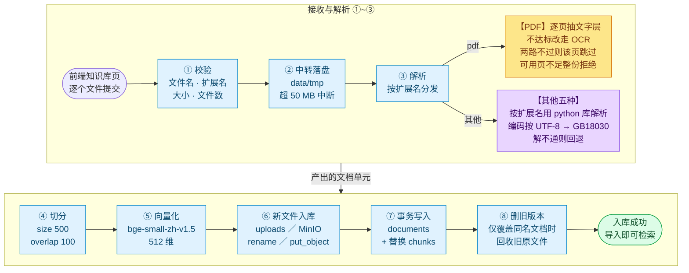
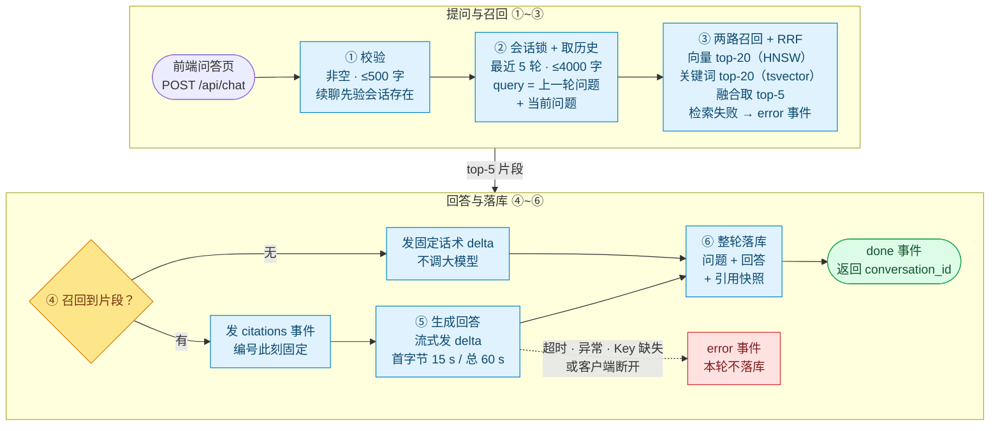

# 知问 zhiwen

单机运行的个人知识库问答。上传文档，提问，得到带引用来源的流式回答。数据全部留在本机，只有生成模型走外部 API。


## 核心功能

| 能力 | 说明 |
| --- | --- |
| 上传解析 | PDF / Word / Markdown / TXT / Excel / CSV，扫描件自动 OCR |
| 混合检索 | 向量召回 + PostgreSQL 全文关键词，RRF 按名次融合 |
| 带引用回答 | 流式输出，每条结论标注来源片段；无依据时明确拒答 |
| 多轮追问 | 保留最近 5 轮上下文 |
| 文档管理 | 列表、删除、片段只读预览 |

## 设计与取舍

**向量库就用 pgvector，不引入独立服务**
单用户单机场景，8,935 块规模下 HNSW 查询 4.04 ms。独立向量库（Milvus / Qdrant）要多一套服务和一份运维成本，换不回这点时间；真到单机撑不住那天再换也不迟。

**混合检索用 RRF，不给分数调权重**
dense 与关键词的分数量纲不可比，线性加权要反复调参。RRF 只用名次融合，两路各取 top-20，零调参，且单路召回失效时另一路仍能兜住。

**扫描件 PDF 走本地 OCR，不调云 API**
RapidOCR + PP-OCRv4，依赖增量 26 MB，字符相似度 0.99，1.1~2.9 s/页；带文字层的 PDF 完全不受影响（0.09 s 走原路径）。代价是首次 0.6 s 引擎初始化。

## 架构

依赖单向流动，只有 `services` 同时接触算法层与仓储层：

```text
web/                  React + Vite + TS
  │  HTTP / SSE
server/api/           路由与请求校验（不写 SQL）
  │
server/services/      业务编排
  │
  ├─ server/rag/      纯算法：解析 / 切分 / 嵌入 / 关键词 / RRF / 生成
  └─ server/db + core 全部 SQL · 配置 / 错误 / 日志 / 存储
```

一次问答经过：问句 → 嵌入 → dense top-k + 关键词 top-k → RRF 融合 → 上下文拼装 → DeepSeek 流式 → SSE（`citations` → `delta`* → `done`）。

## 文档入库流程

每个文件走完八步才进知识库。解析按格式分两支：PDF 逐页判质量、不达标才 OCR；其他五种直接调对应解析库。任一步失败只影响这一个文件，旧数据与旧原文件保持不动。



图源：[docs/diagrams/知识库入库流程.mmd](docs/diagrams/知识库入库流程.mmd)。

## 提问检索流程

一次提问走完六步：先校验与拼检索 query，两路召回后按 RRF 融合取 top-5；有召回就先发引用编号再流式生成，无召回按固定话术回绝但仍记历史。生成失败或客户端断开则本轮不落库。



图源：[docs/diagrams/提问检索流程.mmd](docs/diagrams/提问检索流程.mmd)。

## 实测数据

| 项 | 结果 | 说明 |
| --- | --- | --- |
| 检索（280 块） | **20.7 ms** | dense + PG 全文 + RRF（热态 n=15 中位）；8,680 块低 df 6.56 ms |
| 向量检索单项 | **4.04 ms** | HNSW，8,935 块 |
| SSE 首字节 | **1.64 s** | 含检索与 DeepSeek 首 token |
| 启动同步初始化 | **18.2~23.0 s** | 解析库 0.5~1.2 / 模型 8.0~11.3（BM25 构建已移除） |
| 扫描件 OCR | **1.09~2.07 s/页** | 120 dpi，字符相似度 0.99 |
| 检索质量 | **Recall@5 83.1%** · faithfulness 0.963 | 259 题，RAGAS + DeepSeek 判分 |

## 快速开始

```bash
cp .env.example .env         # 填 POSTGRES_PASSWORD / MINIO_ROOT_* / DEEPSEEK_API_KEY
docker compose up -d         # PostgreSQL(pgvector) + MinIO，自动建桶
pip install -r requirements.txt
python scripts/migrate.py apply
scripts/run_dev.sh           # 后端；预热约 20 s 后开始接收请求

cd web && npm install && npm run dev    # 另开终端，访问 http://127.0.0.1:5173
```

需要 Python 3.11+、PostgreSQL 15+（装 pgvector）、Node.js 18+。首次运行会下载 `BAAI/bge-small-zh-v1.5`（约 95 MB）到 `HF_HOME`。全部环境变量见 [.env.example](.env.example)。

## 界面

**知识库**：上传文档后自动解析、切分、向量化。


**片段预览**：点开任一文档，逐片段查看入库原文。


## 技术栈

| 层 | 选型 |
| --- | --- |
| 后端 | Python 3.11+ / FastAPI / Uvicorn |
| 数据库 | PostgreSQL 17 + pgvector 0.8.5 |
| 嵌入 | `BAAI/bge-small-zh-v1.5`（CPU，512 维） |
| 检索 | dense + PostgreSQL `tsvector` + RRF |
| 生成 | DeepSeek（流式） |
| 前端 | React 18 + Vite + TypeScript |
| 存储 | MinIO（S3 兼容）/ 本地目录 |

## 项目结构

```text
server/             后端单包，分层见上方架构图（地图见 server/README.md）
web/                前端：问答 / 知识库两页
docs/               需求、SRS、设计 00~11、规范
scripts/            迁移、启动脚本、建表 SQL
evals/              评测数据集
tools/eval/         评测脚本（采集 / 指标 / RAGAS）
```

## 设计文档

按 SDLC 阶段推进，每个关键决策都有据可查：

- **需求** — [00 需求分析](docs/00.需求分析.md)（角色 / 场景 / 用例）、[SRS](docs/SRS.md)（FR / NFR / BR / AC + 接口与数据契约）
- **设计** — [01 功能模块](docs/design/01.功能模块梳理.md)、[02 整体架构](docs/design/02.整体架构设计.md)、[03 数据库](docs/design/03.数据库设计.md)、[04 API](docs/design/04.API接口设计.md)、[09 前端](docs/design/09.前端详细设计.md)、[10 多轮会话](docs/design/10.多轮会话设计.md)、[11 RAG 评测](docs/design/11.RAG评测设计.md)
- **过程** — [05 评审结果](docs/design/05.设计方案评审结果.md)、[06 遗留问题](docs/design/06.遗留问题清单.md)、[07 测试用例](docs/design/07.测试用例清单.md)、[08 性能基线](docs/design/08.性能基线实测.md)
- **规范** — [API 规则](docs/rules/api-rules.md)、[数据库规则](docs/rules/database-rules.md)
