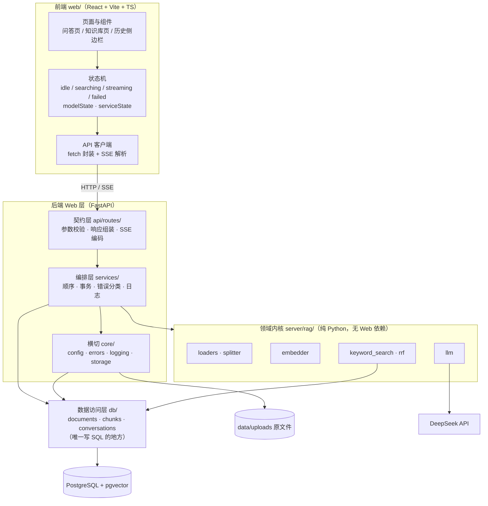
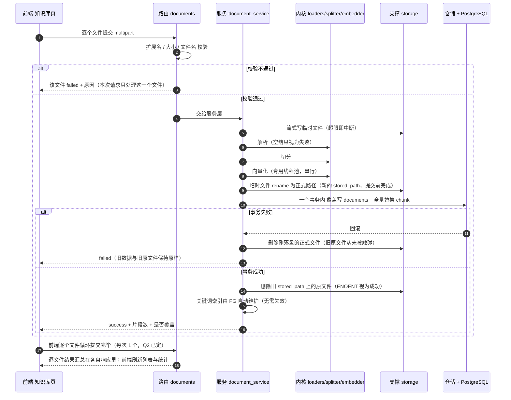
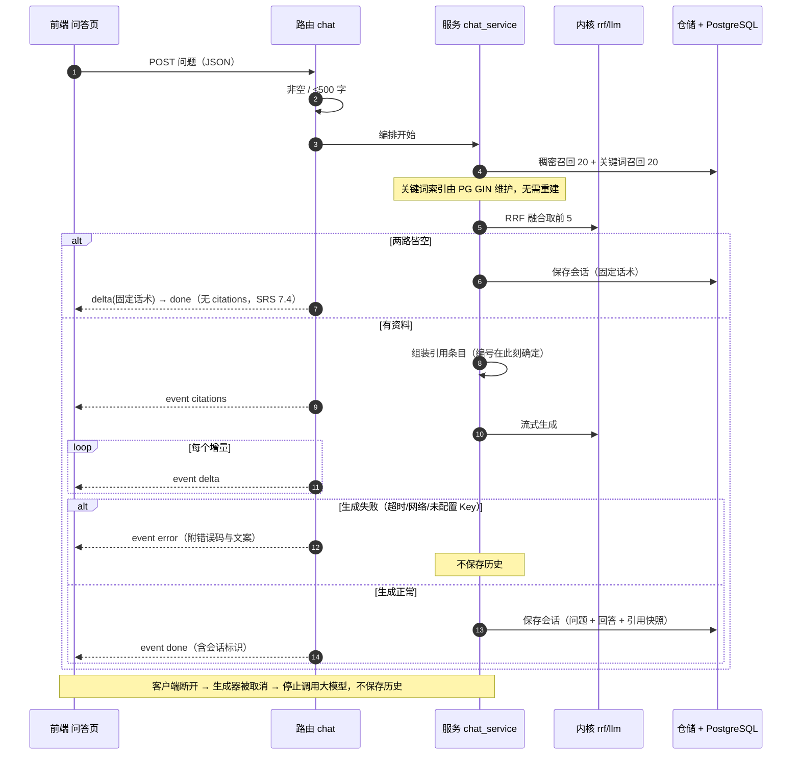
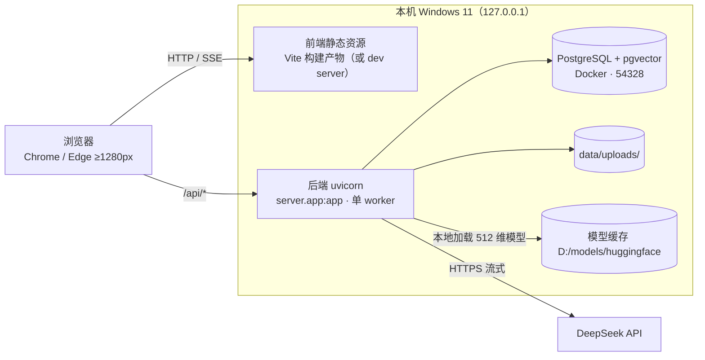
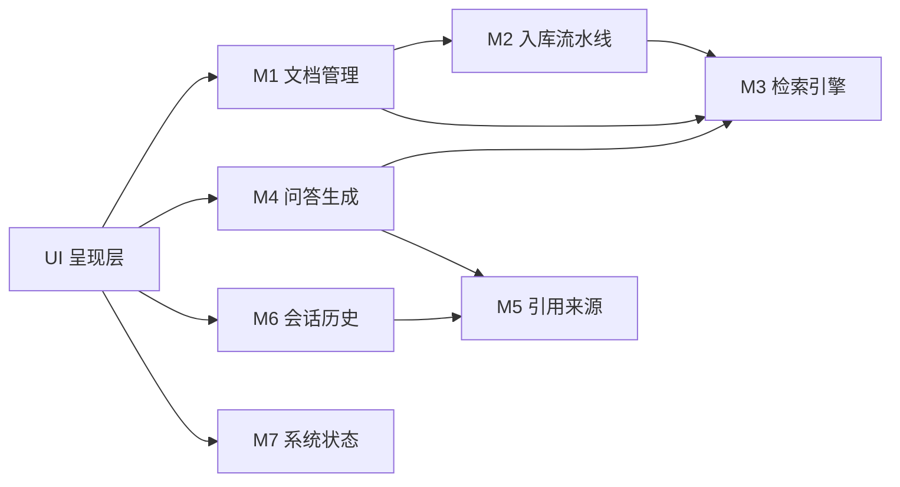

# 02. 整体架构设计

| 项目 | 知问（zhiwen） |
| --- | --- |
| 文档阶段 | 设计第 2 阶段：技术选型与整体架构（HLD） |
| 文档版本 | v0.22（2026-11-09：关键词检索改为 PG tsvector + GIN） |
| 编写日期 | 2026-11-02 |
| 上游依据 | [00.需求分析](../00.需求分析.md) v0.3、[SRS](../SRS.md) v0.6、[01.功能模块梳理](01.功能模块梳理.md) v0.8、[docs/rules/](../rules/)、现有 RAG 内核代码 |
| 下游文档 | 详细设计（LLD）：表结构、接口契约、错误码目录、类与方法签名 |

## 本阶段边界

**本文回答**：用什么技术、分成哪几层、模块落在哪、目录怎么组织、有哪些关键决策与待确认项。

**本文不展开**：具体表结构 DDL、接口请求/响应定义与错误码目录、类图与方法签名、业务代码。这些留给 LLD；接口形态沿用 [SRS 第 7 章](../SRS.md)。

**标注约定**：`已定` = 上游文档或你已明确确认；`建议` = 本文推荐但尚未经你确认；`待裁决` = 影响面大、必须由你拍板。

---

## 1. 技术选型

### 1.1 不可协商的既有约束（优先遵循）

| 约束 | 来源 |
| --- | --- |
| FastAPI + Uvicorn，监听 `127.0.0.1`，单用户无认证 | SRS 2.3、2.4.1 |
| PostgreSQL + pgvector（本机 Docker，端口 54328） | SRS 2.3 |
| 嵌入模型 `BAAI/bge-small-zh-v1.5`，512 维，本地缓存，不联网 | SRS 2.4.4、2.5 |
| 大模型 DeepSeek `deepseek-chat`，OpenAI 兼容协议 | SRS 1.4、llm.py |
| 前端 React + Vite + TypeScript | SRS 2.3（你已于 2026-11-02 确认走 React） |
| 数据库连接串、API Key 只从环境变量读取 | SRS 2.4.2、2.4.3 |
| 生产形态：本机单体，不容器化、不上公网 | SRS D-8 |
| 表间只建逻辑关联，不建物理外键 | SRS D-9 |
| 列表接口不分页 | SRS D-10 |

### 1.2 选型总表

**后端**

| 层次 | 选型 | 版本（实测已装） | 依据 | 替代方案与被否理由 |
| --- | --- | --- | --- | --- |
| 语言 | Python | 3.13.9 | SRS 要求 3.11+；本机可用且全部依赖已装 | — |
| Web 框架 | FastAPI | 0.136.3 | SRS 锁定；原生支持 `StreamingResponse`（SSE）、pydantic 校验、依赖注入、自带 OpenAPI 便于验收 | Flask（无异步与 SSE 支持）/ Django（过重，本期无 ORM/Admin 需求） |
| ASGI 服务器 | Uvicorn | 0.46.0 | SRS 锁定；单 worker 部署即可 | Hypercorn / Granian（无必要） |
| 数据校验 | pydantic v2 | 2.12.5 | FastAPI 内置，请求/响应模型一处定义 | 手写校验（重复且易漏，违反 api-rules §3.2） |
| DB 驱动 | psycopg 3 + psycopg_pool | 3.3.6（pool 随 `psycopg[pool]` 安装） | 现有代码已用同步 API；连接由 S-09 的进程内连接池提供，`vector` 参数以字符串字面量传入 | asyncpg（需自行处理 vector 类型与连接池，收益在并发而非本场景）/ SQLAlchemy（见 ADR-04） |
| 向量检索 | pgvector（HNSW） | 现有 | 规模 ≤5000 chunk，单表足够 | 专用向量库（Milvus/Qdrant）：多一个服务，违反 D-8 |
| 嵌入 | sentence-transformers + torch (CPU) | 5.4.1 / 2.11.0+cpu | 现有代码与模型缓存已就绪；CPU 足够本规模 | ONNX Runtime（提速但需另做转换，本期不做） |
| 中文分词 | jieba（精确模式） | 0.42.1 | 现有代码；已踩过 `lcut_for_search` 引入子词误召回的坑 | — |
| 关键词检索 | PostgreSQL tsvector + GIN 倒排（`simple` 配置）+ 自研 jieba 分词 | PG 17 内置 | 8,680 块实测：低 df 查询 **6.56 ms**、存储 **2.8 KB/块（落磁盘，不占进程内存）**、**上传零重建**；代价是 280 块小语料 20.7 ms（bm25s 为 18.4 ms，慢 13%）、高 df（>50% 命中）退化到 54 ms | 见 06 §17；放弃 bm25s / rank_bm25 的理由同节 |
| 大模型接入 | openai SDK 指向 DeepSeek | 2.32.0 | 现有代码；OpenAI 兼容协议，换模型只改 base_url | 直连 HTTP（要自己处理流式解析与重试） |
| 文档解析 | pdfplumber / python-docx / openpyxl / csv(stdlib) | 0.11.9 / 1.2.0 / 3.1.5 | 现有代码；六种格式已覆盖 | PyMuPDF（许可与体积）、pandas（只为读表引入整个数据分析栈，过重） |
| 扫描件 OCR | rapidocr-onnxruntime + pypdfium2 | 1.4.4 / 5.8.0 | FR-1 解析兜底（SRS v0.15）；纯 CPU、模型随 wheel 自带 16 MB、首屏 2.9 s 之后 1.1~2.9 s/页、相似度 0.99 | PaddleOCR（多背 paddlepaddle 100 MB+，版本兼容易出事）、EasyOCR（中文不如 PP-OCR、torch 推理慢）、Tesseract（中文版面差）、云 API（文档需出本机） |
| 文件上传解析 | python-multipart | 0.0.28 | FastAPI 处理 `multipart/form-data` 的必需依赖 | — |
| 日志 | 标准库 logging + 自定义 formatter | — | 只要结构化字段（request_id / 耗时 / 结果），无需第三方 | loguru / structlog（多一层依赖，收益有限） |
| 测试 | pytest + httpx | 待装 | SRS AC-1~AC-13 需要接口级验证 | unittest（生态与夹具不如 pytest） |
| 迁移 | 单个幂等 SQL 文件 | — | 单机单环境、无多人协作、无回滚需求 | Alembic（见 ADR-05） |

**前端**

| 层次 | 选型 | 版本 | 依据 | 替代方案与被否理由 |
| --- | --- | --- | --- | --- |
| 框架 | React + TypeScript | 18.x（待装） | SRS 2.3（你已确认） | 原生 JS 承接原型（你已否决，见 ADR-06） |
| 构建 | Vite | 5+（待装） | SRS 2.3；冷启动快、零配置 TS | webpack（配置成本高） |
| 路由 | 不引入路由库，用 `location.hash` 切换视图 | — | 只有两个视图（问答 / 知识库），SRS 8.1 只要求切换与锚点记忆 | react-router（为两个视图引入整套路由，过重） |
| 状态管理 | **Zustand**（S-07 已确认） | 待装 | 三个独立 store（会话 / 文档 / 健康状态），无需 Provider 嵌套，代码量最小 | Context + useReducer（可行，但 SSE 增量更新会频繁触发全树重渲染）/ Redux Toolkit（模板代码多，无收益） |
| 样式 | **建议**复用原型 `styles.css`（约 1500 行，视觉已验收） | — | 原型是已确认的交互与视觉蓝本（设计 01），直接迁成全局样式表成本最低 | Tailwind（要重写全部视觉，且原型类名已稳定）/ CSS Modules（可与复用方案并存，按组件再拆分）—— **待确认 P-5** |
| SSE 客户端 | 原生 `fetch` + `ReadableStream` 手写解析 | — | `EventSource` 不支持 POST body，而问答必须带 JSON 请求体 | 第三方 SSE 库（多一层依赖，解析逻辑不过几十行） |
| HTTP 封装 | 原生 fetch + 薄封装 | — | 只有 8 个接口，无需拦截器体系 | axios（体积与特性都用不上） |
| Markdown 渲染 | **不引入**，回答按纯文本 + 保留换行渲染 | — | SRS 8.2 只要求流式渲染与引用卡片，未要求 Markdown；渲染 `**加粗**` 等属超出范围 | react-markdown（引入 GFM 解析，回答内容来自 LLM，渲染反而放大注入面）—— 若你需要，请明确 |

### 1.3 不引入的技术及代价（AGENTS.md §3.5 要求）

| 不引入 | 理由 | 不引入的代价 |
| --- | --- | --- |
| SQLAlchemy / ORM | 表只有 4 张、SQL 简单；AGENTS.md 要求 SQL 集中在 repository 层，ORM 会稀释这条边界 | 手写 SQL 与参数绑定，字段变更要同步改 SQL |
| Alembic | 单机单环境，无迁移历史需求 | 无 downgrade；靠"只增不删"的幂等 SQL 保证可重复执行 |
| LangChain / LlamaIndex | 现有链路的七步实现已经跑通且注释完整，框架会遮蔽检索细节 | 换模型、换切分策略时要自己改代码（本来也是自己写） |
| Redis / 消息队列 / Celery | 单用户、≤20 文件/批、同步上传已满足 SRS 5.2 | 上传期间请求串行，无法横向扩；但本期不需要 |
| 对象存储 | **本机 MinIO**（容器 `zhiwen-minio`，S3 兼容，bucket `zhiwen`）：原文件存对象存储，`stored_path` 记 `s3://…`；`RAG_STORAGE_BACKEND=local` 可回退到 `data/uploads/` | 多应用可按 bucket + 独立 key 共用同一实例；代价是多一个常驻服务 + boto3 + 凭证配置（06 B14） |
| Nginx / 反向代理 | 只监听 127.0.0.1，SRS D-8 | 无 HTTPS、无 gzip 压缩；本期不需要 |
| Docker Compose 起**基础服务** | 已落地 `docker-compose.yml`（pgvector + MinIO，`127.0.0.1` 绑定）：应用本身仍跑宿主机，符合 D-8，容器只承载有状态服务 | 后端/前端仍手动起两个进程（`scripts/run_dev.*`） |

### 1.4 环境现状（实测，2026-11-02）

| 项 | 实测结果 | 对架构的影响 |
| --- | --- | --- |
| Python 3.13.9 | pdfplumber / docx / openpyxl / psycopg / sentence-transformers / torch / openai / jieba / fastapi / uvicorn 全齐 | 直接用这个解释器（解释器路径属本机环境，不入库） |
| 项目下 `.venv` | **空壳**（0 个包） | 要么删掉，要么重建后安装依赖（见 P-2） |
| PostgreSQL 54328 | **已连通**（容器 `pgvector`，PostgreSQL 17.10 + pgvector 0.8.5；库 `zhiwen`） | 已取得运行时基线：建表脚本执行通过、旧 8 行片段已按 P-7 清空并存档 |
| `DEEPSEEK_API_KEY` | 未设置 | 问答链路无法实测；健康检查需能区分"未配置" |
| 模型缓存 | `HF_HOME` 下的 `hub/models--BAAI--bge-small-zh-v1.5` 存在 | 可离线加载；**冷启动实测 21.6 s（磁盘缓存热）/ 70.8 s（冷）**，远高于初版假设的 10 s（[08](08.性能基线实测.md) §1） |
| Node.js | 24.16.0 | 满足 Vite 要求 |
| 依赖清单 | **无** `requirements.txt` / 锁文件 | M1 必须先补，否则环境不可复现 |
| 数据库结构 | 4 张表已按 03 §6.3 落地（`documents` / `rag_chunks` / `conversations` / `messages`，均为 0 行） | M1 只需写数据访问层，不再建表 |
| 版本控制 | **不是 git 仓库** | 目录迁移与后续开发没有回滚点（见风险） |

---

## 2. 整体架构

### 2.1 架构风格

**前后端分离的单体应用 + 进程内缓存**：两个进程（前端静态资源、后端 API），后端单进程单 worker，进程内状态（嵌入模型、健康状态）都在后端进程内存里，持久状态只在 PostgreSQL 与 `data/uploads/`。

选它的理由：
1. 单用户、本机、几十份文档——分布式带来的复杂度没有任何收益（SRS 2.5 规模上限）。
2. 嵌入模型是进程内对象（关键词索引已下沉到 PG，见 V003），天然要求"一个进程"；多 worker 会各加载一份模型。
3. SRS 5.2 已把"同步上传 + SSE 流式"定为关键决策，单体即可满足。

### 2.2 分层与调用方向



**各层职责与禁止事项**

| 层 | 职责 | 禁止 |
| --- | --- | --- |
| 前端 | 渲染、交互状态、SSE 解析、错误文案映射 | 直接判断业务规则（如"能否删除"）、拼 SQL/接口路径之外的逻辑 |
| 路由层 | 入参校验（pydantic）、调用服务、组装响应与 SSE 事件 | 写 SQL、开事务、做业务编排、直接调内核 |
| 服务层 | 业务流程编排、事务边界、并发控制、错误分类、日志 | 写 SQL（调用仓储方法）、直接操作 HTTP 对象 |
| 支撑组件 | 文件落盘、健康探测 | 处理业务规则（如"同名覆盖"由服务层决定） |
| 领域内核 | 解析/切分/嵌入/检索融合/生成，纯函数式，可被 CLI 复用 | import `server`、读数据库（`chunk_repository` 除外）、处理 HTTP |
| 数据访问 | 唯一 SQL 出口，返回 dict / 领域对象 | 业务判断、日志以外的副作用 |

### 2.3 主链路一：批量上传（逐文件）



要点：**新数据未就绪前不触碰旧数据**（BR-2）；失败不落库不落盘（BR-10）；单文件失败不影响同批（FR-1）。

> 落盘顺序（v0.4 修订，与 03 §3.2 一致）：磁盘操作不进事务，因此采用「新文件先落到正式路径 → 提交事务 → 回收旧文件」。事务失败时删掉新文件即可回到原状；反序（先提交再 rename）会让库指向一个可能 rename 失败的文件。

### 2.4 主链路二：问答（SSE）



要点：无结果不调大模型（BR-6）但**要存历史**（Q7）；引用编号在生成前固定（F-20）；失败不产生空历史（FR-6）。

### 2.5 部署视图



### 2.6 状态归属

| 状态 | 存放位置 | 生命周期 |
| --- | --- | --- |
| 文档 / chunk / 会话 / 消息 | PostgreSQL | 持久 |
| 原文件 | `data/uploads/`（服务端生成文件名） | 持久，随文档删除 |
| 关键词索引（tsvector + GIN） | PostgreSQL（`rag_chunks.content_tsv`） | 写入时随行生成、索引自动维护，无需重建 |
| 嵌入模型（512 维） | 后端进程内存 | 启动后台加载，全生命周期常驻 |
| 健康状态（模型加载中 / 已加载 / 失败） | 后端进程内存 | 进程内状态位，供 `/api/health` 读取 |
| 前端对话与流式状态 | 浏览器内存（Zustand/Context） | 页面会话；刷新后从接口恢复 |

---

## 3. 模块架构

### 3.1 七个业务模块在系统中的位置

| 模块 | 归属层 | 主要落点 | 对外能力 |
| --- | --- | --- | --- |
| M1 文档管理 | 路由 + 服务 | `api/routes/documents` + `services/documents` | 上传、列表（含统计口径，无独立统计接口）、删除 |
| M2 入库流水线 | 服务 + 内核 + 支撑 | `services/documents` + `core/storage` + `rag/loaders·splitter·embedder` | 把文件变成可检索片段，原子替换 |
| M3 检索引擎 | 内核 + 数据访问 | `rag/keyword_search` + `rag/rrf` + `db/chunks` | 唯一检索入口，给"有/无结果"结论 |
| M4 问答生成 | 服务 + 内核 | `services/chat` + `rag/llm` | 流式回答、兜底话术、错误分类 |
| M5 引用来源 | 服务 | `services/chat` 内的引用组装 | 唯一引用条目产出者（含编号与摘要） |
| M6 会话历史 | 路由 + 服务 + 数据访问 | `api/routes/conversations` + `services/history` | 保存、列表、详情、删除 |
| M7 系统状态 | 路由 + 支撑 | `api/routes/health` + `services/health` | 数据库 / 模型 / Key 三项状态 |
| UI 横切 | 前端 | `web/src/{pages,components,state}` | 展示、状态机、反馈 |

### 3.2 模块依赖



**依赖规则**（与设计 01 §4.1 一致）：单向、无环；M3 是唯一检索入口，M1/M4 不直接查库；M5 是唯一引用组装者，M4/M6 不自行拼引用；M7 不依赖任何业务模块。

### 3.3 横切关注点归属

| 关注点 | 实现位置 | 说明 |
| --- | --- | --- |
| 配置 | `server/core/config.py` | 环境变量 + 默认值集中一处；检索/切分/上限参数全部来自这里（NFR-6） |
| 异常与错误码 | `server/core/errors.py` + `app.py` 全局处理器 | 异常分类 → 统一错误响应；错误码目录在 LLD 定义 |
| 校验 | 路由层 pydantic 模型 | 前后端都校验，服务端为准（api-rules §3.2） |
| 事务 | 服务层 | 一个用例一个事务边界；仓储只提供原子方法 |
| 并发控制 | 服务层（进程内锁） | 上传/覆盖/删除串行，避免同名并发写 |
| 日志 | `server/core/logging.py` + 各层关键节点 | request_id 贯穿；不打印全文与密钥 |
| 健康检查 | `services/health.py` | 三项探测，供前端冷启动与降级展示（G2/G3） |

---

## 4. 项目目录设计

### 4.1 现状与目标

**现状（实测，2026-11-02 搬迁后）**：后端代码全部收在 `server/` 单包内（9 个既有模块，后续 Web 层同包）；项目根只剩 `docs/`、`prototype/`、`scripts/`、`backups/`。CLI 在项目根运行 `python -m server.main`，**不再依赖父目录** `py_project01/`；父目录的 `Zhiwen.py` 已同步为 `from zhiwen.server.main import main`，仍可用。

**已确认（P-1，2026-11-02 首版；同日修订）**：初版定为「`zhiwen/` 内核 + `server/` Web 层」两个包；你要求后端只保留一个目录，**修订为 `server/` 单包平铺**——领域内核与 Web 层同包，分层靠命名与 import 方向约定守住（内核模块不得 import `app` / `routes` / `service` / `fastapi`）。

### 4.2 目标目录结构

```text
zhiwen/                          # 项目根（≡ 仓库根）
├── AGENTS.md                     # 协作规则（分阶段）
├── README.md                     # 待补：启动步骤、环境变量、验收入口
├── requirements.txt              # 待补：运行期依赖（含版本锁定）
├── requirements-dev.txt          # 待补：pytest / httpx
├── docs/
│   ├── 00.需求分析.md
│   ├── SRS.md
│   ├── design/                   # 01.功能模块梳理 / 02.整体架构设计 / 后续 LLD
│   ├── rules/                    # api-rules / database-rules
│   └── _revoked/                 # 已作废文档归档（当前含一版 HLD 草案）
├── prototype/                    # 高保真原型（原生 JS + localStorage，交互蓝本）
├── server/                       # 【后端】单一 Python 包：core / rag / db / api / services
│   ├── __init__.py
│   ├── app.py                    # 唯一装配点：lifespan、异常、中间件、路由注册
│   ├── main.py                   # CLI 入口（python -m server.main）：预览 / --build / --ask
│   │
│   ├── core/                     # 【横切·基础设施】与业务无关
│   │   ├── config.py             # 参数集中读取（DSN、端口、top_k、切分、上限）
│   │   ├── errors.py             # 错误码目录 + AppError
│   │   ├── logging.py            # 日志格式与 request_id
│   │   ├── timeutil.py           # 库内 UTC → 接口 +08:00
│   │   └── storage.py            # 原文件存储：LocalStore / ObjectStore（MinIO）
│   │
│   ├── rag/                      # 【领域内核】纯算法，禁止 import psycopg / fastapi
│   │   ├── loaders.py            # 六种格式解析
│   │   ├── splitter.py           # 句子聚合切分（chunk_index 文档级连续）
│   │   ├── embedder.py           # 512 维向量化
│   │   ├── keyword_search.py     # 分词与查询式构造（打分交给 PG）
│   │   ├── rrf.py                # RRF 融合公式（纯函数）
│   │   ├── llm.py                # DeepSeek 接入（提示词 + 流式）
│   │
│   ├── db/                       # 【数据访问】所有 SQL 只在这里
│   │   ├── pool.py               # 连接池（min=1 / max=4 / timeout=5 s）
│   │   ├── documents.py          # 表 documents
│   │   ├── chunks.py             # 表 rag_chunks（检索 + 按文档写入）
│   │   └── conversations.py      # 表 conversations / messages（M2）
│   │
│   ├── api/                      # 【契约层】路径、参数校验、响应组装
│   │   ├── routes/               # documents / chat / conversations / health
│   │   ├── schemas.py            # 请求 / 响应模型
│   │   └── deps.py               # 容器：仓储 + 连接池 + 索引 + 模型状态位
│   │
│   └── services/                 # 【编排层】顺序、事务边界、副作用、错误映射
│       ├── documents.py          # 上传 / 列表 / 删除
│       ├── retrieval.py          # 两路召回 + RRF（M2 起被 chat 复用）
│       ├── chat.py               # 问答 SSE（M2）
│       ├── history.py            # 会话历史（M2）
│       └── health.py             # 三项健康探测
├── web/                          # 【前端】M3 建立；详细设计（组件树/store/文案表）在 M3 前另出文档（06 A5）
│   ├── index.html
│   ├── package.json
│   ├── vite.config.ts
│   ├── tsconfig.json
│   └── src/
│       ├── main.tsx
│       ├── api/                  # client.ts（fetch 封装）、chatStream.ts（SSE 解析）
│       ├── state/                # chatStore / docsStore / healthStore
│       ├── pages/               # ChatPage / DocumentsPage
│       ├── components/           # MessageList、CitationCard、Composer、UploadQueue、DocTable、StatusPill、ConfirmModal、Toast
│       ├── hooks/                # useChatStream / useDocuments / useHealth
│       └── styles/               # 从原型迁入的全局样式 + 组件样式
├── scripts/
│   ├── sql/schema.sql            # 建表与索引（幂等；03 配套，已执行）
│   ├── run_dev.bat / run_dev.sh  # 启动后端（含环境变量示例，--workers 1）
│   ├── run_web.bat / run_web.sh  # 启动前端 dev server
│   └── check_db.py               # 数据库连通性与表存在性自检
├── tests/
│   ├── unit/                     # 内核与仓储（可用真实 PG 的测试库）
│   └── api/                      # 接口级（httpx），对应 AC-1~AC-13
├── backups/                      # 迁移快照与旧数据存档（不进版本库）
└── data/
    ├── uploads/                  # 原文件（不进版本库）
    └── .gitkeep
```

### 4.3 目录职责与约定

| 目录 | 用途 | 约定 |
| --- | --- | --- |
| `server/app.py` | 唯一装配点 | 只做装配与横切：不写 SQL、不写业务分支 |
| `server/main.py` | CLI（开发工具） | 必须复用 `db/` 仓储与 `services/` 编排，**不许另写一条写入路径** |
| `server/core/` | 横切与基础设施 | 不 import `services/` `db/` `api/`；工具函数保持无状态 |
| `server/rag/` | 领域内核（解析 / 切分 / 嵌入 / 打分 / 融合 / 生成） | **禁止** import `psycopg` / `fastapi` / `server.api` / `server.db` / `server.services`；输入输出都是普通 dict |
| `server/db/` | 数据访问 | 一个表（或一对强关联表）一个文件；只写 SQL，不做业务判断；事务由调用方传入 `conn` |
| `server/api/` | HTTP 契约 | 一个资源一个文件；只做参数校验与响应组装，不写 SQL、不做编排 |
| `server/services/` | 用例编排 | 事务、顺序、文件副作用、错误分类都在这一层；不 import `fastapi` |
| `web/src/api/` | 后端接口的唯一调用处 | 组件不直接 `fetch`，错误码到文案的映射也放这里 |
| `web/src/state/` | 前端状态机 | 一个域一个 store；不得在组件内散落 streaming 标志位 |
| `prototype/` | 交互蓝本 | 只读参照，不再演进（ADR-06） |
| `docs/design/` | 分阶段设计 | 编号递增；每阶段一个文件 |
| `data/uploads/` | 运行期数据 | 不进版本库；文件名由服务端生成 |
| `scripts/sql/` | DDL | 只增不删、幂等可重跑；不含破坏性语句（`TRUNCATE` 走 03 §6.3 手工步骤） |
| `tests/` | 测试 | 按"内核单测 / 接口级"两档，不做 E2E 浏览器自动化（本期无此要求） |

### 4.4 与现有代码的关系

| 现有文件 | 处理 | 说明 |
| --- | --- | --- |
| `loaders.py`、`splitter.py`、`embedder.py`、`keyword_search.py`、`rrf.py` | **保留**（已移入 `server/`） | 逻辑已验证；`loaders` 需把"解析为空 → 打印警告"改为**抛异常**（FR-1 要求该文件失败） |
| `server/rag/llm.py` | **保留 + 改造** | 提示词与流式逻辑不变；是否改异步客户端见 P-4 |
| `server/db/chunks.py`（原 `chunk_repository.py`） | **扩展** | 去掉明文 `DEFAULT_DSN`（P-3）、增加 `document_id` 与按文档删除、暴露事务内批量写 |
| `server/main.py`（CLI，含原 `rag/cli.py`） | **保留** | 作为无 Web 时的自检入口；`python -m server.main`，`--build`/`--ask` 语义不变 |
| `server/db/documents.py`、`server/db/conversations.py` | **新增** | documents / conversations / messages 的数据访问 |
| `server/app.py`、`server/api/`、`server/services/`、`web/*` | **新增** | Web 层与前端 |
| `__pycache__/`、空 `.venv` | **清理** | 见 P-2 |

---

## 5. 关键设计决策

### 5.1 已定决策（上游或你已确认，本文只承接）

| 编号 | 决策 | 来源 |
| --- | --- | --- |
| K-01 | 前端 React + Vite + TS，原型作交互蓝本 | 你 2026-11-02 确认 |
| K-02 | 表间只建逻辑关联，不建物理外键，级联删除由服务层事务保证 | SRS D-9 |
| K-03 | 列表接口不分页 | SRS D-10 |
| K-04 | 单用户无认证、只监听 127.0.0.1、不容器化 | SRS D-1、D-8 |
| K-05 | 单轮问答，不拼历史上下文 | SRS D-6、BR-5 |
| K-06 | 上传同步完成并返回（不做异步队列） | SRS 5.2 |
| K-07 | 问答走 SSE 流式 | SRS 5.2 |
| K-08 | 关键词索引下沉到 PostgreSQL（不再进程内缓存） | SRS 5.2 |
| K-09 | 原文件落盘保留，删除文档时一并删除 | SRS D-4 |

### 5.2 架构层决策（全部已确认，2026-11-02）

| 编号 | 决策 | 依据 | 影响面 | 状态 |
| --- | --- | --- | --- | --- |
| S-01 | 后端单进程单 worker（`--workers 1` 写死在启动脚本） | 嵌入模型是进程内状态，多 worker 会各加载一份 | 并发上传会排队；`/api/health` 在重活时可能慢 | ✅ 已确认 |
| S-02 | 目录规范化为 `server/` 单包 + `web/`；`server/` 内再分 `rag/`（领域内核）与 Web 层（路由/服务/装配） | 后端只有一个目录；运行目录不再依赖父目录 | 9 个 `.py` 已移入 `server/`，CLI 改为 `python -m server.main`；分层靠约定（内核模块禁止 import `app`/`routes`/`service`） | ✅ 已确认（P-1，2026-11-02 修订） |
| S-03 | 数据访问用 psycopg 同步 API，在服务层用 `to_thread` 调用；嵌入与解析放专用单线程池 | 现有代码是同步驱动；CPU 密集任务串行化避免抢核 | 需要明确哪些调用必须走线程池（LLD 细化） | ✅ 已确认 |
| S-04 | 关键词索引**下沉到 PostgreSQL**（V003）：`rag_chunks.content_tsv` + GIN 倒排，写入随行生成、索引自动维护，进程内不再有 rebuild / invalidate / 启动预热 | 起因见 06 §17：bm25s 全量矩阵带来写放大（每次上传 O(N) 重建）与内存墙（14.4 KB/块） | 小语料查询比 BM25 慢约 2 ms（20.7 vs 18.4，keyword 分支 6.0 vs 0.85）；高 df（>50% 命中）查询退化到 54 ms | ✅ 已落地（2026-11-09） |
| S-05 | 迁移用单个幂等 SQL（不用 Alembic） | 单机单环境，无回滚与多人协作需求 | 无 downgrade；靠"只增不删"约束 | ✅ 已确认 |
| S-06 | 前端不引路由库、不引 axios、不渲染 Markdown | 两视图 / 8 接口 / SRS 未要求 Markdown | 若后续要 Markdown 渲染，需回到需求确认 | ✅ 已确认 |
| S-07 | 前端状态用 Zustand + 复用原型 CSS | 三个独立域、SSE 高频增量更新；原型视觉已验收 | 需迁移约 1500 行 CSS，并按组件拆分为模块 | ✅ 已确认 |
| S-08 | 健康检查恒返 200，用 `status` 字段表达降级 | 前端要读分项做 G2/G3 展示，返回 503 就拿不到明细 | 监控不能只看状态码 | ✅ 已确认 |
| S-09 | 数据库连接用 `psycopg_pool.ConnectionPool`（进程内单池：`min_size=1` / `max_size=4` / 取连接 `timeout=5s`；健康检查走独立短超时连接，A4 已定） | 健康检查被前端轮询 + SSE 长连接都要拿连接；每次新建连接在轮询下会反复握手 | 新增依赖 `psycopg[pool]`；池参数进 `server/config.py`；连接泄漏要由池的 `timeout` 兜底 | ✅ 已确认（2026-11-02） |

### 5.3 决策过程与待确认问题

> P-1~P-3、P-6、P-7 已确认（结论见各小节）；**P-4（LLM 客户端异步化）挂到 M2 开工前**、**P-5（前端状态与样式）已随 S-07 确认**。

**P-1 目录规范化：是否现在就把包体下沉？**

| 选项 | 说明 | 代价 |
| --- | --- | --- |
| A（推荐） | 按 4.2 规范化：根保留 docs/prototype，包体下沉 | 移动 9 个 `.py`；CLI 命令变化 |
| B | 保持现状（根即包），`server/` 作为同级顶层包放在父目录 `py_project01/` | 零移动，但项目根分裂成两处 |
| C | 暂不动，等 M1 开工再定 | 写 LLD 时目录还没定，会返工 |

**倾向 A**：目录一旦开始写代码就难改。

**结论（2026-11-02，首版已确认）**：采用 A，M1 开工前完成目录规范化。

**修订（2026-11-02，你要求「后端只留一个目录」）**：包体不再拆成「`zhiwen/` 内核 + `server/` Web 层」两个包，改为 **`server/` 单包平铺**——9 个既有模块与后续 `app.py` / `routes/` / `service/` 同处一包。已执行：文件移入 `server/`（搬迁前快照 `backups/snapshot_pre_server_move_20261102_113204.zip`），CLI 改为 `python -m server.main`（项目根运行），父目录 `Zhiwen.py` 同步改 import，两个入口均实测通过。**代价**：内核与 Web 层之间没有包边界，依赖方向只能靠约定守住（内核模块不得 import `app` / `routes/` / `service` / `fastapi`），已在 §4.3 写明。

**P-2 依赖与环境怎么固化？**

| 选项 | 说明 |
| --- | --- |
| A（推荐） | 用现有解释器（3.13.9，依赖齐全）+ 生成 `requirements.txt` 锁定版本；删掉空壳 `.venv` |
| B | 重建项目 `.venv` 并重装全部依赖（含 torch CPU 约 200 MB+） |
| C | 引 uv 管理虚拟环境（本机已装 uv） |

**依据**：环境实测表明现有解释器依赖齐全；重启一个 venv 会重新下载 torch，时间成本高。但 B 的可复现性更好。

**结论（2026-11-02，你已确认）**：采用 A——沿用现有解释器（3.13.9），M1 生成 `requirements.txt` 锁定版本，删除空壳 `.venv`。

**P-3 数据库连接串与密码来源**

| 选项 | 说明 |
| --- | --- |
| A（推荐） | 必填环境变量 `RAG_DB_DSN`，缺失即启动失败；删除 `chunk_repository.py:12` 的明文默认值；启动脚本里写不含密码的示例 |
| B | A + 支持 `.env`（需引入 `python-dotenv`） |
| C | 保留一个无密码的默认 DSN 便于本机快速启动 |

**依据**：SRS 2.4.3 明确"不硬编码密码"；C 会把错误配置留成陷阱。

**结论（2026-11-02，你已确认）**：采用 A——`RAG_DB_DSN` 必填、缺失即启动失败，删除明文默认值；不引入 `.env`（B 被否）。

**P-4 大模型客户端是否改异步？**

| 选项 | 说明 |
| --- | --- |
| A（推荐） | 改用 `AsyncOpenAI` + `async for`，`llm.py` 暴露异步生成器；CLI 侧用 `asyncio.run` 包装 |
| B | 保持同步 client，服务层用 `asyncio.to_thread(next, gen)` 逐块取 |
| C | 不动 `llm.py`，只在路由层用 `run_in_threadpool` 包裹整个流 |

**依据**：同步流式迭代会占住事件循环线程；A 最干净但会改已验证的内核文件签名（AGENTS.md 要求动内核前确认）。B 改动小但每个 chunk 一次线程切换。

**结论（2026-11-02，你已确认）**：采用 **A** —— `llm.py` 改用 `AsyncOpenAI` + `async for`，对外暴露**异步生成器**；CLI（`server/main.py`）侧用 `asyncio.run` 包装调用。**已落地（M2）**：`chat` / `chat_stream` / `answer` 全部异步，首字节 15 s + 总时长 60 s 在 `chat_stream` 内用 `asyncio.wait_for` / `asyncio.timeout` 实现；CLI 的 `--ask` 用 `asyncio.run` 消费同一生成器；`rrf.retrieve` 已上移 `services/retrieval.py`，不再有同步调用点。

**P-5 前端状态与样式方案**

| 选项 | 说明 |
| --- | --- |
| A（推荐） | Zustand + 迁移原型 CSS 为全局样式 + 组件级样式文件 |
| B | Context + useReducer + 迁移原型 CSS |
| C | Zustand + Tailwind 重写视觉 |

**依据**：原型 CSS 是已验收的视觉蓝本（设计 01），重写会有视觉回归风险；Zustand 对 SSE 增量更新更省事。

**结论（2026-11-02）**：采用 **A** —— 已随 S-07 一并确认（Zustand + 复用原型 CSS）。

**P-6 测试范围**

| 选项 | 说明 |
| --- | --- |
| A（推荐） | pytest：内核单测（切分/分词/RRF 纯函数）+ 接口级（httpx，覆盖 AC-1~AC-13 的主路径与失败路径） |
| B | 只做接口级 |
| C | 追加 Playwright 浏览器 E2E |

**依据**：AGENTS.md §5 要求按 AC 建用例；内核已有确定行为，单测成本低；浏览器 E2E 超出本期范围。

**结论（2026-11-02，你已确认）**：采用 A——pytest 内核单测 + httpx 接口级，覆盖 AC-1~AC-13 主路径与失败路径；不做浏览器 E2E。

**P-7 旧 chunk 数据如何处置（新增表前必须定）**

现状：`rag_chunks` 里已有 CLI 建库的数据，但**没有** `document_id`，也没有对应的原文件（当时直接读外部路径）。

| 选项 | 说明 | 风险 |
| --- | --- | --- |
| A（推荐） | 清空重建（`TRUNCATE rag_chunks`），用新流程重新上传 | 删除既有数据（当前是开发机数据，可由 CLI 重建） |
| B | 按 `source` 回填 `documents` 行，`document_id` 补齐 | 会留下"大小 0、无原文件"的假文档，删除时无文件可删 |
| C | 回填但放宽 `documents` 的非空约束 | 表约束变松，新数据失去保护 |

**依据**：A 最干净，但是破坏性操作。

**结论（2026-11-02，你已明确同意）**：采用 A——M1 建表前执行 `TRUNCATE rag_chunks` 并重新上传；执行时我会先打日志记录被删行数。

### 5.4 风险

| 风险 | 影响 | 应对 |
| --- | --- | --- |
| ~~没有版本控制~~（已解决） | — | 已 `git init` 并推送 Gitee 私有仓（`c694ba1` / `99f7bb2`）；`backups/` 不进版本库 |
| 无运行时基线（部分解决） | PG 已连通、4 表已落地；但**上传链路与性能指标仍无基线**（`DEEPSEEK_API_KEY` 仍未配置） | M1 一开始就跑一次真实 PDF 入库，实测 60 s 指标（05 §8 B1） |
| 高密度 PDF 逼近 60 s 上限（已实测） | 50 页文本量（16.6 万字、429 块）嵌入 47.8 s，余量仅 12.2 s，且不含解析与入库 | 已实测（08 §1）；M1 联调时按真实 PDF 复测，必要时调 `batch_size` 或分批提示 |
| 单 worker + 同步驱动 | 上传期间健康检查与列表接口变慢 | 前端 30 s 轮询、连续 2 次失败才置降级（A3）；健康检查带短超时 |
| 原型 CSS 迁移 | 组件化后样式作用域冲突、视觉回归 | 先整表迁入保证一致，再按组件逐步拆；关键页面截图对比 |
| 回答不做 Markdown 渲染 | LLM 输出 `1.` `**` 等标记会原样显示 | 已在 S-06 明确为范围外；若影响可读性再提需求 |
| pgvector HNSW 小数据量行为 | 数据很少时索引可能不被使用（顺序扫描更快），性能表现与预期不同 | 以实测为准，不据此调参 |
| 目录迁移遗漏 import | CLI 或脚本失效 | 迁移后立即跑 `--help`、`--build` 冒烟；一次性提交，不做渐进式混排 |

---

## 6. 本阶段不做（留给 LLD 或后续）

1. 表结构 DDL、字段类型、索引定义（LLD 产出，本文只承认"4 张表 + 逻辑关联"）。
2. 接口请求/响应字段、错误码目录、SSE 事件字段细节（接口形态沿用 SRS 第 7 章，细化在 LLD）。
5. 类图、方法签名、模块内文件级拆分。

> 范围口径（2026-11-02 你已确认）：AGENTS.md §4.3 要求的「新表 DDL、错误码目录、SSE 事件状态机」本轮**不写进本文**，下沉到 LLD；SRS 7.4 已给出事件序列，架构层不重复。
4. 前端组件树与像素级样式。
5. 任何业务代码、脚本实现。

---

## 7. 变更记录

| 版本 | 日期 | 变更内容 | 状态 |
| --- | --- | --- | --- |
| v0.1 | 2026-11-02 | 首版：技术选型（含不引入清单与环境实测）、整体架构与两条主链路时序、模块落点与依赖、项目目录设计、9 条已定决策 + 8 条建议 + 7 个待确认问题 + 8 项风险 | 待审核 |
| v0.2 | 2026-11-02 | 记录 5 项确认结论：P-1 目录规范化、P-2 环境与依赖固化、P-3 连接串必填环境变量、P-6 测试范围、P-7 旧数据清空重建；P-4/P-5 仍待确认（挂 M2/M3） | 待审核 |
| v0.3 | 2026-11-02 | 8 条架构决策全部确认（S-01~S-08）；范围口径裁定：DDL / 错误码目录 / SSE 状态机下沉 LLD；§5.2 改名为「架构层决策（已确认）」并加状态列 | 待审核 |
| v0.4 | 2026-11-02 | 设计评审回写（05 §4）：①§2.3 落盘顺序改为「先就位 → 提交 → 回收旧文件」，与 03 §3.2 一致；②§2.4 无检索结果不再下发 `citations`（对齐 SRS 7.4 与 04 §5.1）；③§3.1 删除 M1 的「统计」对外能力（Q4 定为前端现算）；④§4.2/§4.3 迁移脚本落点由 `migrations/001_init.sql` 改为 `scripts/sql/schema.sql`；⑤§1.4 环境实测刷新（PG 已连通、4 表已落地）；⑥§2.3 时序中「其余文件不受影响」「全部文件处理完」改为单文件语境（Q2 已定每次 1 个） | 待审核 |
| v0.5 | 2026-11-02 | P-1 修订并落地：后端目录由「`zhiwen/` 内核 + `server/` Web 层」两包改为 **`server/` 单包平铺**；§4.1 现状/结论、§4.2 目录树（顺带合并重复的 `scripts/` 节点）、§4.3 分层约定、§4.4 文件落点、S-02 全部同步；9 个 `.py` 已移入 `server/`，CLI 改 `python -m server.main`，两个入口实测通过 | 待审核 |
| v0.6 | 2026-11-02 | 评审裁决落地（05 §8）：新增 **S-09 数据库连接池**（`psycopg_pool`，需加 `psycopg[pool]` 依赖）、**P-4 结论 = A**（`llm.py` 改 `AsyncOpenAI` + `async for`，CLI 用 `asyncio.run` 包装，属内核签名变更）；§1.2 DB 驱动行同步补连接池 | 待审核 |
| v0.7 | 2026-11-02 | 清理过期标记：§1.2 状态管理改为「已定 S-07」、§5.3 P-5 补结论行、§5.4 风险表两条状态刷新（版本控制已解决、运行时基线部分解决） | 待审核 |
| v0.8 | 2026-11-02 | 评审后参数定稿（06 A 组）：S-09 补 `max_size=4` / `timeout=5s`；§5.4 风险表同步「30 s 轮询、连续 2 次失败置降级」；§4.2 注明前端详细设计在 M3 前另出文档（A5） | 待审核 |
| v0.9 | 2026-11-02 | 回写性能基线实测（08）：§1.4 冷启动 10 s → 实测 21.6 s（热盘）/ 70.8 s（冷盘）；§5.4「CPU 嵌入耗时未知」改为「高密度 PDF 逼近 60 s 上限」（429 块 / 47.8 s） | 待审核 |
| v0.10 | 2026-11-02 | 目录调整：`server/` 内的 RAG 内核（loaders/splitter/embedder/keyword_search/rrf/llm/chunk_repository）收进 `server/rag/` 子包，CLI 实现移到 `server/rag/cli.py`，`server/main.py` 保留为兼容入口（`python -m server.main` 仍可用）；§4.2 目录树、§4.3 职责表、S-02 同步 | 待审核 |
| v0.11 | 2026-11-02 | 采纳方案 A：`bm25_index.py` 由 `server/` 根移入 `server/rag/`（与 keyword_search/rrf 同层）；§2.2 分层图（支撑组件只剩 storage/health、内核节点补 bm25_index、补 `K -> REPO` 边）、§3.1 M3 归属、§4.2 目录树、§4.3 职责表同步 | 待审核 |
| v0.12 | 2026-11-02 | 目录整理（B9）：`server/` 根从 12 个散文件收成 5 个目录 + 2 个入口；新增 `core/`（config·errors·logging·timeutil·storage）、`db/`（pool·documents·chunks·conversations）、`api/`（routes·schemas·deps）、`services/`（documents·retrieval·chat·history·health）；`rag/` 只留纯算法（`chunk_repository` → `db/chunks`、`rrf.retrieve` / `keyword_search.search_chunks` → `services/retrieval`）；`rag/cli.py` 并入 `server/main.py`。§2.2 图、§3.1、§3.3、§4.2、§4.3、§4.4 同步 | 已定稿 |
| v0.13 | 2026-11-02 | M2 落地：§5.3 P-4 标注为已实现（异步 LLM + 超时）；SSE 主链路（`services/chat.py`）与历史接口按 §3.2 时序实现，事件序列与 04 §5.1 一致 | 已定稿 |
| v0.14 | 2026-11-02 | M3 落地：`web/` 按 09 前端详细设计实现（组件树 / 三 store / SSE 状态机 / 20 条错误码文案），样式复用原型 `styles.css`；04 §3.6.1 的前端契约不变 | 已定稿 |
| v0.15 | 2026-11-02 | 存储决策反转：§1.4 技术选型两行同步（对象存储由「不做」改为**本机 MinIO 共享实例**；Docker Compose 由「不容器化」改为「compose 只起基础服务」）；§4.2 目录树 `storage.py` 职责改为 LocalStore/ObjectStore；落盘顺序约定不变（事务前就位、提交后删旧） | 待审核 |
| v0.16 | 2026-11-04 | S-04 索引生命周期补两处：导入结束**同步重建后才返回**（响应即"可检索"，8,935 块实测 8.3 s）、删除后**后台合并重建**（1.5 s 合并窗口，不阻塞删除响应）；懒重建降为兜底。新增 `services/indexing.py` | 待审核 |
| v0.17 | 2026-11-04 | S-04 补正确性语义：`generation` 变化（构建期间有写入）时**丢弃结果并重试一次**，不再把作废快照返回给调用方；两次都撞上写入则只应急使用、**不入缓存**（否则会永久缺最新写入）。落点 `Bm25Index._build_fresh`，单测 `scripts/test_bm25_generation.py` | 待审核 |
| v0.18 | 2026-11-06 | §1.2 依赖表新增「扫描件 OCR」行（rapidocr-onnxruntime + pypdfium2，附放弃 PaddleOCR / EasyOCR / Tesseract / 云 API 的理由）；解析链路变为「优先文字层 → 无文字层的页渲染 120 dpi 走 PP-OCRv4」；实测 3 页扫描件整链路 6.5 s（含切分、嵌入、BM25 重建），带文字层 PDF 仍走原路径 0.09 s | SRS v0.15 FR-1、`server/rag/loaders.py` |
| v0.19 | 2026-11-06 | §1.2 依赖表「关键词检索」由自研 BM25 改为 **bm25s 0.3.16**（分词仍走 jieba）；等价性实测 20 条真实问题 top-10 完全同序、无命中行为一致、16 项单测通过；分数整体缩放 0.4 倍但 RRF 只用名次，链路无影响。放弃 rank_bm25、暂缓 FTS5/PG tsvector 的理由同表 | 06 §17 |
| v0.20 | 2026-11-06 | 公开前脱敏：§1.4 环境现状与 P-2 去掉本机解释器绝对路径（改为「现有解释器」）；模型缓存改为 `HF_HOME`（默认 `~/.cache/huggingface`）。无架构与接口变更 | 已落地 |
| v0.21 | 2026-11-06 | 项目改名：ragdemo → zhiwen（中文名「知问 · 个人知识库问答」），文档标题与项目元信息同步；正文内容未变 | 已落地 |
| v0.22 | 2026-11-09 | §1.2 依赖表「关键词检索」由 **bm25s 改为 PostgreSQL tsvector + GIN**（V003 迁移 `rag_chunks.content_tsv`）；进程内索引生命周期（rebuild / invalidate / 启动预热）整体移除，§2 分层图与状态归属、§3 时序、§4 目录树、K-08 / S-01 / S-04 同步改写。实测 8,680 块：低 df 查询 6.56 ms、存储 2.8 KB/块（磁盘、不占进程内存）、上传零重建；代价是 280 块小语料查询 20.7 ms（bm25s 18.4 ms，+13%） | 06 §17、`rag/keyword_search.py`、V003 |
