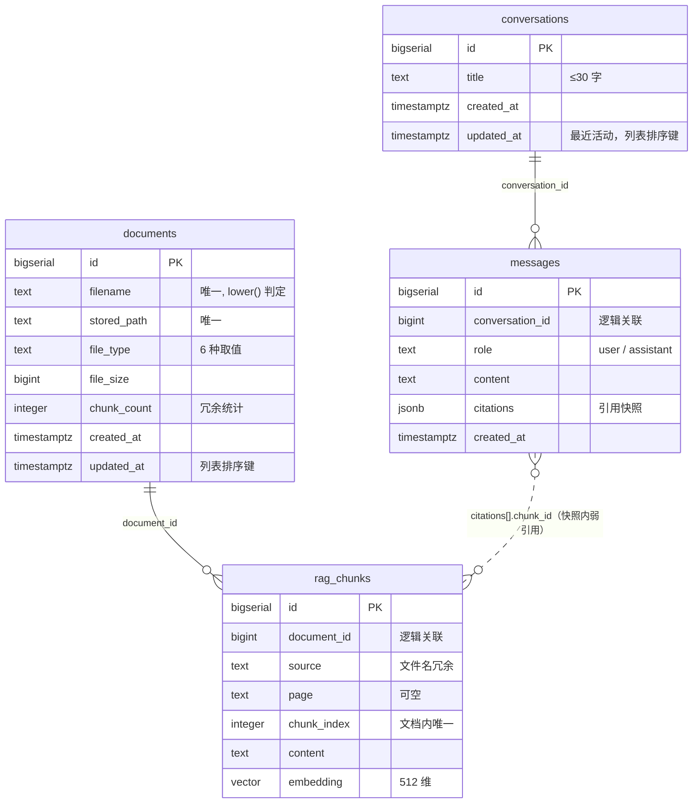

# 03. 数据库设计

| 项目 | 知问（zhiwen） |
| --- | --- |
| 文档阶段 | 设计第 3 阶段：数据库设计（LLD 数据部分） |
| 文档版本 | v0.11（2026-11-09：rag_chunks 增加 content_tsv + GIN 全文索引） |
| 编写日期 | 2026-11-02 |
| 上游依据 | [SRS](../SRS.md) v0.5 第 6 章与第 9 章、[01.功能模块梳理](01.功能模块梳理.md) v0.8、[02.整体架构设计](02.整体架构设计.md) v0.3、[docs/rules/database-rules.md](../rules/database-rules.md) |
| 配套脚本 | [scripts/sql/schema.sql](../../scripts/sql/schema.sql)（**全量快照，仅供重建参考**）；DDL 迁移走 `scripts/sql/migrations/`（yoyo，见 §6.7） |
| 下游文档 | LLD 其余部分：接口契约、错误码目录、类与方法签名（另立文档） |

## 本阶段边界

**本文回答**：有哪些实体、表怎么建、字段/类型/约束/索引是什么、表之间怎么关联、数据怎么删、存量数据怎么迁移、是否满足规范与需求。

**本文不展开**：接口请求/响应字段、错误码目录、SSE 事件字段、类图与方法签名、SQL 语句在仓储层怎么写、文件落盘的实现细节。这些留给 LLD 其余部分。

**标注约定**：`已定` = 上游文档或你已明确确认；`建议` = 本文推荐但尚未经你确认；`待确认` = 需你裁决（第 8 节 Q1~Q6 已于 2026-11-02 全部确认，结论见 §8.0）。

> **实现口径声明**：`schema.sql` 与本文正文写的都是**推荐方案**的实现。若你对第 8 节某项裁决为其它选项，改动点已逐条写明「改哪里」，不需要重写文档。

---

## 1. 设计目标与约束

### 1.1 目标

1. 用 4 张表承载 7 个业务模块（M1~M7）的全部持久状态，不引入本期用不到的表。
2. 每个业务规则（BR-1~BR-10）在数据层有**可验证的落点**：要么是约束，要么是明确的事务顺序。
3. 存量 `rag_chunks` 能在不清库重建的前提下完成改造，且改造后旧数据不会成为脏数据。
4. 全部对象符合 [database-rules](../rules/database-rules.md)。

### 1.2 不可协商的约束（优先遵循）

| 约束 | 来源 |
| --- | --- |
| 主键统一 `id` + 自增（bigserial） | database-rules §4.1 |
| **禁止物理外键**，只建逻辑关联，完整性由服务层保证 | database-rules §4.2、SRS D-9 |
| 业务唯一值必须用唯一约束兜底，不能只靠应用层 | database-rules §4.4 |
| 状态/枚举字段取值集合有限且有文档说明 | database-rules §3.6 |
| 时间统一时区策略：库内 UTC 存储，展示层转换 | database-rules §3.5 |
| PostgreSQL + pgvector，本机 54328，不容器化 | SRS 2.3、D-8 |
| 迁移用单个幂等 SQL，不用 Alembic | 02 §S-05 |
| 存量 `rag_chunks` 旧数据清空重建（不回填） | 02 §P-7（你已确认） |
| 表名单复数风格统一 | database-rules §2.3 |

---

## 2. 概念模型

### 2.1 核心实体

| 实体 | 定义 | 生命周期 | 是否落表 |
| --- | --- | --- | --- |
| 文档 Document | 用户上传的一份文件；同名视为同一文档（BR-1） | 上传创建 → 同名覆盖更新 → 删除销毁 | ✅ `documents` |
| 知识片段 Chunk | 文档切分后的一段文字 + 512 维向量；检索的最小单位 | 随所属文档创建、全量替换、删除 | ✅ `rag_chunks` |
| 会话 Conversation | 一次对话的记录，可含多轮问答（每轮 = 1 条 user + 1 条 assistant） | 首问答成功后创建 → 每轮追加消息并刷新 `updated_at` → 可删除 | ✅ `conversations` |
| 消息 Message | 会话内的提问原文或回答正文 | 随会话创建 → 随会话删除 | ✅ `messages` |
| 引用条目 Citation | 序号 + 文件名 + 位置 + 摘要 + 片段标识，**自包含快照**（Q2） | 随所属助手消息保存，永久有效 | ❌ 值对象，存于 `messages.citations`（jsonb） |
| 上传结果项 | 单个文件的处理结果（成功/失败/是否覆盖/片段数） | 请求内瞬时存在，返回后丢弃 | ❌ 不落库（失败项不入库，BR-10） |
| 健康状态 | 数据库 / 模型 / Key 三项探测结果 | 进程内状态位 | ❌ 不落库（02 §2.6） |

> 刻意不落表的三个概念说明：引用条目**不是**独立实体，它是回答的从属成分，且必须与回答同生共死、内容冻结（Q2）；上传结果与健康状态都是瞬时/运行时信息，落库只会制造无法清理的垃圾数据。

### 2.2 实体关系



图例约定：实线 `||--o{` 表示存在逻辑关联字段；虚线 `}o..o{` 表示**快照内弱引用**，不参与任何 join，也不做完整性校验（见 §3.1）。

### 2.3 关系总表

| # | 关系 | 基数 | 实现方式 | 完整性保证 |
| --- | --- | --- | --- | --- |
| R-1 | 文档 → 片段 | 1 : N（N ≥ 1，入库成功文档恒 ≥ 1） | `rag_chunks.document_id` | 服务层同一事务内先删/写片段再更新文档；无物理外键（D-9） |
| R-2 | 会话 → 消息 | 1 : N（N = 2 × 轮数，每轮 2 条） | `messages.conversation_id` | 服务层同一事务内写一轮的两条消息；**不再有"每角色一条"约束**（V002 已删除 `uq_messages_conversation_role`） |
| R-3 | 消息 → 片段 | N : N（仅快照内） | `messages.citations[].chunk_id` | **不保证**：文档删除后该值可能指向不存在的行，只作追溯，不参与查询 |

---

## 3. 逻辑设计

### 3.1 为什么只建逻辑关联（不建物理外键）

沿用 SRS D-9 与 database-rules §4.2：表间只保留关联字段，不声明 FOREIGN KEY。代价与补偿：

| 失去的保证 | 补偿手段 |
| --- | --- |
| 插入孤儿片段不会被数据库拦住 | 片段一律由 `document_service` 在同一事务内、以刚拿到的 `document_id` 写入；无第二条写入路径 |
| 删除文档不会自动级联删片段 | 服务层按固定顺序在同一事务内显式删除（§3.2），并用 §5.3 的漂移检测 SQL 兜底 |
| 引用指向的片段可能已被删除 | 引用是自包含快照（Q2），展示不依赖片段是否还存在 |

### 3.2 数据删除与覆盖策略

| 操作 | 事务内的数据库动作 | 事务成功后的动作 | 失败语义 | 依据 |
| --- | --- | --- | --- | --- |
| 上传新增 | `INSERT documents` → `INSERT rag_chunks`（批量） | 无（文件已在事务前落到正式路径） | 回滚 → 无任何记录、无文件残留 | BR-10、F-05 |
| 同名覆盖 | `UPDATE documents`（filename / file_type / file_size / chunk_count / updated_at=now()）→ `DELETE rag_chunks WHERE document_id` → `INSERT` 新片段 | 删除旧原文件；新文件已在事务前落到正式路径 | 回滚 → 旧行、旧片段、旧原文件全部保持原样（BR-2） | BR-1、BR-2、Q1（01 文档） |
| 删除文档 | `DELETE rag_chunks WHERE document_id` → `DELETE documents WHERE id` | 删除磁盘原文件 | 回滚 → 文档仍在；文件不存在（ENOENT）仍算成功（01 §5.2） | BR-3、F-10 |
| 删除会话 | `DELETE messages WHERE conversation_id` → `DELETE conversations WHERE id` | 无 | 回滚 → 会话仍在 | F-25、M6 职责 3 |
| 删除单条消息 | **不支持**（SRS 未定义） | — | — | 范围外 |

要点（与 01 的 4 条流程一致）：

1. **先删子后删父**：两次删除顺序固定，因为数据库不会替我们级联。
2. **覆盖不留空窗**：`DELETE` + `INSERT` 在**同一事务**内，外部读不到"片段已删但新片段未写"的中间态（Q1：先就绪、后替换）。
3. **文件不进事务**：磁盘操作不具事务性，采用「提交前文件已就位 → 提交成功回收旧文件」的顺序；提交失败时删掉新文件，旧文件从未被触碰。
4. **删除的幂等性**：`DELETE` 影响 0 行即视为"已删除"，接口对文档/会话不存在返回 404（SRS 7.3、7.7）。

### 3.3 必须成立的不变量（数据层可校验）

| # | 不变量 | 校验方式 |
| --- | --- | --- |
| I-1 | 不存在 `document_id` 指向已不存在文档的片段 | §5.3 检测 SQL |
| I-2 | `documents.chunk_count` 等于该文档实际片段行数 | §5.3 检测 SQL |
| I-3 | 同一文档内 `chunk_index` 从 0 连续、不重复 | `uq_rag_chunks_document_chunk` + §5.3 检测 SQL；**M1 实测**：`splitter` 曾按页归零导致多页 PDF 撞唯一键，已改为整篇连续编号 |
| I-4 | 每条 assistant 消息都有同会话、更早的 user 消息（不存在孤立 assistant）；生成失败的轮次整轮不写库，因此也不存在"只有 user"的半轮 | 服务层整轮事务 + §5.3 检测 SQL |
| I-5 | `file_size > 0`、`chunk_count >= 0`、`file_type` 属于 6 种取值 | CHECK 约束 |
| I-6 | 引用只以快照形式存在，不被任何查询 join | 代码评审 + 仓储层无 `citations[].chunk_id` 的 join |

---

## 4. 物理设计

### 4.1 `documents`（新增）

| 字段 | 类型 | 约束 | 默认 | 说明 |
| --- | --- | --- | --- | --- |
| `id` | `bigserial` | PK | 自增 | 文档 ID |
| `filename` | `text` | NOT NULL；长度 1~255 | — | 原始文件名，保留大小写用于展示；唯一性按 `lower()` 判定（SRS 6.1） |
| `stored_path` | `text` | NOT NULL；UNIQUE | — | 原文件位置，服务端生成、不来自用户输入（AC-9 的防线之一）：本地后端为相对项目根的 `data/uploads/<uuid>.pdf`，MinIO 后端为对象引用 `s3://<bucket>/<prefix>/<uuid>.pdf` |
| `file_type` | `text` | NOT NULL；IN 六值 | — | `pdf` / `docx` / `md` / `txt` / `xlsx` / `csv` |
| `file_size` | `bigint` | NOT NULL；> 0 | — | 字节数；空文件在前置校验即失败（AC-13） |
| `chunk_count` | `integer` | NOT NULL；>= 0 | `0` | 片段数冗余统计，供列表与统计接口直接读 |
| `created_at` | `timestamptz` | NOT NULL | `now()` | 首次入库时间 |
| `updated_at` | `timestamptz` | NOT NULL；>= created_at | `now()` | 最近覆盖时间，列表排序键（Q5） |

**约束清单**

| 名称 | 类型 | 定义 | 作用 |
| --- | --- | --- | --- |
| `documents_pkey` | PK | `id`（PostgreSQL 对 `PRIMARY KEY` 的默认命名，未显式命名） | 唯一标识 |
| `uq_documents_filename_lower` | 唯一索引 | `lower(filename)` | 同名覆盖的前提；大小写不敏感（`A.pdf` 与 `a.pdf` 视为同一文档） |
| `uq_documents_stored_path` | 唯一索引 | `stored_path` | 防止两次上传落到同一物理文件 |
| `ck_documents_filename_len` | CHECK | `char_length(filename) BETWEEN 1 AND 255` | 对齐 Windows 文件名上限 |
| `ck_documents_file_type` | CHECK | 六种取值 | 挡掉 `.exe` 之类的越界类型（BR-9） |
| `ck_documents_file_size` | CHECK | `> 0` | 空文件兜底（AC-13） |
| `ck_documents_chunk_count` | CHECK | `>= 0` | 冗余统计不为负 |
| `ck_documents_updated_at` | CHECK | `>= created_at` | 时间语义自洽 |

**索引**

| 名称 | 列 | 类型 | 用途 |
| --- | --- | --- | --- |
| `uq_documents_filename_lower` | `lower(filename)` | 唯一 btree | 上传时判重 / 定位覆盖目标 |
| `uq_documents_stored_path` | `stored_path` | 唯一 btree | 路径冲突兜底 |
| `idx_documents_updated_at` | `(updated_at DESC, id DESC)` | btree | 文档列表（FR-2）与统计；`id` 作稳定次序键，避免同一秒内排序抖动 |

> 排序用降序 btree 而非普通索引：列表**唯一**的排序方向就是 `updated_at DESC`，降序索引让计划器无需反向扫描。

### 4.2 `rag_chunks`（存量表改造）

| 字段 | 类型 | 约束 | 说明 | 变化 |
| --- | --- | --- | --- | --- |
| `id` | `bigserial` | PK | 片段 ID，也是 `citations[].chunk_id` 的来源 | 不变 |
| `document_id` | `bigint` | NOT NULL | 逻辑关联 `documents(id)` | **新增** |
| `source` | `text` | NOT NULL | 文件名冗余快照，写入时等于 `documents.filename` | 不变（Q1 已确认保留） |
| `page` | `text` | 可空 | 位置原值：PDF 页码 / 表格 `Sheet!行` / 无页码为 NULL | 不变 |
| `chunk_index` | `integer` | NOT NULL；>= 0 | 同一文档内从 0 开始的连续序号 | **收紧为 NOT NULL** |
| `content` | `text` | NOT NULL；长度 > 0 | 片段正文（切分结果，`size=500` / `overlap=100`，见 `splitter.py` 与 SRS FR-1） | **新增 CHECK** |
| `embedding` | `vector(512)` | NOT NULL | bge-small-zh-v1.5 输出，已归一化 | **收紧为 NOT NULL** |
| `content_tsv` | `tsvector` | 可空 | 关键词检索的倒排输入：`to_tsvector('simple', 空格分隔的 jieba 词)` | **V003 新增** |

**与现有表的差异（改造动作）**

| 动作 | 语句要点 | 说明 |
| --- | --- | --- |
| 补列 | `ADD COLUMN IF NOT EXISTS document_id bigint` | 存量库执行；新建库由建表语句直接带 |
| 收紧非空 | `ALTER COLUMN document_id / chunk_index / embedding SET NOT NULL` | **前置条件是旧数据已清空**（§6.3），否则脚本守卫中断 |
| 加唯一 | `uq_rag_chunks_document_chunk`：`UNIQUE (document_id, chunk_index)` | 同时承担 `document_id` 单列索引的职责 |
| 加 CHECK | `ck_rag_chunks_chunk_index`（`chunk_index >= 0`）、`ck_rag_chunks_content_len`（`char_length(content) > 0`） | 与 SRS 无冲突，属规范 §3.6/§4.5 落地 |
| 改索引名 | `idx_rag_chunks_embedding_hnsw` 替代 `rag_chunks_embedding_idx` | 统一命名（Q5 已确认） |
| 加全文索引 | `ADD COLUMN content_tsv tsvector` + `CREATE INDEX ... USING GIN (content_tsv)` | V003；存量由 `scripts/backfill_tsv.py` 回填（按 jieba 分词，与写入同源） |

**索引**

| 名称 | 列 | 类型 | 用途 |
| --- | --- | --- | --- |
| `uq_rag_chunks_document_chunk` | `(document_id, chunk_index)` | 唯一 btree | ① 文档内序号唯一；② 最左列覆盖 `WHERE document_id = ?`（删除片段、取片段），因此**不再单独建** `(document_id)` 索引 |
| `idx_rag_chunks_embedding_hnsw` | `embedding vector_cosine_ops` | HNSW | 稠密召回 20 条（F-13）；与现有 `<=>` 余弦距离查询匹配 |
| `idx_rag_chunks_tsv` | `content_tsv` | GIN | 关键词召回（V003）；倒排扫描 O(命中)，8,680 块低 df 实测 6.56 ms |

> ~~不建 `(content)` 上的全文索引：关键词检索走进程内 BM25~~ —— **V003 反转**：关键词检索下沉到 PostgreSQL，
> `content_tsv` 上建 GIN 倒排。**分词仍由应用层的 jieba 完成**，数据库只用 `simple` 配置按空白切、英文小写化，
> 因此不引入 `zhparser` / `pg_jieba` 扩展（02 §1.2、06 §17）。

### 4.3 `conversations`（新增）

| 字段 | 类型 | 约束 | 默认 | 说明 |
| --- | --- | --- | --- | --- |
| `id` | `bigserial` | PK | 自增 | 会话 ID，即 SSE `done` 事件里的 `conversation_id` |
| `title` | `text` | NOT NULL；长度 1~30 | — | 问题前 30 字（F-21）；**不含省略号**，截断由展示层完成（Q6） |
| `created_at` | `timestamptz` | NOT NULL | `now()` | 创建时间（首问时间） |
| `updated_at` | `timestamptz` | NOT NULL | `now()` | 最近活动时间：每轮写入时刷新；**历史列表排序键**（FR-9）；存量行由 `created_at` 回填（V002） |

**索引**

| 名称 | 列 | 类型 | 用途 |
| --- | --- | --- | --- |
| `idx_conversations_updated_at` | `(updated_at DESC, id DESC)` | btree | 历史列表按**最近活动**倒序（F-23、FR-9、AC-14） |
| `idx_conversations_created_at` | `(created_at DESC, id DESC)` | btree | 保留：按创建时间查询/排障用 |

### 4.4 `messages`（新增）

| 字段 | 类型 | 约束 | 默认 | 说明 |
| --- | --- | --- | --- | --- |
| `id` | `bigserial` | PK | 自增 | 消息 ID |
| `conversation_id` | `bigint` | NOT NULL | — | 逻辑关联 `conversations(id)` |
| `role` | `text` | NOT NULL；`user` / `assistant` | — | 角色，两值封闭集合（database-rules §3.6） |
| `content` | `text` | NOT NULL；长度 > 0 | — | user：问题原文；assistant：回答正文 |
| `citations` | `jsonb` | NOT NULL；必须是数组 | `'[]'` | 引用快照；user 消息恒为 `[]`（SRS 7.6 示例即如此） |
| `created_at` | `timestamptz` | NOT NULL | `now()` | 创建时间 |

**约束**

| 名称 | 类型 | 定义 | 作用 |
| --- | --- | --- | --- |
| ~~`uq_messages_conversation_role`~~ | ~~UNIQUE~~ | ~~`(conversation_id, role)`~~ | **已于 V002 删除**（2026-11-04 多轮裁决反转 Q2）：多轮后每会话可有多条 user/assistant |
| `ck_messages_role` | CHECK | `IN ('user','assistant')` | 挡掉任意字符串角色 |
| `ck_messages_content_len` | CHECK | `char_length(content) > 0` | 空回答不入库（AC-8 的语义延伸） |
| `ck_messages_citations_type` | CHECK | `jsonb_typeof(citations) = 'array'` | 防止写成对象/字符串导致前端解析崩溃 |

**`citations` 元素契约**（SRS 6.5，加必填约束）

```json
{ "n": 1, "filename": "计算机网络.pdf", "page": "3", "snippet": "……前 100 字……", "chunk_id": 123 }
```

| 键 | 类型 | 必填 | 说明 |
| --- | --- | --- | --- |
| `n` | int | 是 | 引用序号，从 1 开始，与回答中的 `[n]` 一致（BR-7） |
| `filename` | str | 是 | 快照时刻的文件名（文档删除后仍显示） |
| `page` | str / null | 是 | PDF 页码；其余为 `"全文"`（Q9 的展示映射在此处已固化） |
| `snippet` | str | 是 | 前 100 字摘要 |
| `chunk_id` | int | 是 | 来源片段 ID，仅追溯用，不参与 join（R-3） |

**索引**

`uq_messages_conversation_role` 删除后其隐式索引随之消失，改为显式索引：

| 名称 | 列 | 类型 | 用途 |
| --- | --- | --- | --- |
| `idx_messages_conversation_id` | `(conversation_id, id)` | btree | 按会话取全部消息 + 轮次升序；`created_at` 同秒时用 `id` 兜底（替代原 `(conversation_id, created_at)`，见 §7.2 D-4） |

### 4.5 命名与类型约定

| 项 | 约定 | 依据 |
| --- | --- | --- |
| 表名 | 复数 snake_case：`documents` / `rag_chunks` / `conversations` / `messages` | database-rules §2.3 |
| 主键 | 一律 `id`，`bigserial` 自增 | §4.1 |
| 关联字段 | 关联实体名 + `_id` | §2.4 |
| 时间字段 | `created_at` / `updated_at`，类型 `timestamptz` | §2.5、§3.5 |
| 约束命名 | `ck_<表>_<规则>`、`uq_<表>_<列>` | 本文新增约定（§2.7 要求一致） |
| 索引命名 | `idx_<表>_<列>`、`uq_<表>_<列>`、HNSW 带 `_hnsw` 后缀 | 同上 |
| 枚举取值 | 用 `text + CHECK`，不用 PostgreSQL `ENUM` 类型 | `ENUM` 加值需 `ALTER TYPE` 且不可回滚，与 §S-05「只增不删的幂等 SQL」相冲突 |
| JSON | 用 `jsonb`（可索引、去重键），不用 `json` | `citations` 需要 `jsonb_typeof` 校验 |
| 排序次序 | 所有 DESC 排序都带 `id` 作次序键 | 避免同秒写入导致列表抖动（AC-2 覆盖后浮顶需稳定） |

---

## 5. 冗余字段与一致性

### 5.1 冗余项清单

| 冗余项 | 冗余的是什么 | 存在的理由 | 维护规则 |
| --- | --- | --- | --- |
| `documents.chunk_count` | `count(rag_chunks)` | 列表与统计接口避免 N+1 / `GROUP BY` 聚合 | 与片段写入在**同一事务**内赋值；覆盖时先删后插，事务末写最终值 |
| `rag_chunks.source` | `documents.filename` | 检索结果直接带出文件名，关键词检索与 CLI 无需 join | 写入时取同一事务内的 `documents.filename`；检索展示以 `documents.filename` 为准（Q1） |
| `messages.citations` | 片段内容与文件名 | 引用必须自包含（Q2），文档删除后仍可回看 | 只在问答成功时写入一次性快照，之后不更新 |
| `rag_chunks.page` 原值 | 页码的原始形态 | 保留解析期信息，展示映射（"全文"）集中在引用组装层 | 写入后不再修改 |

### 5.2 一致性的守门人

- **写**：只有 `document_service` / `chat_service` 两个事务入口能同时触碰父子表，仓储层只提供原子方法（02 §3.3）。
- **读**：列表与检索都以 `documents` 为主表读展示字段，冗余列只作加速。
- **兜底**：下面的检测 SQL 在 M1 联调与每次验收前跑一次（结果应为空）。

### 5.3 漂移检测 SQL（运维自查用）

```sql
-- I-2：片段数冗余与真实行数不符
SELECT d.id, d.filename, d.chunk_count, count(c.id) AS actual
  FROM documents d
  LEFT JOIN rag_chunks c ON c.document_id = d.id
 GROUP BY d.id, d.filename, d.chunk_count
HAVING d.chunk_count <> count(c.id);

-- I-1：孤儿片段（document_id 指向不存在的文档）
SELECT c.document_id, count(*) AS orphans
  FROM rag_chunks c
  LEFT JOIN documents d ON d.id = c.document_id
 WHERE d.id IS NULL
 GROUP BY c.document_id;

-- I-3：同一文档内序号不连续（应为 0..n-1）
SELECT document_id,
       min(chunk_index) AS min_idx,
       max(chunk_index) AS max_idx,
       count(*)         AS cnt
  FROM rag_chunks
 GROUP BY document_id
HAVING min(chunk_index) <> 0 OR max(chunk_index) <> count(*) - 1;

-- I-4：孤立 assistant（没有同会话、更早的 user）——多轮后不再限制会话内消息条数
SELECT m.conversation_id, m.id AS assistant_id
  FROM messages m
 WHERE m.role = 'assistant'
   AND NOT EXISTS (
       SELECT 1 FROM messages u
        WHERE u.conversation_id = m.conversation_id
          AND u.role = 'user'
          AND u.id < m.id);
```

---

## 6. 迁移方案

### 6.1 现状（实测，2026-11-02）

| 项 | 现状 |
| --- | --- |
| `rag_chunks` | 已存在，列为 `id / source / page / chunk_index / content / embedding`，**无 `document_id`**，`chunk_index`、`embedding` 可空 |
| 旧数据来源 | 早期 CLI `--build` 直接读外部路径入库，**没有对应的原文件，也没有 `documents` 行** |
| 旧数据行数 | **8 行**（2026-11-02 实测 `SELECT count(*)`；清理前需在迁移日志里记录） |
| 其他表 | `documents` / `conversations` / `messages` 均不存在 |
| 数据库连通性 | **已连通**：容器 `pgvector`（PostgreSQL 17.10 + pgvector 0.8.5），端口 54328，库 `zhiwen` |
| 版本控制 | 不是 git 仓库 → 无代码回滚点，迁移前必须手动备份 |

### 6.2 目标态

4 张表 + 4 个主键索引 + 7 个非主键索引（4 个唯一索引、2 个排序索引、1 个 HNSW）+ 11 个 CHECK 约束，`rag_chunks.document_id` 非空且唯一关联片段序号。

### 6.3 执行步骤（M1 开工时按序执行）

> 破坏性动作只有第 2 步，且已按 02 §P-7 由你确认。**建议在执行前先 `pg_dump` 备份**（§6.4）。

```bash
# 0) 前置：确认备份与行数，留痕
psql "$RAG_DB_DSN" -c "SELECT count(*) FROM rag_chunks;"   # 记录到执行日志

# 1) 准备目录（服务端生成文件名的落点）
mkdir -p data/uploads

# 2) 清空旧片段（P-7 已确认；日志记录被删行数）
psql "$RAG_DB_DSN" -c "TRUNCATE rag_chunks RESTART IDENTITY;"   # 返回 TRUNCATE TABLE

# 3) 建表 / 改造（幂等，可重跑）
psql "$RAG_DB_DSN" -f scripts/sql/schema.sql

# 4) 自检：脚本末尾会打印表/约束/索引数量与 embedding 类型
#    预期 embedding_type = vector(512)，embedding_not_null = t

# 5) 业务自检：重新上传 1 份 PDF，再跑 §5.3 的四条检测 SQL（应全部返回 0 行）
```

| 步骤 | 幂等性 | 失败时的处理 |
| --- | --- | --- |
| 2 `TRUNCATE` | 可重复（第二次删 0 行） | 不会失败；若表不存在则报错 → 说明库不对，停止 |
| 3 `schema.sql` | 可重复（全部 `IF NOT EXISTS` + `DO` 块守卫） | 守卫会中断并提示"存在无法满足 NOT NULL 的存量数据"，说明漏了第 2 步 |
| 5 业务自检 | — | 检测 SQL 有输出即为缺陷，回滚到 §6.4 |

> 第 0~4 步与 `schema.sql` 已在临时库按序实测通过；**真库 `zhiwen` 的迁移已于 2026-11-02 执行完毕**（备份 → 存档 8 行旧数据 → `TRUNCATE` → 建表 → 自检，详见 §6.6）。备份与旧数据存档：`backups/zhiwen_20261102_110156_pre_schema.dump`、`backups/legacy_rag_chunks_20261102_110156.csv`。

### 6.4 回滚方案

| 场景 | 回滚方式 |
| --- | --- |
| 迁移前 | `pg_dump "$RAG_DB_DSN" -Fc -f backup_<日期>.dump`（无 git，这是唯一回滚点） |
| `schema.sql` 执行失败 | 脚本整体在 `BEGIN ... COMMIT` 内，失败自动回滚，库保持迁移前状态 |
| 迁移后发现设计缺陷 | 恢复 dump；或按"只增不删"原则追加新列/新表，不改旧列（05 已定，无 downgrade） |

### 6.5 明确不做

- 不写回填脚本：旧片段没有 `document_id`、没有原文件，回填只能造出"大小为 0、无原文件"的假文档（02 §P-7 已否决方案 B）。
- ~~不引入 Alembic / Flyway：单机单环境（S-05）~~ → **2026-11-04 裁决反转**：引入 **yoyo-migrations** 做 DDL 版本化（见 §6.7）。Alembic（绑 SQLAlchemy/ORM，本项目无 ORM）与 Flyway（需 JRE + JDBC 驱动）仍不采用；自研迁移器、dbmate 评估后未选（理由见 §6.7）。
- 不改表名 `rag_chunks`：与现有内核代码一致，改名收益为零。

### 6.6 验证状态（2026-11-02 实测）

**环境**：容器 `pgvector`（`pgvector/pgvector:pg17`，PostgreSQL 17.10，pgvector 0.8.5），`127.0.0.1:54328`。实测全部在临时库进行，`zhiwen` 现有数据未被改动（跑完后仍为 1 张表、`rag_chunks` 8 行，已复核）。

| 验证项 | 方法 | 结果 |
| --- | --- | --- |
| 全新库建表 | 临时库 `zhiwen_schema_check` 从空执行 `schema.sql` | ✅ 4 张表、4 PK + 7 非主键索引、11 CHECK，`embedding = vector(512) NOT NULL` |
| 幂等性 | 同一库连续执行第二次 | ✅ 无错误、结构数量不变（仅有 `NOTICE: already exists`） |
| 存量表改造 | 临时库 `zhiwen_legacy_check` 按现网结构建旧表 + 3 行旧数据，执行 `schema.sql` | ✅ 守卫拦下并报中文错误，事务回滚（库内仍只有旧表） |
| 迁移正路径 | 同上，先 `TRUNCATE` 再执行 | ✅ 改造成功：`document_id` / `chunk_index` / `embedding` 全部 `NOT NULL`，旧索引 `rag_chunks_embedding_idx` 已消失，`idx_rag_chunks_embedding_hnsw` 就位 |
| 约束行为 | 18 条正/负用例 | ✅ 全部符合预期，见下表 |
| 旧数据行数 | `SELECT count(*) FROM rag_chunks`（`zhiwen`） | **8 行**（`测试.txt` 的 8 个片段，内容为课程 JSON） |
| **真库迁移** | 备份 → 存档旧数据 → `TRUNCATE` → `schema.sql` | ✅ 已完成：4 张表、11 个索引（4 PK + 7 非主键）、17 个约束（4 PK + 11 CHECK + 2 UNIQUE），各表 0 行 |
| 真库幂等性 | 在 `zhiwen` 上重复执行 `schema.sql` | ✅ 0 个错误 |
| 真库漂移检测 | §5.3 的孤儿片段 / `chunk_count` 两条 | ✅ 均返回 0 |

**约束行为实测（18/18 通过）**

| # | 用例 | 预期 | 结果 |
| --- | --- | --- | --- |
| 1 | 正常插入 `documents` | 接受 | ✅ |
| 2 | `计算机网络.PDF` 与 `计算机网络.pdf` 并存 | 拒绝 | ✅ |
| 3 | `file_type = 'exe'` | 拒绝 | ✅ |
| 4 | `file_size = 0` | 拒绝 | ✅ |
| 5 | `filename` 256 字符 | 拒绝 | ✅ |
| 6 | 正常插入 `rag_chunks` | 接受 | ✅ |
| 7 | 同文档重复 `chunk_index = 0` | 拒绝 | ✅ |
| 8 | 正常插入 `conversations` | 接受 | ✅ |
| 9 | 标题 31 字符 | 拒绝 | ✅ |
| 10 | 正常插入 user 消息 | 接受 | ✅ |
| 11 | 正常插入 assistant 消息（含 `citations`） | 接受 | ✅ |
| 12 | 同会话第二条 assistant | 拒绝 | ✅ |
| 13 | `citations = '{}'`（对象） | 拒绝 | ✅ |
| 14 | `role = 'system'` | 拒绝 | ✅ |
| 15 | 空回答 `content = ''` | 拒绝 | ✅ |
| 16 | `document_id = 999` 的孤儿片段 | **接受**（无物理外键，符合 D-9） | ✅ |
| 17 | 删除文档后其片段是否残留 | **残留**（数据库不级联，须服务层先删） | ✅ |
| 18 | 改造后旧索引名是否消失 | 消失 | ✅ |

> 第 16、17 项是**故意验证"数据库不会兜底"**：它们证明 §3.1 与 §3.2 把完整性责任放在服务层不是纸面说法，而 §5.3 的四条检测 SQL 是唯一的兜底手段。

**仍未验证（属 M1 交付物，不属本设计范围）**：真实文档上传链路的端到端写入、`chunk_count` 冗余维护、5000 片段的检索耗时 —— 都要等 `document_service` 落地后才能测。

**2026-11-02 复核（空库重建）**：为排除历史残留，`zhiwen` 库已 `DROP DATABASE` 后重建，由**空库**执行同一份 `schema.sql`（无种子数据）：

| 项 | 结果 |
| --- | --- |
| 表 | 4 张（`documents` / `rag_chunks` / `conversations` / `messages`） |
| 索引 / 约束 | 11 个索引；17 个约束（11 CHECK + 2 UNIQUE + 4 PK，**FK=0**） |
| 扩展 / 向量列 | `vector 0.8.5`；`embedding vector(512) NOT NULL` |
| 数据 | 四张表均 **0 行**（无种子数据） |
| 幂等 | 再次执行脚本：**0 个错误** |
| 应用侧连通 | 用 `RAG_DB_DSN` 直连成功，可列出 4 张表 |

---

### 6.7 迁移版本管理（yoyo-migrations，2026-11-04 裁决）

**背景**：`schema.sql` 靠 `IF NOT EXISTS` 幂等，只能保证"重复执行不炸"，无法回答"库现在是哪一版、下一条 DDL 执行过没有"。第二次改表（多轮会话）就必须手写 SQL 人肉执行，文档/代码/库三方容易漂移。

**工具选型对比**

| 候选 | 结论 | 理由 |
| --- | --- | --- |
| **yoyo-migrations** | ✅ 采用 | 纯 SQL 文件、单个 pip 包、**原生支持 `postgresql+psycopg://`（psycopg 3，项目现用驱动）**、自带版本表与校验和、单事务执行 |
| Flyway（官方 Docker） | 备选 | 语义最成熟，但需 JDBC URL + 多一个镜像；Docker 未启动时不能迁移 |
| dbmate | 未选 | UX 最像 Flyway，但要下二进制（本机 GitHub 限速 40–90 KB/s），Windows 需手工放 PATH |
| Alembic | 不采用 | 生在 SQLAlchemy 上，本项目无 ORM，autogenerate 失效还白背依赖 |
| 自研迁移器 | 不采用 | 零依赖但顺序/事务/并发锁要自己保证，长期维护成本高于收益 |

**目录与命名**

```
scripts/sql/migrations/
  V001__init_schema.sql                      # 基线：现有 4 张表（由 schema.sql 搬入）
  V002__multiturn_conversations.sql          # 多轮会话（见 10.多轮会话设计 §4.2）
  V002__multiturn_conversations.rollback.sql # 回滚（yoyo 约定：同名 + .rollback.sql）
```

- 命名：`V###__snake_case.sql`，版本号三位递增，**只增不改**；
- 跨文件依赖用文件头 `-- depends: V00X__xxx` 声明；
- 每个迁移由 yoyo 放在**单个事务**内执行（PG 支持 DDL 事务），文件内不写 `BEGIN/COMMIT`。

**版本表**

yoyo 自动创建 `_yoyo_migration`（迁移 id、应用时间、校验和等），不手工维护；`yoyo list` 查看每个迁移的状态前缀（U=未执行 / A=已执行），`yoyo mark` 可把迁移标记为已应用（**baseline 就用它**），`yoyo unmark` 用于修正误标。

**底线规则（后续所有 DB 变更都适用）**

| # | 规则 |
| --- | --- |
| 1 | **所有 DDL 变更必须新增迁移文件**，不允许直接连库改表，也不允许再手改 `schema.sql` |
| 2 | **已执行的迁移文件禁止修改**（校验和会报错）；修正只能追加 `V###__fix_xxx.sql` |
| 3 | **存量库走 baseline**：当前库已有 4 表 + 数据，用 `yoyo mark V001__init_schema` 只写版本记录，**不 apply**，避免重复建表 |
| 4 | **执行方式为手动**：入口封装在 `scripts/`（读 `RAG_DB_DSN`）；应用启动只做版本校验，落后就日志告警，不在启动时隐式改库 |
| 5 | 回滚：每个迁移配一个同名 `<name>.rollback.sql`（yoyo 约定），`yoyo rollback` 才会执行；没写回滚文件的迁移只能人工处理 |
| 6 | 新环境建库：`yoyo apply`（V001→V002…），不再 `psql -f schema.sql` |

**`schema.sql` 的定位**：降级为**全量快照**，只用于对照/人工重建参考；内容与 `V001__init_schema` 一致，后续变更不回写，避免两套真相。

**落地状态（2026-11-04 完成）**

| 项 | 结果 |
| --- | --- |
| 依赖 | `yoyo-migrations==9.0.0` 已装（写进 `requirements.txt`） |
| 入口 | `scripts/migrate.py`：`status` / `mark <id>` / `apply` / `rollback <id>`；连接串从 `RAG_DB_DSN` 读取并自动转成 `postgresql+psycopg://`，**不接受命令行传密码**（不用 `.yoyo.toml`，避免凭证落盘） |
| 基线 | `V001__init_schema`（= `schema.sql`，去 psql 元命令与自检 SELECT）、`V002__multiturn_conversations` + `.rollback.sql` |
| 存量库 | 先 `mark V001`、`mark V002`（两份 DDL 已手工执行过）；`_yoyo_migration` 现已记录 2 行，`apply` 为空操作 |
| 新库验证 | 另建空库 `zhiwen_migratetest` 跑 `apply`：V001→V002 顺序执行成功，4 张表 + `conversations.updated_at` + 两个新索引齐备、`uq_messages_conversation_role` 不存在；验证后已 DROP |
| 启动校验 | `server/core/migrations_check.py` 在 lifespan 里只读比对「磁盘迁移 vs `_yoyo_migration`」：落后记 `数据库结构落后…` warning、库里多出磁盘上没有的也告警、版本表不存在同样告警；任何异常都吞掉，不阻塞启动、不执行 DDL（对应规则 4） |

后续所有 DDL 按下面的底线规则走；应用启动不隐式迁移。

---

## 7. 设计校验

### 7.1 对 database-rules 的逐条符合性

| 条款 | 要求 | 本文做法 | 结论 |
| --- | --- | --- | --- |
| §2.1 | 小写 + 下划线 | 全部对象 snake_case | ✅ |
| §2.3 | 表名单复数统一 | 4 张表全部复数 | ✅ |
| §2.4 | 主键 `id`；关联字段 `<实体>_id` | `id`；`document_id` / `conversation_id` | ✅ |
| §2.5 | 时间字段语义明确 | `created_at` / `updated_at` | ✅ |
| §2.7 | 命名规则保持一致 | §4.5 统一了约束与索引前缀 | ✅ |
| §3.1 | 类型准确，不许一律用字符串 | bigserial / bigint / integer / text / jsonb / vector / timestamptz | ✅ |
| §3.2 | 必填字段 NOT NULL | 除 `page`（业务允许为空）外全部 NOT NULL | ✅ |
| §3.3 | 默认值有业务含义 | 仅 `chunk_count=0`、`citations='[]'`、时间 `now()` | ✅ |
| §3.4 | 金额用定点数 | 本系统无金额 | — |
| §3.5 | 时区策略统一 | 全部 `timestamptz`，库内 UTC，展示层转 +08:00 | ✅（需实现侧配合，见 §9 K-3） |
| §3.6 | 状态字段取值有限且成文档 | `file_type` 6 值、`role` 2 值，均有 CHECK + 注释 | ✅ |
| §3.7 | 不拼接多值到单字段 | 引用用 jsonb 数组，不拼字符串 | ✅ |
| §4.1 | 主键自增、唯一、非空 | `bigserial PK` ×4 | ✅ |
| §4.2 | **禁止物理外键** | 全库 0 个 FOREIGN KEY | ✅ |
| §4.4 | 业务唯一值用唯一约束 | `lower(filename)`、`stored_path`、`(document_id, chunk_index)`、`(conversation_id, role)` | ✅ |
| §4.5 | 服务端校验 + 数据库约束兜底 | 11 个 CHECK 覆盖枚举、长度、数值下限 | ✅ |
| — | 索引 | 每个高频访问路径都有索引，无冗余索引（见 §4.2 说明） | ✅ |

### 7.2 与 SRS 第 6 章的差异（需你知晓/裁决）

| # | SRS 原文 | 本文做法 | 差异性质 | 处理 |
| --- | --- | --- | --- | --- |
| D-1 | `filename text NOT NULL UNIQUE` + 索引 `(updated_at DESC)` | `UNIQUE(lower(filename))` 表达式唯一索引；排序索引为 `(updated_at DESC, id DESC)` | 实现方式细化：唯一性判定按大小写不敏感（SRS 同段已要求"按不区分大小写处理"），排序加 `id` 保稳定 | 建议接受，不改 SRS 语义 |
| D-2 | `rag_chunks` 索引 `(document_id)` | 不建单列索引，由 `UNIQUE(document_id, chunk_index)` 的最左列承担 | 索引收敛，访问路径不变 | 建议接受 |
| D-3 | `source` 保留"用于展示与兼容旧数据" | 保留列，但**兼容旧数据的前提已消失**（P-7 清空） | 潜在冗余，见 **Q1** | **已裁决（Q1）：保留为冗余快照** |
| D-4 | `messages` 索引 `(conversation_id, created_at)` | 改为 `UNIQUE(conversation_id, role)` | 由"索引"升级为"完整性约束"，见 **Q2** | **已裁决（Q2）：采纳唯一约束**；**2026-11-04 再次反转**——多轮会话取消该约束，改为显式索引 `(conversation_id, id)`（V002 迁移，见 10.多轮会话设计 §4.2） |
| D-5 | 未规定长度/数值下限 | 新增 `filename ≤255`、`title ≤30`、`content > 0` 等 CHECK | 规范 §3.6 / §4.5 的落地，SRS 无冲突 | 建议接受 |

> 以上 5 条都**不是**与 SRS 的矛盾，而是 SRS 未定到字段级的细节。其中 D-3、D-4 会改变模型语义，已于 2026-11-02 由你裁决（见 §8）。

### 7.3 业务规则 → 数据层落点

| 规则 | 数据层落点 |
| --- | --- |
| BR-1 同名即同一文档 | `uq_documents_filename_lower` + 上传时的判重查询 |
| BR-2 覆盖先就绪后替换、失败保留旧数据 | 覆盖流程固定为 UPDATE→DELETE→INSERT 同一事务（§3.2）；文件先落正式路径再提交 |
| BR-3 删除文档先删片段再删文档 | §3.2 删除流程；两表无物理外键，顺序由服务层保证 |
| BR-4 写操作后关键词索引即可用 | 涉及：`content_tsv` 随 `INSERT / UPDATE / DELETE` 自动维护（V003），无失效动作 |
| BR-5 每次问答独立检索 | 无会话上下文列，模型上不可能携带历史 |
| BR-6 无结果不调大模型 | 与表无关；无结果仍写会话+消息（Q7） |
| BR-7 引用编号顺序生成 | `messages.citations[].n`，写入顺序即编号 |
| BR-8 文件大小/数量/问题长度上限 | `file_size > 0` CHECK；50MB / 20 个 / 500 字由路由层校验（数据层只兜底） |
| BR-9 六种文件类型 | `ck_documents_file_type` |
| BR-10 失败不落库不落盘 | 单文件单事务，失败即回滚，无孤儿行 |
| FR-2 列表字段 + 最近更新倒序 | `idx_documents_updated_at`；`chunk_count` 免聚合 |
| F-08 知识库统计 | `count(*) FROM documents` + `sum(chunk_count)`（覆盖根数口径见 §7.5） |
| FR-6 历史列表 / 详情 | `idx_conversations_created_at` + `citations` 快照 |
| FR-7 健康检查 | 不落库；`database` 项即一次 `SELECT 1` |

### 7.4 验收标准（AC-1~AC-13）的数据层支撑

| AC | 数据层支撑 | 是否依赖本设计的约束 |
| --- | --- | --- |
| AC-1 上传 PDF | `documents` + `rag_chunks` 同事务写入 | 依赖：`document_id NOT NULL` |
| AC-2 同名覆盖 | 唯一索引定位旧行 → 全量替换片段 | 依赖：`uq_documents_filename_lower`、`uq_rag_chunks_document_chunk` |
| AC-3 `.exe` 失败不入库 | 无 INSERT，列表自然查不到 | 依赖：无孤儿行 |
| AC-4 删除文档 | 先删片段再删文档 + 删文件 | 依赖：`document_id` 索引（走唯一索引最左列） |
| AC-5 流式回答 + 引用 | `messages.citations` 自包含 | 依赖：`ck_messages_citations_type` |
| AC-6 无结果兜底 | 仍写会话 + 消息（Q7） | 依赖：`content > 0`（固定话术非空） |
| AC-7 刷新后历史仍在 | `conversations` / `messages` 持久化 | 依赖：两表 PK 与索引 |
| AC-8 生成失败不产生空历史 | 事务只在成功后提交 | 依赖：`uq_messages_conversation_role`（Q2 已确认） |
| AC-9 路径穿越被拒 | `stored_path` 由服务端生成，不接收用户输入 | 依赖：`uq_documents_stored_path` |
| AC-10 重启后检索正常 | 向量、正文与 `content_tsv` 都在库，无需任何重建 | 依赖：`embedding NOT NULL` |
| AC-11 参数校验 422 | 不触库 | 不依赖 |
| AC-12 xlsx 表格入库 | `page` 存 Sheet 标识、`content` 存"列名: 值" | 依赖：`page` 保持可空 text |
| AC-13 空文件拒绝 | 前置校验 + `file_size > 0` | 依赖：`ck_documents_file_size` |

### 7.5 容量与性能核算（推断，待实测）

| 项 | 估算 | 依据 |
| --- | --- | --- |
| 片段总量上限 | 5000 行（SRS 2.5） | 30 份文档 × ~160 片段 |
| 单行体积 | 正文 ~2 KB + 向量 2 KB（512 × 4 B）+ 行开销 ≈ 4.5 KB | — |
| 表总量 | ≈ 25 MB | 无需分区/分表 |
| HNSW 构建 | 5000 × 512 维，秒级 | 数据量小，可能退化为顺序扫描（02 §5.4 风险已登记） |
| 列表接口 | 全表扫描几十行，可忽略 | D-10 不分页 |

---

## 8. 待确认问题（Q1~Q6 已全部确认，2026-11-02）

### 8.0 结论汇总

| 编号 | 问题 | 结论 | 影响 |
| --- | --- | --- | --- |
| Q1 | `rag_chunks.source` 去留 | **保留**为冗余快照 | 表结构不变；§4.2、§5.1 的"待确认"改为定论 |
| Q2 | 是否锁定"一会话一问一答" | **加** `uq_messages_conversation_role` | 表结构不变；SRS 6.4 的索引被该唯一约束取代 |
| Q3 | 文件名长度 / 路径形态 | **≤255 字符** + **相对路径** | `ck_documents_filename_len` 生效；`stored_path` 注释明确相对根目录 |
| Q4 | 原文件删除失败的语义 | **提交成功即 204**，失败只记 error 日志 | 服务层实现约束，不涉及表结构 |
| Q5 | 索引命名整改 | **统一为 `idx_*`**（按 database-rules §2.7） | 旧索引 `rag_chunks_embedding_idx` 已被替换 |
| Q6 | 会话标题是否存省略号 | **不存**，库里是纯 30 字 | `ck_conversations_title_len` 阈值取 30 |

> Q5、Q6 未单独提问：前者是 database-rules §2.7（"命名规则应保持一致"）的直接落地，后者依 F-21 原文"标题取问题前 30 字"，两者都不涉及新业务规则。若你不同意，改回成本各为脚本一行。

### 8.1 逐项记录

### Q1【已确认】`rag_chunks.source` 列是否保留

**背景**：SRS 6.2 说 `source` "保留用于展示与兼容旧数据"。但 02 §P-7 已确认清空旧数据，**兼容旧数据的前提不复存在**；同时 `documents.filename` 已成为文件名的唯一权威来源，`source` 变成可能漂移的冗余。

| 选项 | 说明 | 代价 |
| --- | --- | --- |
| **A（推荐）** | 保留列，明确为"写入时等于 `documents.filename`"的冗余快照；检索展示以 `documents.filename` 为准 | 零改动；留一列冗余（≈ 几十字节/行） |
| B | 删除 `source`，检索时 join `documents` 取文件名 | 需同步改 SRS 6.2、`chunk_repository.search/fetch_all` 的返回结构、`keyword_search` 的展示字段 |
| C | 保留但允许为空 | 违反 §3.2「必填字段设 NOT NULL」，不建议 |

**为何问**：这是模型层面的取舍，选 B 会动到已验证的内核代码（AGENTS §4.6 要求确认），选 A 则接受一处冗余。

**结论（2026-11-02，你已确认）**：采用 **A** —— 保留 `source`，定位为"写入时等于 `documents.filename`"的冗余快照，零改动；检索结果的文件名以 `documents.filename` 为准，`source` 只作 BM25 与 CLI 的直接取值来源。改选 B 的改动点保留在下行备查：`schema.sql` 删 `source` 列与相关注释，本文 §4.2、§5.1 删对应行。

### Q2【已确认】是否用唯一约束锁定"一会话一问一答"

**背景**：本期是单轮问答（D-6），每个会话恒为 1 条 user + 1 条 assistant。用 `UNIQUE(conversation_id, role)` 可以让数据库强制这条语义；不加则只靠服务层。

| 选项 | 说明 | 代价 |
| --- | --- | --- |
| **A（推荐）** | 加 `uq_messages_conversation_role` | 数据层可验证 I-4；将来要支持多轮必须迁移（本期明确不做多轮） |
| B | 不加约束，服务层保证；保留 SRS 6.4 的 `(conversation_id, created_at)` 索引 | 少一层防线；会话完整性只能靠检测 SQL 发现 |

**结论（2026-11-02，你已确认）**：采用 **A** —— 加 `uq_messages_conversation_role`，由数据库强制"一个会话恰有一问一答"；将来要做多轮必须迁移，而多轮在 S-06/D-6 里已明确不在本期。改选 B 的改动点备查（**若选 B** 则删该约束块、加回 `idx_messages_conversation_created`，等价于 SRS 6.4 的 `(conversation_id, created_at)`，§4.4、§7.2 D-4 同步改）。

### Q3【已确认】文件名长度上限与存储路径形态

**背景**：SRS 只规定"文件名安全"，未规定长度。Windows 单文件名上限 255 字符，超长文件名无法落盘 —— 若不设 CHECK，会出现"入库成功但文件写不进去"的异常。

| 选项 | 说明 |
| --- | --- |
| **A（推荐）** | `CHECK (char_length(filename) BETWEEN 1 AND 255)`，超长在前置校验即拒绝 |
| B | 不设上限，由文件系统报错兜底 |

**结论（2026-11-02，你已确认）**：采用 **A + 相对路径** —— `filename` 限 1~255 字符（超长在前置校验即拒绝）；`stored_path` 存相对项目根的 POSIX 路径 `data/uploads/<uuid>.<ext>`，便于整体搬迁目录（**2026-11-02 补充**：启用 MinIO 后端后改存 `s3://<bucket>/<prefix>/<uuid>.<ext>`；两形态由 `storage.delete_ref()` 分派，混存期无需迁移）。改选"不设上限"的改动点备查：删 `ck_documents_filename_len` 与 §4.1 约束表对应行。

### Q4【已确认】删除文档时原文件删除失败的语义

**背景**：BR-3 要求删除文档时一并删原文件，但磁盘操作无法进事务。"文件已被手动删除"（ENOENT）01 §5.2 已定为**仍算成功**；现在需要定"文件删除因权限等原因失败"怎么办。

| 选项 | 说明 | 风险 |
| --- | --- | --- |
| **A（推荐）** | 数据库删除提交成功即返回 204；删文件失败只记 error 日志（含路径） | 可能残留孤儿文件，需人工清理；但用户视角一致（文档确实已不在知识库） |
| B | 先删文件再删库，文件删失败则整个请求 500 | 文件已删而库未删时，文档还在列表里但打不开原文件（因本期无预览，实际影响小） |
| C | 事务提交后删文件，失败则把整条文档回滚 | 需要补偿事务，复杂度高，本期不值得 |

**为何问**：这决定 AC-4 之外的异常路径与日志要求，也影响"数据以谁为准"的口径。

**结论（2026-11-02，你已确认）**：采用 **A** —— 数据库删除提交成功即返回 `204`；删文件失败（非 ENOENT）只记 `error` 日志（含 `document_id`、`stored_path`、异常摘要），不留补偿事务。口径明确为"数据库是真相源，原文件是附属物"；孤儿文件由 §5.3 之外的一条自查清单兜底（实现时写进 `scripts/check_orphan_files.py`，属 M1 交付物，不在本设计范围）。

### Q5【已确认】是否统一整改现有索引命名

**背景**：现有 HNSW 索引名为 `rag_chunks_embedding_idx`，不符合本文 §4.5 的 `idx_<表>_<列>` 约定（database-rules §2.7 要求新增对象保持一致）。

| 选项 | 说明 |
| --- | --- |
| **A（推荐）** | 新建 `idx_rag_chunks_embedding_hnsw` 并 `DROP` 旧索引（约秒级重建） |
| B | 保留旧名，只在新增对象上守约定 |

**结论（2026-11-02）**：采用 **A** —— 统一为 `idx_rag_chunks_embedding_hnsw`，旧索引 `rag_chunks_embedding_idx` 由脚本 `DROP`。依据是 database-rules §2.7（命名规则应保持一致），未单独提问；已在真库验证改造后旧索引名消失、新索引可用（§6.6）。

### Q6【已确认】会话标题是否存省略号

**背景**：F-21 要求"标题取问题前 30 字，超出省略"。省略号可以是展示层的 CSS 截断，也可以写进数据。

| 选项 | 说明 |
| --- | --- |
| **A（推荐）** | 库里存**纯 30 字原文**，省略由展示层完成；`CHECK ≤ 30` | 
| B | 库里存"前 30 字 + …"（31 字符），`CHECK ≤ 31` |

**为何问**：影响 `ck_conversations_title_len` 的阈值，也影响将来导出/搜索标题的干净程度。

**结论（2026-11-02）**：采用 **A** —— 库里存纯 30 字原文（`CHECK ≤ 30`），省略由展示层 CSS 完成。依据是 F-21 原文"标题取问题前 30 字"，未单独提问。

---

## 9. 刻意不做的设计（附理由）

| # | 不做 | 理由 |
| --- | --- | --- |
| K-1 | `documents.status` 状态列 | Q4 已定：能出现在列表即代表可用，不存在"处理中/失败"的持久态 |
| K-2 | 软删除（`deleted_at`） | SRS 无恢复需求，D-6 明确"删除不可恢复"；软删除会让每个查询都要带过滤条件 |
| K-3 | `updated_at` 触发器 | 只有"同名覆盖"一条 UPDATE 路径，由服务层显式写 `now()` 更可控；触发器会把时间语义藏进数据库，与本项目"SQL 集中在仓储层"的纪律冲突 |
| K-4 | `rag_chunks.created_at` | 片段生命周期完全跟随文档，时间语义由 `documents.updated_at` 承载；加列只增加写入与迁移负担 |
| K-5 | `citations` 独立表 | 引用是消息的从属值对象，1:1 嵌套、内容冻结、从不单独查询（Q2） |
| K-6 | 分区 / 分表 / 物化视图 | 总量 ≈ 25 MB（§7.5），无收益 |
| K-7 | PostgreSQL `ENUM` 类型、Alembic、ORM 自动迁移 | 见 §4.5、§6.5 |
| K-8 | 全文检索扩展（pg_trgm / zhparser） | ~~关键词检索走进程内 BM25~~ → **V003 改用 PG `tsvector` + GIN，但仍不装扩展**：分词在应用层 jieba，PG 只按空白切（`simple` 配置） |
| K-9 | 审计字段（created_by / updated_by） | 单用户无认证（D-1） |
| K-10 | 文档版本历史表 | 同名覆盖即销毁旧版本（BR-1、Q1），版本管理在范围外 |

---

## 10. 变更记录

| 版本 | 日期 | 变更内容 | 状态 |
| --- | --- | --- | --- |
| v0.1 | 2026-11-02 | 首版：4 张表的字段/约束/索引设计、逻辑关联与删除策略、冗余与一致性规则、存量迁移方案、规范与需求逐条校验、6 项待确认问题（Q1~Q6）；配套 `scripts/sql/schema.sql`（幂等） | 待审核 |
| v0.2 | 2026-11-02 | Q1~Q6 全部裁决并回写：Q1 保留 `source`、Q2 加 `uq_messages_conversation_role`、Q3 文件名 ≤255 + 相对路径、Q4 删文件失败只记日志、Q5 索引统一命名、Q6 标题存纯 30 字；§8 改为「结论汇总 + 逐项记录」；§6.1 补实测现状（8 行旧数据、PG 17.10 + pgvector 0.8.5）；§6.6 由「未实测」改为实测报告（建表/幂等/存量改造/守卫/18 条约束用例）；§7.2 D-3、D-4 标记已裁决；§4.2 修正 `content` 的切分参数表述（700 字 → `size=500`/`overlap=100`，与 `splitter.py` 默认值一致）。**真库 `zhiwen` 已完成迁移**：备份 + 8 行旧数据存档 → `TRUNCATE` → `schema.sql`，结果为 4 表 / 11 索引 / 17 约束，重复执行 0 错误 | 待审核 |
| v0.3 | 2026-11-02 | 设计评审回写（05 §4）：§8 标注约定改为「已全部确认」；§4.2 `source` 列的「去留见 Q1」改为「Q1 已确认保留」。结构、约束、索引与 `schema.sql` 无变化（评审复检通过） | 待审核 |
| v0.4 | 2026-11-02 | 新增「空库重建复核」：`zhiwen` 库 DROP 后由空库执行 `schema.sql`，4 表 / 11 索引 / 17 约束 / FK=0 / 0 行 / 重复执行 0 错误 / DSN 直连可用；无种子数据 | 待审核 |
| v0.5 | 2026-11-02 | I-3 补 M1 实测：`chunk_index` 必须是文档级连续序号（按页归零会撞 `uq_rag_chunks_document_chunk`），实现已修正 | 待审核 |
| v0.6 | 2026-11-02 | `stored_path` 语义扩为两形态（本地相对路径 / `s3://` 对象引用），§4.2 字段表与 §7.2 Q3 结论同步；`schema.sql` 列注释更新；约束与索引不变 | 待审核 |
| v0.7 | 2026-11-04 | 新增 **§6.7 迁移版本管理**：DDL 改由 **yoyo-migrations** 版本化（目录/命名/`_yoyo_migration`/baseline/手动执行/禁改已执行文件/回滚约定），并给出 5 个候选的选型对比；§6.5「不引入 Alembic / Flyway」标记为**裁决反转**；`schema.sql` 降级为全量快照；表结构、约束、索引与现有数据均未变动 | 待评审 |
| v0.8 | 2026-11-04 | 多轮会话落库设计：§1.2 术语「会话」改多轮语义；ER 图补 `conversations.updated_at`；§2.3 R-2 基数改 1:N（每轮 2 条）；§3 不变量 I-4 由「每会话恰好 2 条」改为「无孤立 assistant」；§4.3 补 `updated_at` 与 `idx_conversations_updated_at`；§4.4 删除 `uq_messages_conversation_role`、改显式索引 `(conversation_id, id)`；§5.3 I-4 检测 SQL 重写；§7.2 D-4 标注二次反转。**实际执行由 `V002__multiturn_conversations.sql` 完成，本文件仅同步设计** | 待评审 |
| v0.9 | 2026-11-04 | §6.7 待办改为「落地状态」：装 yoyo-migrations 9.0.0、新增 `scripts/migrate.py`（status/mark/apply/rollback，只读 `RAG_DB_DSN`）、存量库 mark V001+V002、空库 apply 验证通过（4 表 + `updated_at` + 新索引） | 待评审 |
| v0.10 | 2026-11-06 | 项目改名：ragdemo → zhiwen（中文名「知问 · 个人知识库问答」），文档标题与项目元信息同步；正文内容未变 | 已落地 |
| v0.11 | 2026-11-09 | §4.2 `rag_chunks` 新增 `content_tsv tsvector` 与 `idx_rag_chunks_tsv` GIN 索引（V003 迁移）；**反转**旧结论「不建全文索引」。分词仍由应用层 jieba 完成、数据库用 `simple` 配置，不引入 zhparser / pg_jieba 扩展；存量片段由 `scripts/backfill_tsv.py` 回填 | 02 v0.22、06 §17 |
