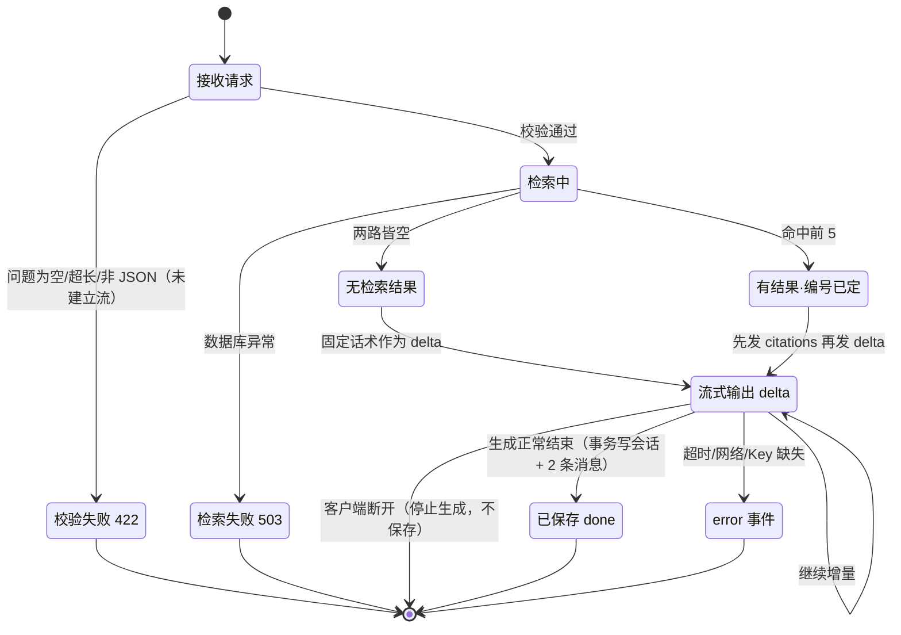

# 04. API 接口设计

| 项目 | 知问（zhiwen） |
| --- | --- |
| 文档阶段 | 设计第 4 阶段：API 接口设计（LLD 接口部分） |
| 文档版本 | v0.14（2026-11-09：V003 后无索引重建，上传/删除语义对齐） |
| 编写日期 | 2026-11-02 |
| 上游依据 | [SRS](../SRS.md) v0.5 第 7 章与第 9 章、[01.功能模块梳理](01.功能模块梳理.md) v0.8、[02.整体架构设计](02.整体架构设计.md) v0.3、[03.数据库设计](03.数据库设计.md) v0.2、[docs/rules/api-rules.md](../rules/api-rules.md)、[AGENTS.md](../../AGENTS.md) §6/§7 |
| 下游文档 | LLD 其余部分：类图与方法签名、错误码到前端文案的映射表（实现期） |

> **依据说明（口径差异，先记一笔）**：任务要求"遵循 `CLAUDE.md` 中的 API 接口设计规范"，但项目内**不存在 `CLAUDE.md`**（已确认：项目根与 `docs/` 下均无此文件）。本项目权威的接口规范是 [docs/rules/api-rules.md](../rules/api-rules.md)，AGENTS.md §6 也指向它。本文按后者执行；若你另有 `CLAUDE.md` 未放入仓库，请提供，我按其条款复核。

## 本阶段边界

**本文回答**：有哪些接口、归属哪个模块、路径/方法/参数/响应、统一的响应与错误结构、参数校验与异常处理、权限方式、以及这些接口与需求/架构/数据库是否一致。

**本文不展开**：类图与方法签名、路由与服务层的函数拆分、前端组件实现、错误码到中文文案的前端映射表、SSE 解析代码。本阶段**不写业务代码**。

**标注约定**：`已定` = 上游文档或你已确认；`建议` = 本文推荐但尚未确认；`待确认` = 见第 7 节 Q1~Q4。

---

## 1. 设计目标与约束

### 1.1 目标

1. 用 **8 个接口**覆盖 FR-1 ~ FR-7 的全部后端能力，不新增 SRS 未定义的接口。
2. 每个接口的字段都能回到 [03.数据库设计](03.数据库设计.md) 的列或明确的派生值，不引入库外字段。
3. 错误可区分、可映射、不泄露内部实现（api-rules §5.3）。
4. 与 02 的架构决策不冲突：单 worker、同步上传、SSE 流式、关键词索引在 PG、健康检查恒 200。

### 1.2 不可协商的约束

| 约束 | 来源 |
| --- | --- |
| 统一前缀 `/api`，无认证，仅监听 `127.0.0.1` | SRS 2.3、D-1、7 章 |
| 上传同步完成并返回（不做异步队列/轮询） | SRS 5.2、02 K-06 |
| 问答走 SSE：`citations` → `delta`* → `done` \| `error` | SRS 7.4、02 K-07 |
| 文档列表全量返回，不分页、不返回 total；历史列表用 limit/offset 且不返回 total | SRS D-10、7.2、7.5 |
| 健康检查恒返 200，用 `status` 字段表达降级 | 02 S-08 |
| 删除成功返回 `200` + 统一信封（`data: null`），不存在返回 `404` | SRS 7.3、7.7（状态码由 204 改为 200，见 §6.6 D-8） |
| 不得把错误都包在 200 里 | api-rules §4.5、§5.5 |
| 响应只含调用方需要的字段，不暴露数据库内部字段 | api-rules §4.3 |

---

## 2. 接口总览

### 2.1 8 个接口

| 编号 | 方法 | 路径 | 所属模块 | 用途 | 覆盖需求 |
| --- | --- | --- | --- | --- | --- |
| API-1 | POST | `/api/documents/upload` | M1 文档管理（调用 M2 入库） | 上传一个文件并同步完成入库 | FR-1、F-01~F-06 |
| API-2 | GET | `/api/documents` | M1 文档管理 | 文档列表（全量）+ 统计口径来源 | FR-2、F-07~F-09 |
| API-3 | DELETE | `/api/documents/{document_id}` | M1 文档管理 | 删除文档、其全部片段与原文件 | FR-3、F-10、F-11 |
| API-4 | POST | `/api/chat` | M4 问答生成（调用 M3 检索、M5 引用） | 提问并流式返回回答 + 引用 | FR-4、FR-5 |
| API-5 | GET | `/api/conversations` | M6 会话历史 | 历史列表（时间倒序，limit/offset） | FR-6、F-23 |
| API-6 | GET | `/api/conversations/{conversation_id}` | M6 会话历史 | 单条历史详情（只读回看） | FR-6、F-24 |
| API-7 | DELETE | `/api/conversations/{conversation_id}` | M6 会话历史 | 删除单条历史及其消息 | FR-6、F-25 |
| API-8 | GET | `/api/health` | M7 系统状态 | 数据库 / 嵌入模型 / Key 三项状态 | FR-7、F-27、F-28 |

### 2.2 覆盖检查：没有遗漏，也没有多说

| 功能 | 落点 | 说明 |
| --- | --- | --- |
| F-08 知识库统计（文档总数 / 片段总数） | API-2 的响应内现算 | 不新增统计接口，见 Q4 |
| F-26 新建对话 | 无接口 | 仅清空视图，不创建空会话（01 §5.4） |
| F-29 URL 锚点记忆 | 无接口 | 纯前端 `location.hash`（02 S-06） |
| F-30 全局反馈 | 无接口 | 由各接口的状态码与错误码驱动 |
| 检索过程 | 无独立接口 | 检索是 API-4 的内部步骤，不单独暴露 |
| 上传阶段进度（解析 / 切分向量化 / 写入） | 无接口 | 同步单响应无法给阶段事件，见 Q5 |

---

## 3. 通用约定（横切设计）

### 3.1 基础协议

| 项 | 约定 |
| --- | --- |
| Base URL | `http://127.0.0.1:8000/api`（端口来自 `scripts/run_dev.*`，可配置） |
| 传输 | HTTP/1.1；除上传（`multipart/form-data`）与问答（`text/event-stream`）外，一律 `application/json; charset=utf-8` |
| 字符集 | UTF-8，中文不转义（`ensure_ascii=False`） |
| ID | 数据库 `bigserial` → JSON **整数**（不是字符串，避免前端类型转换） |
| 时间 | ISO 8601 带时区偏移，形如 `2026-10-30T10:00:00+08:00`；**库内存 UTC，接口层转 +08:00**（03 §4.5） |
| 布尔 | JSON `true` / `false`（不是 0/1） |
| 空值 | 可选字段缺失时返回 `null`，不用空字符串占位 |
| 字段命名 | `snake_case`，与数据库列名一致（便于对照 03 文档）；唯一例外是上传结果的 `chunks`（SRS 7.1 已定名，语义对应 `documents.chunk_count`，不另造同义字段） |
| 调试入口 | FastAPI 自带的 `/docs` 与 `/openapi.json` **保留开启**（SRS §11 的 M1 验收口径就是"可用 Swagger 完成上传/列表/删除"）；仅监听 127.0.0.1，不对外暴露 |

### 3.2 统一响应结构

**所有 JSON 响应同构三字段**：`code` + `message` + `data`（Q1 已确认采用同构信封）。

| 字段 | 类型 | 成功 | 失败 |
| --- | --- | --- | --- |
| `code` | string | 固定 `"ok"` | §3.3 目录里的错误码（全大写下划线） |
| `message` | string | 固定 `"ok"` | 中文、可直接展示 |
| `data` | object \| array \| null | 资源本体 | 固定 `null` |

```json
// 成功：集合
{ "code": "ok", "message": "ok", "data": { "items": [ { "id": 1, "filename": "计算机网络.pdf" } ] } }

// 成功：单对象
{ "code": "ok", "message": "ok", "data": { "id": 15, "title": "王教授在哪个教室上课？" } }

// 成功：无内容（删除类操作，data 为 null）
{ "code": "ok", "message": "ok", "data": null }

// 失败
{ "code": "UNSUPPORTED_FILE_TYPE", "message": "不支持的文件类型：.exe", "data": null }
```

| 规则 | 说明 |
| --- | --- |
| 成功码 | 恒为字符串 `"ok"`，不用 `0`/`true`/`200`——`code` 只有一种类型，前端一次判断即可 |
| HTTP 状态码仍然保留 | `code` 是业务码，HTTP 状态码表达类别（200/422/404/500/503），两者**不得矛盾**（api-rules §4.5、§5.5） |
| 不再使用 `204` | 信封必须带 body，删除类操作改为 `200` + `data: null`（见 §6.6 D-8） |
| 部分失败不是错误 | 上传时单文件失败仍是 `code: "ok"`、HTTP 200，失败原因在 `data.items[].error`（见 API-1） |
| 前端解析 | 统一在 `web/src/api/client.ts` 解包 `data`；`code != "ok"` 即失败，按 code 查文案表（02 §4.3） |

> **唯一例外**：SSE（API-4）的 `data` 不套信封 —— 事件类型已由 `event:` 表达，逐 token 再包一层只会让每个增量多约 30 字节且无信息增益；`error` 事件本身自带 `code`/`message`。见 §5.1。

### 3.3 错误码目录

> 成功码固定 `ok`（§3.2）；下表其余码出现在信封顶层 `code`，**HTTP 状态码同步设置**。逐文件失败码（`UNSUPPORTED_FILE_TYPE` 等）出现在 `data.items[].error.code` 内，**不改变 HTTP 状态码**。

| code | HTTP | 触发条件 | message（示例） | 前端处理 |
| --- | --- | --- | --- | --- |
| `VALIDATION_ERROR` | 422 | 字段缺失/类型错/取值越界（含 FastAPI 校验失败） | 参数校验失败：question 不能为空 | 行内提示 |
| `QUESTION_EMPTY` | 422 | `question` 去空白后为空 | 问题不能为空 | 阻止提交（正常由前端先拦） |
| `QUESTION_TOO_LONG` | 422 | `question` > 500 字 | 问题不能超过 500 字 | 字数提示 |
| `TOO_MANY_FILES` | 422 | 单次请求文件数 > 20（BR-8） | 每次最多上传 20 个文件，请分批提交 | 选择文件时先按 20 拦；超量整批拒绝，一个都不处理 |
| `PAYLOAD_TOO_LARGE` | 413 | 请求体 > 55 MB（读 body **之前**按 `Content-Length` 判定） | 请求体过大 | 选择文件时即拦截（50 MB 上限在前端已有提示） |
| `UNSUPPORTED_FILE_TYPE` | — | 扩展名不在白名单（per-file） | 不支持的文件类型：.exe | 队列行标红 |
| `FILE_TOO_LARGE` | — | 单文件 > 50 MB（per-file） | 文件超过 50 MB | 队列行标红 |
| `EMPTY_FILE` | — | 0 字节（per-file） | 文件为空 | 队列行标红 |
| `INVALID_FILENAME` | — | 含路径分隔符或 `..`、或超 255 字符（per-file） | 非法文件名 | 队列行标红 |
| `PARSE_FAILED` | — | 解析结果为空（含扫描件） | 无法解析文件内容，可能是扫描件或空文档 | 队列行标红 |
| `TABLE_EMPTY` | — | xlsx/csv 无有效数据行 | 表格为空或无有效行 | 队列行标红 |
| `EMBEDDING_FAILED` | — | 向量化异常（per-file） | 向量化失败，请稍后重试 | 队列行标红，可重试 |
| `STORAGE_FAILED` | — | 落盘 / 替换原文件失败（per-file） | 文件保存失败 | 队列行标红，可重试 |
| `DOCUMENT_NOT_FOUND` | 404 | 文档不存在或已删除 | 文档不存在 | 按"已删除"友好提示，不展示错误态 |
| `CONVERSATION_NOT_FOUND` | 404 | 会话不存在或已删除 | 会话不存在 | 移除该条并提示 |
| `DB_UNAVAILABLE` | 503 | 数据库连接/查询失败 | 数据库不可用，请检查数据库服务 | 顶部降级徽标 + 可重试 |
| `LLM_KEY_MISSING` | 503 | `DEEPSEEK_API_KEY` 未配置 | 未配置大模型 API Key | 提示配置，不展示 Key |
| `LLM_TIMEOUT` | — | 大模型首字或总时长超时（SSE `error` 事件） | 大模型响应超时，请重试 | 错误态 + 重试按钮 |
| `LLM_ERROR` | — | 大模型其它错误（网络/4xx/5xx） | 大模型调用失败，请重试 | 错误态 + 重试按钮 |
| `INTERNAL_ERROR` | 500 | 未分类异常 | 服务内部错误 | 通用错误提示 |

> `LLM_TIMEOUT` / `LLM_ERROR` 的 HTTP 状态码为 `—`，因为 SSE 流已建立（状态 200），错误只能通过 `error` 事件下发；这也解释了为什么 SRS 7.4 把 `error` 定义为事件而不是状态码。
>
> 另有 **2 个框架级码**不属于业务目录、也不参与上表计数：**NOT_FOUND**（404，未路由的路径，如拼错的 URL）与 **NOT_IMPLEMENTED**（501，骨架期占位，接口实现后删除）。

### 3.4 参数校验规则

| # | 规则 | 校验位置 | 失败结果 |
| --- | --- | --- | --- |
| V-1 | 路由层用 pydantic 模型 + Query/Path 约束声明，服务端校验是最终裁决（api-rules §3.2） | 路由层 | 422 `VALIDATION_ERROR` |
| V-2 | `question`：去首尾空白后非空、`len()` ≤ 500（按字符，不按字节） | 路由层 | 422 `QUESTION_EMPTY` / `QUESTION_TOO_LONG` |
| V-3 | `limit`：整数 1~100，默认 50；`offset`：整数 ≥ 0，默认 0 | 路由层 | 422 `VALIDATION_ERROR` |
| V-4 | 路径参数 `document_id` / `conversation_id`：整数 ≥ 1；越界/非整数一律 422 | 路由层 | 422 `VALIDATION_ERROR` |
| V-5 | 上传：文件数上限、单文件 ≤ 50 MB、扩展名白名单（大小写不敏感）、文件名安全 | 路由层先做，服务层复核 | 见 §2.3 错误码 |
| V-6 | 文件名：`len` 1~255，不含 `/` `\` `..`，不允许空基线名 | 路由层 | `INVALID_FILENAME` |
| V-7 | 请求体大小：`Content-Type` 与声明不符、非法 JSON → 422 | FastAPI | 422 `VALIDATION_ERROR` |
| V-8 | 上传接口在**读取 body 之前**校验 `Content-Length`，超过 55 MB（50 MB 文件 + multipart 边界开销）直接拒绝，不落盘、不读流 | 中间件 | 413 `PAYLOAD_TOO_LARGE` |

**422 响应必须被统一**：FastAPI 默认返回 `{"detail":[{"loc":..., "msg":...}]}`，与 §3.2 的信封不符。实现时注册 `RequestValidationError` 与 `HTTPException` 处理器，转成 `{"code":"VALIDATION_ERROR","message":"参数校验失败：<字段> <原因>","data":null}`。（api-rules §5.4 要求指出字段与原因，故 message 保留字段名。）

### 3.5 异常处理与状态码映射

| 异常来源 | 异常类型（实现期） | HTTP | code | 处理要点 |
| --- | --- | --- | --- | --- |
| 参数校验 | `RequestValidationError` / `ValueError` | 422 | `VALIDATION_ERROR` 或更具体码 | 指向字段与原因 |
| 资源不存在 | 自定义 `NotFoundError` | 404 | `*_NOT_FOUND` | 不区分"从未存在"与"已删除" |
| 数据库不可用 | `psycopg.OperationalError` | 503 | `DB_UNAVAILABLE` | 不把 DSN、主机、密码写进 message |
| 大模型未配置 | 配置缺失 | 503 | `LLM_KEY_MISSING` | 只在日志记录"未配置"，不回显任何 Key 片段 |
| 大模型超时/异常 | `asyncio.TimeoutError` / SDK 异常 | SSE `error` | `LLM_TIMEOUT` / `LLM_ERROR` | 已建立的流不改成状态码 |
| 单文件入库失败 | 服务层返回结果对象 | 200 + `data.items[].error` | 见 §3.3 | 不抛到顶层，不影响同批其他文件 |
| 请求体过大 | 中间件预检 `Content-Length` | 413 | `PAYLOAD_TOO_LARGE` | 不读 body、不落盘、不回显具体字节数 |
| 未分类异常 | `Exception` | 500 | `INTERNAL_ERROR` | 全局兜底：记 error 日志（含 request_id），响应不含内部细节 |

**顺序**：业务异常 → 更具体的错误码；未识别的一律 `INTERNAL_ERROR`。日志与响应分离：日志有堆栈，响应只有中文说明（api-rules §5.3）。

### 3.6 权限校验方式

本系统**无认证、无授权**（SRS D-1），因此没有 token/session/role 校验。安全边界由以下四条承担：

| 边界 | 做法 | 依据 |
| --- | --- | --- |
| 网络可达性 | 只绑定 `127.0.0.1`，不监听 `0.0.0.0`；不开放局域网 | SRS 2.3、NFR-3、D-8 |
| 跨域面 | 前端 dev 走 Vite 代理（`/api` → `127.0.0.1:8000`）；后端**不**配置 `allow_origins=["*"]` | §3.6.1 |
| 输入信任 | 所有入参服务端校验；文件名清洗；存储路径由服务端生成（不接收用户路径） | api-rules §3.2、NFR-3、AC-9 |
| 输出最小化 | 不返回 `stored_path`、不返回 Key、错误不含 SQL/堆栈 | api-rules §4.3、§5.3 |

#### 3.6.1 跨域策略（Q6 已确认）

| 选项 | 说明 |
| --- | --- |
| **A（建议）** | 开发期用 Vite `server.proxy` 把 `/api` 转发到后端；后端不写 CORS 中间件。生产期前端构建产物与后端同源（静态文件由后端或本地静态服务器提供） |
| B | 后端加 CORS 白名单 `http://127.0.0.1:5173`（开发）+ 生产端口 |

选 A 的理由：不新增跨域配置面，也不会因为以后误配 `allow_origins=["*"]` 把本机服务暴露给同机其它页面。

**结论（2026-11-02，你已确认）**：采用 **A** —— `web/vite.config.ts` 里配 `server.proxy['/api'] → http://127.0.0.1:8000`；后端不注册 CORS 中间件。

### 3.7 幂等、并发与超时

| 项 | 约定 | 依据 |
| --- | --- | --- |
| 上传幂等 | 同名文件重复上传 = 覆盖同一 `documents.id`，不产生重复文档（自然幂等，靠 `UNIQUE(lower(filename))`） | BR-1、NFR-2 |
| 删除幂等 | 第二次删除同一文档/会话返回 `404`；前端按"已删除"友好提示，不视为故障 | SRS 7.3、7.7 |
| 并发写 | 上传/覆盖/删除在服务层用进程内锁串行（单 worker），后到的同名请求**等待**而不是返回 409。落点 `Container.write_lock`（`server/api/deps.py`）；上传只在**写阶段**持锁，解析/切分/向量化在锁外，避免串行化整条流水线 | 02 §3.3、S-01 |
| 问答并发 | 允许并行（各自独立检索与生成）；前端在生成中整体只读，天然串行 | 01 Q12 |
| 上传超时 | 服务端不设硬超时（NFR-1 目标是 60 s，不是上限）；**前端 120 s 超时，超时后提示「仍在处理中，请稍后刷新列表」**（A2 已定） | 已定 |
| 大模型超时 | **首字节 15 s、总时长 60 s**（A1 已定），两值进配置模块（NFR-6） | 已定 |
| 客户端断开 | 服务端检测到断连即取消生成，**不保存历史**；不产生 error 事件 | SRS 7.4、FR-6 |

### 3.8 日志

每个请求记录：`request_id`、方法、路径、状态码、耗时、关键业务字段（文件名、`document_id`、片段数、是否覆盖、检索耗时、生成耗时）。**不记录**：文件全文、问题全文之外的 chunk 内容、API Key、DSN（AGENTS.md §7.6）。`request_id` 仅进日志，不进响应体（不给前端新增字段）。

---

## 4. 接口详述

> **阅读约定**：本节目录下的字段表只列 **`data` 内部的资源字段**（省略 `data.` 前缀以免每行重复），JSON 示例则给出完整信封（`code` / `message` / `data`）。例：表中 `items[].id` 实际位于 `data.items[].id`。

### 4.1 API-1 上传文档

**用途**：把一个文件同步完成"校验 → 解析 → 切分 → 向量化 → 入库"，返回逐文件结果。所属模块 M1，内部调用 M2。

| 项 | 内容 |
| --- | --- |
| 方法与路径 | `POST /api/documents/upload` |
| Content-Type | `multipart/form-data` |
| 请求字段 | `files`（文件数组，**长度 1~20**；>20 → 422 `TOO_MANY_FILES` 整批拒绝；Q2 已二次裁决反转，见 §7.1） |
| 成功状态 | `200 OK`（单个文件失败也仍是 200，原因在该项的 `data.items[].error`） |

**请求参数**

| 字段 | 类型 | 必填 | 约束 | 说明 |
| --- | --- | --- | --- | --- |
| `files` | file[] | 是 | 长度 1~20（上限取 `Settings.max_files_per_request`） | 文件二进制；单文件 ≤ 50 MB；扩展名 ∈ {pdf, docx, md, txt, xlsx, csv} |

**响应 `200`**

| 字段 | 类型 | 说明 |
| --- | --- | --- |
| `items` | array | 与请求顺序一致，每项一个文件的结果 |
| `items[].filename` | string | 原始文件名（回显，不改成服务端文件名） |
| `items[].status` | string | `success` \| `failed` |
| `items[].document_id` | int \| null | 成功时为文档 ID；覆盖时沿用旧 ID；失败为 `null` |
| `items[].chunks` | int | 本次入库的片段数；失败为 `0` |
| `items[].overwritten` | bool | 是否覆盖了同名文档（派生值，不落库；由命中 `uq_documents_filename_lower` 推断） |
| `items[].error` | object \| null | 失败原因；成功为 `null`。失败时 `{"code": "UNSUPPORTED_FILE_TYPE", "message": "不支持的文件类型：.exe"}`（Q3 已确认，与顶层同形） |

```json
{
  "code": "ok",
  "message": "ok",
  "data": {
    "items": [
      {
        "filename": "计算机网络.pdf",
        "status": "success",
        "document_id": 1,
        "chunks": 37,
        "overwritten": false,
        "error": null
      }
    ]
  }
}

// 该文件失败时（HTTP 仍 200，code 仍为 ok）：
{
  "code": "ok",
  "message": "ok",
  "data": {
    "items": [
      {
        "filename": "bad.exe",
        "status": "failed",
        "document_id": null,
        "chunks": 0,
        "overwritten": false,
        "error": { "code": "UNSUPPORTED_FILE_TYPE", "message": "不支持的文件类型：.exe" }
      }
    ]
  }
}
```

**业务规则**

1. **先整批、后逐文件**：文件数超上限（>20）→ 422 `TOO_MANY_FILES`，一个都不处理（BR-8、01 Q8）；文件数合规后逐文件校验，单个失败不影响其他（F-05）。
2. 失败的文件**不写库、不落盘**，只在本次响应中出现，列表接口查不到（BR-10、FR-2）。
3. 同名文件走"先就绪、后替换"：新数据全部准备好才在**同一事务**内替换旧段落与旧原文件；任一步失败，旧数据与旧文件保持原样（BR-2、01 Q1）。
4. 覆盖成功后 `updated_at` 刷新，该文档浮到列表首位（Q5）。
5. 关键词索引由 PostgreSQL 随写入自动维护（BR-4，V003 后无重建步骤），所以"上传成功"即"立刻可检索"，无需等待任何索引构建。整批提交仅为减少往返：N 个文件逐个 POST 会走 N 次解析 + 嵌入 + 写库，前端因此整批提交。
6. 逐文件处理顺序即 `items` 顺序；处理是串行的。
7. 失败项的 `filename` 仍是用户提交的原文（用于前端逐行标红），不做清洗改写。

**错误**

| 场景 | 状态 | code |
| --- | --- | --- |
| 超出文件数上限 | 422 | `TOO_MANY_FILES` |
| 缺 `files` 字段 / 不是 multipart | 422 | `VALIDATION_ERROR` |
| 单文件超 50 MB、空文件、扩展名不支持、文件名非法、解析失败、表格为空、向量化/落盘失败 | 200 + `items[].error` | 对应 per-file code |
| 数据库不可用 | 503 | `DB_UNAVAILABLE`（此时整批失败，不返回 200） |

> 注意最后一行的边界：**数据库完全不可用**不属于"单文件失败"，它是请求级故障，必须用 503 表达，不能塞进 `items[].error`（否则前端会以为只是这个文件有问题）。

---

### 4.2 API-2 文档列表

**用途**：返回全部文档，按最近更新倒序；同时是"文档总数 / 片段总数"的计算来源。

| 项 | 内容 |
| --- | --- |
| 方法与路径 | `GET /api/documents` |
| 请求参数 | 无（本期不分页，SRS D-10） |
| 成功状态 | `200 OK` |

**响应 `200`**

| 字段 | 类型 | 对应数据库列 | 说明 |
| --- | --- | --- | --- |
| `items[].id` | int | `documents.id` | 文档 ID（删除时用） |
| `items[].filename` | string | `documents.filename` | 原始文件名 |
| `items[].file_type` | string | `documents.file_type` | 六种取值之一 |
| `items[].file_size` | int | `documents.file_size` | 字节数 |
| `items[].chunk_count` | int | `documents.chunk_count` | 片段数 |
| `items[].created_at` | string | `documents.created_at` | 首次入库时间 |
| `items[].updated_at` | string | `documents.updated_at` | 最近覆盖时间（列表排序键） |

```json
{
  "code": "ok",
  "message": "ok",
  "data": {
    "items": [
      {
        "id": 1,
        "filename": "计算机网络.pdf",
        "file_type": "pdf",
        "file_size": 1048576,
        "chunk_count": 37,
        "created_at": "2026-10-30T10:00:00+08:00",
        "updated_at": "2026-10-30T10:00:00+08:00"
      }
    ]
  }
}
```

**业务规则**

1. 排序：`updated_at DESC, id DESC`（稳定次序，见 03 §4.1）。
2. 全量返回，**不返回** `total` / `limit` / `offset`（SRS D-10 明确豁免 api-rules §4.4）。
3. 只包含入库成功的文档；空库返回 `{"items": []}`（不是 404）。
4. 不返回 `stored_path`（内部路径不外泄，api-rules §4.3）。
5. 统计口径（F-08）：前端用 `data.items.length` 与 `sum(data.items[].chunk_count)` 现算，随列表刷新（Q4）。导航徽标（问答页/知识库页共用）也用这一次调用的结果，应用启动时拉一次即可，不额外增加接口。

**错误**：数据库不可用 → 503 `DB_UNAVAILABLE`。

---

### 4.3 API-3 删除文档

| 项 | 内容 |
| --- | --- |
| 方法与路径 | `DELETE /api/documents/{document_id}` |
| 路径参数 | `document_id`：整数 ≥ 1 |
| 成功状态 | `200 OK` + 信封，`data: null`（不再用 204，见 §6.6 D-8） |

**业务规则**

1. 在一个事务内先删该文档全部片段、再删文档行（BR-3，无物理外键，顺序由服务层保证）。
2. 事务提交成功后删除磁盘原文件；`ENOENT`（文件已不存在）**视为删除成功**；其它 IO 错误只记 error 日志，接口仍返回 200 + `data: null`（03 文档 Q4 已确认：数据库是真相源）。
3. 删除成功后关键词索引随事务自动更新（BR-4，V003 后无重建步骤），该文档内容立即不再被检索命中（F-11）。删除响应不等任何索引动作。
4. 不删除历史消息：引用是自包含快照，历史照常展示（01 Q2）。
5. 重复删除同一 ID → 404（幂等语义由前端友好处理，SRS 7.3）。

**错误**

| 场景 | 状态 | code |
| --- | --- | --- |
| 文档不存在 | 404 | `DOCUMENT_NOT_FOUND` |
| `document_id` 非法（非整数/≤0） | 422 | `VALIDATION_ERROR` |
| 数据库失败 | 500 / 503 | `INTERNAL_ERROR` / `DB_UNAVAILABLE`（不删原文件，保持状态一致，SRS FR-3） |

---

### 4.4 API-4 问答（SSE）

**用途**：检索 → 融合 → 组装引用 → 流式生成。所属 M4，内部调用 M3、M5。

| 项 | 内容 |
| --- | --- |
| 方法与路径 | `POST /api/chat` |
| Content-Type | `application/json` |
| 成功状态 | `200 OK`，响应头 `Content-Type: text/event-stream; charset=utf-8` |
| 附加响应头 | `Cache-Control: no-cache`、`X-Accel-Buffering: no`、`Connection: keep-alive` |

**请求体**

| 字段 | 类型 | 必填 | 约束 | 说明 |
| --- | --- | --- | --- | --- |
| `question` | string | 是 | 去空白后非空，≤ 500 字 | 本轮问题原文 |
| `conversation_id` | int \| null | 否 | 整数 ≥ 1；缺省/null = 新建会话 | 续聊目标；传了但会话不存在 → 404 `CONVERSATION_NOT_FOUND`（FR-9） |

```json
{ "question": "那它对谁影响最大？", "conversation_id": 15 }
```

**响应**：`text/event-stream`，事件序列见 §5。

**业务规则**

1. 两路召回各 20 → RRF(k=60) 取前 5（F-13、F-14）；参数进配置模块（NFR-6）。
2. 两路皆空 → **不调用大模型**，只发 `delta`（固定话术）与 `done`，不下发 `citations`；**仍保存历史**（BR-6、01 Q7）。后端**不区分**「知识库为空」与「有文档但无命中」——两者都走同一固定话术；「去上传文档」引导按钮由前端依据 API-2 的文档数是否为 0 决定（01 Q10）。
3. 有结果 → 先发 `citations`（编号在此刻固定，BR-7、F-20），再流式 `delta`，最后 `done`（含 `conversation_id`）。
4. 生成失败 → 发 `error`（`LLM_TIMEOUT` / `LLM_ERROR` / `LLM_KEY_MISSING`），**该轮整轮不写库**（不产生只有 user 的半轮）；已有会话仍可继续提问，首轮失败则不留会话（FR-6、FR-9）。
5. 客户端断开 → 立即停止生成，该轮不写库。
6. 保存时机：新建会话时在 `done` 之前的一个事务内写 `conversations` + 两条 `messages`；续聊时在同一事务内追加本轮两条 `messages` 并刷新 `conversations.updated_at`（`citations` 为快照）。
7. 多轮：带 `conversation_id` 时取最近 **5 轮**（≤4000 字符）历史进提示词；检索 query = **上一轮问题 + 当前问题**（确定性拼接，不做模型改写）；每轮引用编号从 `[1]` 重新开始（FR-9）。

**错误（流建立之前）**

| 场景 | 状态 | code |
| --- | --- | --- |
| 问题为空 / 超长 | 422 | `QUESTION_EMPTY` / `QUESTION_TOO_LONG` |
| 请求体不是 JSON / 缺字段 | 422 | `VALIDATION_ERROR` |
| 会话不存在 / 已删除 | 404 | `CONVERSATION_NOT_FOUND` |
| 数据库不可用（检索阶段） | 503 | `DB_UNAVAILABLE`（流未建立，用状态码而非事件） |

> 关键区分：**流建立前**用 HTTP 状态码；**流建立后**只能用 `error` 事件。前端因此要处理两种失败形态（02 §4.3 的 `api/chatStream.ts` 负责归一）。

---

### 4.5 API-5 历史列表

| 项 | 内容 |
| --- | --- |
| 方法与路径 | `GET /api/conversations?limit=50&offset=0` |
| 查询参数 | `limit` 1~100，默认 50；`offset` ≥ 0，默认 0 |
| 成功状态 | `200 OK` |

**响应 `200`**

| 字段 | 类型 | 对应数据库列 | 说明 |
| --- | --- | --- | --- |
| `items[].id` | int | `conversations.id` | 会话 ID |
| `items[].title` | string | `conversations.title` | 问题前 30 字 |
| `items[].created_at` | string | `conversations.created_at` | 创建时间（首问时间） |
| `items[].updated_at` | string | `conversations.updated_at` | 最近活动时间，**列表排序键**（FR-9） |

```json
{
  "code": "ok",
  "message": "ok",
  "data": {
    "items": [
      { "id": 15, "title": "王教授在哪个教室上课？",
        "created_at": "2026-10-30T10:05:00+08:00", "updated_at": "2026-10-30T10:12:00+08:00" }
    ]
  }
}
```

**业务规则**

1. 排序 **`updated_at DESC, id DESC`**（最近活动在前，多轮会话因续聊浮顶）；不返回总数、不返回总页数（SRS 7.5、D-10、FR-9）。
2. 不返回消息内容——列表只要标题，详情走 API-6（避免 N+1 与响应膨胀）。
3. 无数据时 `data.items` 为空数组（信封里的 `code` 仍是 `"ok"`，空列表不是错误）。
4. **没有 `total` 时如何判断「还有更多」**：本轮 `items.length < limit` 即视为到底；相等则继续按 `offset + limit` 拉下一页（前端 `useConversations` 里唯一的分页判断依据）。

**错误**：`limit`/`offset` 越界 → 422 `VALIDATION_ERROR`；数据库不可用 → 503。

---

### 4.6 API-6 历史详情

| 项 | 内容 |
| --- | --- |
| 方法与路径 | `GET /api/conversations/{conversation_id}` |
| 路径参数 | `conversation_id`：整数 ≥ 1 |
| 成功状态 | `200 OK` |

**响应 `200`**

| 字段 | 类型 | 对应数据库列 | 说明 |
| --- | --- | --- | --- |
| `id` | int | `conversations.id` | 会话 ID |
| `title` | string | `conversations.title` | 标题 |
| `created_at` | string | `conversations.created_at` | 创建时间 |
| `messages` | array | `messages` 两行 | 固定 2 项：`user` 在前、`assistant` 在后 |
| `messages[].role` | string | `messages.role` | `user` \| `assistant` |
| `messages[].content` | string | `messages.content` | 原文 / 回答正文 |
| `messages[].citations` | array | `messages.citations` | user 恒为 `[]` |
| `messages[].citations[].n` | int | 快照内 | 引用序号，从 1 开始 |
| `messages[].citations[].filename` | string | 快照内 | 当时的文件名 |
| `messages[].citations[].page` | string \| null | 快照内 | PDF 页码；其它为 `"全文"` |
| `messages[].citations[].snippet` | string | 快照内 | 前 100 字摘要 |
| `messages[].citations[].chunk_id` | int | 快照内 | 来源片段 ID（追溯用，可能悬空） |

```json
{
  "code": "ok",
  "message": "ok",
  "data": {
  "id": 15,
  "title": "王教授在哪个教室上课？",
  "created_at": "2026-10-30T10:05:00+08:00",
  "messages": [
    { "role": "user", "content": "王教授在哪个教室上课？", "citations": [] },
    {
      "role": "assistant",
      "content": "王教授在 302 教室上课 [1]。",
      "citations": [
        { "n": 1, "filename": "计算机网络.pdf", "page": "3", "snippet": "……", "chunk_id": 123 }
      ]
    }
  ]
  }
}
```

**业务规则**

1. **只读**：不重新检索、不调用大模型、不修改任何数据（F-24）。
2. 消息顺序 **`id ASC`**（等价于轮次先后，`created_at` 同秒时更稳）；每个会话 2 × 轮数 条，多轮后不再有"每会话恒 2 条"的假设（03 v0.8 已删该唯一约束）。
3. **不返回** `messages[].id` 与 `messages[].created_at`：本期前端没有用到（列表按数组顺序渲染），少两个字段就少一处契约维护。若后续需要"逐条删除消息"再加。
4. 引用中的 `chunk_id` 可能指向已删除的片段，契约上明确它**不可用于再请求**（03 R-3）。

**错误**：会话不存在 → 404 `CONVERSATION_NOT_FOUND`；ID 非法 → 422。

---

### 4.7 API-7 删除历史

| 项 | 内容 |
| --- | --- |
| 方法与路径 | `DELETE /api/conversations/{conversation_id}` |
| 成功状态 | `200 OK` + 信封，`data: null` |

**业务规则**

1. 一个事务内先删该会话全部消息、再删会话行（FR-6 原文）。
2. 不存在 → 404；前端按"已删除"处理。
3. 删除会话不影响任何文档或片段（`citations` 是快照，无反向引用）。

---

### 4.8 API-8 健康检查

| 项 | 内容 |
| --- | --- |
| 方法与路径 | `GET /api/health` |
| 请求参数 | 无 |
| 成功状态 | **恒 `200`**（降级也用 200，靠字段表达，02 S-08） |

**响应 `200`**

| 字段 | 类型 | 取值 | 说明 |
| --- | --- | --- | --- |
| `status` | string | `ok` \| `degraded` | 三项全好为 `ok`，否则 `degraded` |
| `database` | string | `ok` \| `error` | 一次轻量探测（`SELECT 1`），不查业务表 |
| `embedding_model` | string | `loaded` \| `loading` \| `failed` | 进程内状态位（02 §2.6） |
| `warmup` | string | `idle` \| `warming` \| `ready` \| `failed` | 启动初始化状态（M8，v0.11 改为同步）：`idle` = 未启用（`RAG_WARMUP=0`）；`warming` = 启动阶段同步加载中（此时端口通常尚未对外服务，客户端一般观察不到）；`ready` = 完成；`failed` = 初始化失败（服务已启动，首个请求退回懒加载） |
| `llm_key` | string | `configured` \| `missing` | 只看环境变量是否存在，**不校验可用性、不回显** |

```json
{
  "code": "ok",
  "message": "ok",
  "data": { "status": "ok", "database": "ok", "embedding_model": "loaded", "warmup": "ready", "llm_key": "configured" }
}
```

**业务规则**

1. 降级判定：`database != "ok"` 或 `embedding_model != "loaded"` 或 `llm_key != "configured"` → `status = "degraded"`。
2. 冷启动：模型加载中返回 `embedding_model = "loading"`，前端据此显示"模型加载中"（G2/F-28），不禁用页面。
3. 探测要轻：数据库不可用时必须在秒级返回（带短超时），不能因为库挂了让健康检查一起挂住（02 §5.4 风险）。
4. 不返回版本号、配置值、路径等内部信息。
5. **前端轮询策略（A3 已定）**：每 **30 s** 调一次；请求失败/无法连接连续 **2 次** → 顶部置「服务不可用」；一旦返回 `status="degraded"` 立即展示降级（不计入失败次数）；任一次恢复正常即回到「就绪」。
6. **启动初始化（M8，v0.11 改为同步）**：解析库 import → 向量模型加载在 lifespan `startup` 中**同步**执行（BM25 构建已随 V003 移除），完成前 uvicorn 不接管请求——所以正常情况下客户端**第一次能连上时 `warmup` 已是 `ready`**，`warming` 基本只出现在启动脚本的进程内日志里（此阶段连 TCP 都连不上，不是"连上后转圈"）。初始化失败不阻断服务：`warmup = "failed"`、`embedding_model = "failed"`，首个请求退回懒加载路径。前端仍保留 `warming` 门控（置灰发送 + 提示"模型预热中"、轮询间隔 3 s / 未探到结果时 2 s）作为兜底。旧客户端不认识 `warmup` 字段时行为不变（忽略即可）。

**错误**：本接口不返回非 200。若进程已无法响应（崩溃），由前端按"服务不可用"处理（G3）。

---

### 4.9 API-9 文档片段预览（只读）

| 项 | 内容 |
| --- | --- |
| 方法与路径 | `GET /api/documents/{id}/chunks` |
| 请求参数 | 路径 `id`：文档 ID；查询 `offset`（≥0，默认 0）、`limit`（1~200，默认 20） |
| 成功状态 | `200` |
| 幂等 | 是（GET，只读） |
| 触发条件 | 用户在知识库点击文件名 / 「预览」 |

**响应 `200`**

| 字段 | 类型 | 取值 | 说明 |
| --- | --- | --- | --- |
| `document` | object | — | 文档元信息：`id` / `filename` / `file_type` / `file_size` / `chunk_count` / `updated_at` |
| `total` | int | ≥0 | 该文档片段总数 |
| `offset` / `limit` | int | — | 回显请求参数 |
| `items[]` | array | — | 每项 `{chunk_id, chunk_index, page, content}`，按 `chunk_index` 升序 |

```json
{
  "code": "ok",
  "message": "ok",
  "data": {
    "document": { "id": 15, "filename": "documents_dup_part_12_part_2.txt", "file_type": "txt",
                  "file_size": 4710063, "chunk_count": 4576, "updated_at": "2026-11-03T19:41:36+08:00" },
    "total": 4576,
    "offset": 0,
    "limit": 20,
    "items": [{ "chunk_id": 20, "chunk_index": 0, "page": null, "content": "……" }]
  }
}
```

**业务规则**

1. 只读：不加 `Container.write_lock`、不触发任何索引维护动作、不改任何数据（SRS FR-8）。
2. 数据源是 `rag_chunks`，**不读原文件**：原文件被清理后仍可预览。
3. `limit > 200` 或 `offset < 0` → `422 VALIDATION_ERROR`；文档不存在 → `404 DOCUMENT_NOT_FOUND`；数据库不可用 → `503 DB_UNAVAILABLE`。
4. 文档存在但无片段：`200` + `items: []`，前端显示空态。
5. 分页语义：`items.length < limit` 表示到底（`total` 仍由服务端给出，避免调用方自行推算）。

---

## 5. SSE 事件契约

### 5.1 事件清单

| event | data | 出现时机 | 次数 |
| --- | --- | --- | --- |
| `citations` | `{"items":[{n, filename, page, snippet, chunk_id}]}` | 检索有结果、调用大模型**之前** | 0 或 1 |
| `delta` | `{"text": "增量文本"}` | 生成过程中 | 1~N |
| `done` | `{"conversation_id": 15}` | 正常结束 | 1 |
| `error` | `{"code": "LLM_TIMEOUT", "message": "..."}` | 生成失败、流已建立之后 | 0 或 1 |

**结构细节**

- 每个事件三行：`event: <name>`、`data: <单行 JSON>`、空行结尾；`data` 内不放换行，避免多行 data 解析歧义。
- `delta.text` 可能是空串以外的任意增量；前端按到达顺序 **append**，不做去重、不做重新排序。
- `delta.text` 是**正文字面量**，可能带 Markdown 标记（列表、加粗、行内代码、代码块）：服务端**不剥离**，由客户端决定怎么呈现；本项目前端按 GFM 子集渲染（SRS v0.16 §8.2、[09 §8](09.前端详细设计.md)）。按纯文本消费的调用方（评测脚本、CLI）行为不变。
- `citations.items` 与 API-6 的 `messages[].citations` **同一结构**，前端一套渲染组件（M5 是唯一引用组装者）。
- `done` 之后服务端关闭流；不再发送任何事件。
- **SSE 的 `data` 不套 §3.2 的信封**（全项目唯一例外）：事件类型已由 `event:` 行表达，逐 token 再包一层只会增加约 30 字节/次且无信息增益；`error` 事件自带 `code`/`message`。若你要求 SSE 也同构，改本节与前端 `chatStream.ts` 解析即可。
- 无检索结果时：**不发** `citations`，直接 `delta`（固定话术"根据已有资料无法回答"）+ `done`（01 Q7 要求此时仍存历史，`conversation_id` 照常返回）。

### 5.2 状态机



### 5.3 不做的三件事

| 不做 | 理由 |
| --- | --- |
| 自动重连 / `Last-Event-ID` 续传 | 提问是 POST 且有副作用（写历史），重放会重复计费与重复入库；失败由用户点"重试"发起新请求 |
| `event: ping` 心跳 | 首字延迟 ≤3 s（热态），没有长空闲窗口；加心跳只会让前端解析多点分支 |
| WebSocket | SSE 单向足够（SRS 5.2 已定），WebSocket 要自己处理帧协议与重连 |

---

## 6. 一致性检查

### 6.1 需求 → 接口覆盖

| 需求 | 接口 | 覆盖情况 |
| --- | --- | --- |
| FR-1 批量上传 | API-1 | ✅ 校验/入库/覆盖/失败隔离全在契约内 |
| FR-2 文档列表 | API-2 | ✅ 字段与排序与 SRS 一致；统计口径见 Q4 |
| FR-3 文档删除 | API-3 | ✅ 200（信封）+ 404 + 500；204 已按 Q1 改为 200 |
| FR-4 问答 | API-4 | ✅ 校验、无结果兜底、流式、异常全在契约内 |
| FR-5 引用来源 | API-4 `citations` 事件 + API-6 | ✅ 字段与 FR-5 一致（序号/文件名/位置/摘要） |
| FR-6 历史 | API-5/6/7 | ✅ 列表/详情/删除 |
| FR-7 系统状态 | API-8 | ✅ 三项状态 + 冷启动 |
| FR-8 文档片段预览（只读） | API-9 | ✅ 分页/上限/404/422/503 全在契约内 |
| NFR-6 参数集中配置 | — | 检索/切分/上限参数不进接口，由后端配置控制 ✅ |

### 6.2 验收标准 → 可验证性

| AC | 用哪个接口验证 | 关键断言 |
| --- | --- | --- |
| AC-1 | API-1 → API-2 | `status=success`、`chunks>0`、列表出现该文档 |
| AC-2 | API-1（同名）→ API-2 | `overwritten=true`、列表仍 1 条、`chunk_count` 变、排首位 |
| AC-3 | API-1（.exe + PDF） | 前者 `status=failed` 且不在列表；后者正常 |
| AC-4 | API-3 → API-2/API-4 | 200 + `data: null`、列表移除、检索不再命中 |
| AC-5 | API-4 | 先收 `citations` 再收多个 `delta`，`content` 含 `[n]` |
| AC-6 | API-4 | 无 `citations`，`delta` 为固定话术，且 `done` 带 `conversation_id` |
| AC-7 | API-5 → API-6 | 刷新后列表仍在，详情可回看 |
| AC-8 | API-4（Key 置空） | 收 `error` 事件；API-5 无新增 |
| AC-9 | API-1（`..\..\evil.pdf`） | `INVALID_FILENAME`；`data/uploads` 外无新文件 |
| AC-10 | API-4（重启后） | 检索正常，无需手工建索引 |
| AC-11 | API-4 | 空/超长 → 422 |
| AC-12 | API-1 → API-2 | xlsx `chunks>0`；用"列名: 值"提问可命中 |
| AC-13 | API-1（0 字节） | `EMPTY_FILE`、不在列表、无临时文件 |

### 6.3 数据库字段 → 响应字段

| 表 | 列 | 出现在 | 是否对外 |
| --- | --- | --- | --- |
| `documents` | `id` / `filename` / `file_type` / `file_size` / `chunk_count` / `created_at` / `updated_at` | API-2 | ✅ 全部 7 列 |
| `documents` | `stored_path` | — | ❌ 内部路径，不外泄 |
| `rag_chunks` | `id` | API-4 `citations[].chunk_id`（快照内） | ✅ 只作追溯 |
| `rag_chunks` | `document_id` / `source` / `page` / `chunk_index` / `content` / `embedding` | — | ❌ 不直接对外；`page` 与 `content` 的派生值（摘要）进 `citations`，`source` 不对外（文件名统一取 `documents.filename`） |
| `conversations` | `id` / `title` / `created_at` / `updated_at` | API-5、API-6 | ✅ 全部 4 列 |
| `messages` | `role` / `content` / `citations` | API-6 | ✅ |
| `messages` | `id` / `created_at` / `conversation_id` | — | ❌ 本期前端无需；`conversation_id` 由外层对象已表达 |

**结论**：响应字段 **100%** 来自 03 的列或其派生值，**没有新增库外字段**；反向有 3 处"库里有、接口不给"（`stored_path`、`messages.id`、`messages.created_at`），均给了理由。

### 6.4 与架构决策的一致性

| 02 决策 | 接口层体现 | 一致 |
| --- | --- | --- |
| S-01 单 worker | 上传串行、无并发扩展承诺 | ✅ |
| K-06 同步上传 | API-1 一次请求完成入库并返回 | ✅ |
| K-07 SSE | API-4 事件流 | ✅ |
| S-04 关键词索引（V003） | 随写入由 PostgreSQL 自动维护，无失效/重建动作（内部行为，不暴露） | ✅ |
| S-06 前端不引 axios/Markdown | API 返回纯文本，不做 Markdown 渲染承诺 | ✅ |
| S-08 健康检查恒 200 | API-8 | ✅ |
| 02 §3.3 事务/锁在服务层 | 契约只描述结果，不暴露事务 | ✅ |

### 6.5 与 api-rules 的逐条符合性

| 条款 | 要求 | 本文做法 | 结论 |
| --- | --- | --- | --- |
| §2.1/§2.2 | 小写路径、名词表达 | `/api/documents`、`/api/conversations` 为名词 | ✅（例外见下） |
| §2.3 | 方法语义 | GET 读、POST 创建/执行、DELETE 删除 | ✅ |
| §2.4 | 路径参数标识资源、查询参数筛选、body 提交数据 | 路径 ID、`limit/offset`、`question` | ✅ |
| §2.5 | 敏感信息不进 URL | Key 只在环境变量 | ✅ |
| §3.1 | 每个接口写明参数类型/必填/默认/校验 | §4 每个接口都有参数表 | ✅ |
| §3.2 | 服务端必须校验 | V-1~V-7 | ✅ |
| §3.3 | 长度/范围/枚举/数组大小限制 | V-3~V-6 | ✅ |
| §4.1 | 统一成功/失败结构并在文档确认 | §3.2 同构信封（`code`/`message`/`data`），成功与失败同形 | ✅ |
| §4.2 | 同类接口字段一致 | 列表统一 `items`；时间统一 ISO8601 | ✅ |
| §4.3 | 不暴露内部字段 | 不返回 `stored_path` 等 | ✅ |
| §4.4 | 列表统一分页结构 | 文档列表全量（D-10 豁免）、历史不分页但用 limit/offset（D-10 豁免 total） | ⚠ 上游已豁免 |
| §4.5/§5.5 | 不用 200 表达失败 | 422/404/503 分开；per-file 失败明确标注为"部分失败" | ✅ |
| §5.1 | 合适状态码 | 200/413/422/404/500/503（删除类不再用 204，因信封需 body） | ✅ |
| §5.2 | 错误码稳定可识别 | §3.3 全大写目录 | ✅ |
| §5.3 | 错误不泄露实现细节 | message 中文、无堆栈 | ✅ |
| §5.4 | 指出字段与原因 | `VALIDATION_ERROR` message 带字段 | ✅ |

**两处需说明的例外**：

1. `/api/documents/upload` 含动词 `upload`，与 §2.2"避免无必要动词"有张力。保留理由：SRS 7.1 已把该路径写进验收口径，且"上传"不是标准 CRUD（multipart + 逐文件结果），用 `POST /api/documents` 会让"创建文档"与"上传文件"两种语义混淆。若要严格守规范，可改为 `POST /api/documents`，需同步改 SRS 7.1。
2. 列表不分页：SRS D-10 的明确豁免，本文照抄，不自行"补"分页。

### 6.6 与 SRS 第 7 章的差异

| # | SRS 原文 | 本文做法 | 性质 | 处理 |
| --- | --- | --- | --- | --- |
| D-1 | 7.1 `files`（1～20 个文件），前端逐文件调用 | 每次请求**接受 1~20 个**文件，串行处理 | 与 SRS 一致 | **Q2 于 2026-11-02 二次裁决反转**：恢复 1~20；SRS 7.1 已回写（v0.9） |
| D-2 | 7.1 失败项 `"error": "不支持的文件类型：.exe"`（字符串） | 改为 `{"code","message"}` 对象 | 结构升级 | **已裁决（Q3）**：采纳，需回写 SRS 7.1 示例 |
| D-3 | 7.4 只示例了 `LLM_TIMEOUT` | §3.3 补齐 `LLM_KEY_MISSING`/`LLM_ERROR` | 目录补全 | 建议接受 |
| D-4 | 7.8 未穷举字段取值 | §4.8 固定枚举（`ok/degraded`、`loaded/loading/failed`、`configured/missing`） | 契约细化 | 建议接受 |
| D-5 | 无 422 结构定义 | 统一为信封 `code/message`，覆盖 FastAPI 默认结构 | 契约细化 | 建议接受 |
| D-6 | FR-2 要求页面显示总数/片段总数，第 7 章无统计接口 | 不新增接口，由 API-2 现算 | 口径说明 | **已裁决（Q4）**：采纳 |
| D-7 | FR-1 界面要求显示"解析中/切分向量化中/写入中" | 同步单响应只能给"处理中" | 能力落差 | **已裁决（Q5）**：采纳，需回写 SRS 8.4 与 01 §F-06 |
| D-8 | 7.3 / 7.7 删除成功返回 `204 No Content` | 改为 `200` + 信封 `data: null` | 状态码变更 | **已裁决（Q1 连带）**：信封必须有 body，204 不可用；需回写 SRS 7.3、7.7 |
| D-9 | 7 章全部响应示例为裸对象 | 全部包进 `{"code","message","data"}` | 结构变更 | **已裁决（Q1）**：需回写 SRS 7.2、7.4（SSE 除外）、7.5、7.6、7.8 及 AC 相关描述 |
| D-10 | 7.1 未规定请求体大小上限 | 新增 `PAYLOAD_TOO_LARGE`（413，读 body 前按 `Content-Length` 判定，阈值 55 MB） | 契约补全 | **已裁决（P2-6）**：采纳；SRS 无需改（50 MB 单文件上限不变，413 是阻止超大请求进入内存/磁盘的前置闸门） |

---

## 7. 待确认问题

### 7.0 结论汇总（2026-11-02 全部确认）

| 编号 | 问题 | 结论 | 连带影响 |
| --- | --- | --- | --- |
| Q1 | 统一响应结构 | **同构信封** `{"code","message","data"}`，成功码固定 `"ok"`；删除类改 200 | 需回写 SRS 7 章全部示例 + 7.3/7.7 的 204 |
| Q2 | 上传一次收几个文件 | **1~20 个**，>20 → 422（2026-11-02 二次裁决，反转 v0.2 的"只接受 1 个"） | 已回写 SRS 7.1（v0.9） |
| Q3 | 逐文件 error 形状 | **对象** `{"code","message"}` | 需回写 SRS 7.1 示例 |
| Q4 | 统计接口 | **不新增**，前端从 API-2 现算 | 无 |
| Q5 | 上传阶段进度 | **同步单响应**，仅"处理中"一态 | 需回写 SRS 8.4、01 §F-06 的三阶段文案 |
| Q6 | 跨域方式 | **Vite 代理**，后端不开 CORS | `web/vite.config.ts` 配 proxy |

> 上述结论连带 **9 处上游回写**：SRS 7.1（文件数 + `error` 形状）、7.2、7.3、7.5、7.6、7.7、7.8（信封）、8.4（上传状态文案），以及 01 §F-06（三阶段文案）。本文**只登记不改**，等你审核通过后一次性回写并升 SRS 版本号。

### 7.1 逐项记录

### Q1【已确认】统一响应结构：裸对象 + `detail`，还是同构信封

| 选项 | 说明 | 代价 |
| --- | --- | --- |
| **A（建议）** | 成功 = 资源对象原样；失败 = `{"detail":{"code","message"}}`（与 SRS 7 章零差异） | 成功侧结构因资源而异，前端要按资源解析 |
| B | 统一信封 `{"code":0,"message":"ok","data":{...}}`，成功失败同构 | 需回写 SRS 第 7 章全部示例、前端 8 处解析、验收文档 |

A 的依据：api-rules §4.1 允许"在 API 设计文档中确认最终格式"；SRS/原型已按 A 写过一遍；8 个接口的规模下信封只增加一层解包。**若选 B**：§3.2 重写、§4 全部响应示例包一层、§6.5 §4.1 结论改 ✅、需回写 SRS 7 章。

**结论（2026-11-02，你已确认）**：采用 **B —— 同构信封**。§3.2 已按信封重写，§4 全部响应示例已包 `data`，删除类由 `204` 改为 `200` + `data: null`；`code` 采用**字符串枚举**（成功 `"ok"`，失败码见 §3.3，共 20 个），不用数字分段。**唯一例外**是 SSE 的 `data` 不套信封（§5.1 给了理由）。

### Q2【已确认】上传接口一次收几个文件

| 选项 | 说明 | 代价 / 风险 |
| --- | --- | --- |
| **A（建议）** | 每次请求**只接受 1 个文件**（字段 `files` 数组长度必须为 1，>1 → 422 `TOO_MANY_FILES`）；批量由前端循环提交 | 需回写 SRS 7.1 的"1～20 个"表述；好处是单请求 ≤60 s，不阻塞唯一 worker |
| B | 允许 1~20，服务端串行处理 | 契约与 SRS 原样一致，但 20 个文件可能占用唯一 worker 十几分钟，期间健康检查/列表都变慢，且浏览器/代理容易超时 |

A 的依据：S-01 单 worker + K-06 同步上传，批量请求天然不可行；01 Q3 已定"前端逐文件提交"。

**结论（2026-11-02，你已确认）**：采用 **A —— 每次请求只接受 1 个文件**。§4.1 的参数约束已改为"长度恰好 1，>1 → 422 `TOO_MANY_FILES`"；批量由前端循环提交（SRS 7.1 的"1～20 个"需回写）。

> **二次裁决（2026-11-02，反转上条）**：M1 落地并实测后你重新拍板 —— 上传接口**恢复为 1~20 个文件**，服务端按提交顺序串行处理，>20 仍整批 422 `TOO_MANY_FILES`。反转理由：① SRS FR-1/BR-8 与 01 F-01 都以"1～20"为需求口径，7.1 的"恰好 1 个"是接口层收紧，造成四处口径分裂；② 实测批量 2 文件耗时主要来自首次模型冷启动（56 s），热态单文件 388 ms，20 个文件同请求不等于"占用 worker 十几分钟"；③ 解析/切分/向量化都走 `to_thread`（事件循环外），单请求变长不再阻塞健康检查与列表。实现落点：`server/api/routes/documents.py`（批内串行 + 上限取配置 `Settings.max_files_per_request`）、`Container.write_lock`（`server/api/deps.py`）。前端仍逐文件调用，两种用法并存。

### Q3【已确认】逐文件失败的 `error` 用字符串还是对象

| 选项 | 说明 | 代价 |
| --- | --- | --- |
| **A（建议）** | `"error": {"code": "UNSUPPORTED_FILE_TYPE", "message": "不支持的文件类型：.exe"}`，与顶层错误同形 | 需回写 SRS 7.1 示例一处 |
| B | 保持 SRS 原样的中文字符串 | 前端无法按 code 分支（比如"可重试"与"不可重试"的区分只能靠文案匹配） |

A 的依据：02 §4.3 要求"错误码到文案的映射放 `web/src/api/`"，没有 code 就无处映射。

**结论（2026-11-02，你已确认）**：采用 **A —— `error` 为 `{"code","message"}` 对象**，与顶层同形；前端一处映射即可区分"可重试（`EMBEDDING_FAILED`/`STORAGE_FAILED`）"与"不可重试（`UNSUPPORTED_FILE_TYPE`/`FILE_TOO_LARGE` 等）"。

### Q4【已确认】知识库统计要不要独立接口

| 选项 | 说明 | 代价 |
| --- | --- | --- |
| **A（建议）** | 不新增接口；前端从 API-2 的 `items` 现算（条数 + `chunk_count` 求和） | 前端多两行计算；文档列表本来就是全量，无额外请求 |
| B | 新增 `GET /api/documents/stats` → `{document_count, chunk_count}` | 多一个接口与一次请求；需在 SRS 7 章补条目 |

**结论（2026-11-02，你已确认）**：采用 **A —— 不新增接口**，前端用 `data.items.length` 与 `sum(data.items[].chunk_count)` 现算（列表本来就全量返回，无额外请求）。

### Q5【已确认】上传的阶段进度怎么表达

| 选项 | 说明 | 代价 |
| --- | --- | --- |
| **A（建议）** | 同步单响应：前端在请求期间只显示"处理中"（单一状态），完成后再显示成功/失败 | F-06 的"解析中/切分向量化中/写入中"三态无法逐字实现，需回写 01 §F-06 与 SRS 8.4 |
| B | 上传改 SSE：每阶段一个事件（`stage`），最后 `result` | 新增一套事件契约与前端解析；与 K-06"同步上传"不冲突但要重写 API-1 |
| C | 保留三阶段但由前端"猜"（按耗时切换文案） | 假进度，误导用户，不建议 |

**结论（2026-11-02，你已确认）**：采用 **A —— 同步单响应**。上传期间前端只显示"处理中"一态，完成后按每个文件的 `data.items[].status` 分成功/失败；F-06 的三阶段文案随之作废（需回写 SRS 8.4 与 01 §F-06）。

### Q6【已确认】跨域与前端接入方式

| 选项 | 说明 |
| --- | --- |
| **A（建议）** | 开发期 Vite 代理 `/api` → `127.0.0.1:8000`；后端不开 CORS |
| B | 后端开 CORS 白名单（`http://127.0.0.1:5173` + 生产端口） |

**结论（2026-11-02，你已确认）**：采用 **A —— Vite 开发代理，后端不配 CORS**（`web/vite.config.ts` 里 `server.proxy['/api'] = 'http://127.0.0.1:8000'`）；后端永不写 `allow_origins=["*"]`。

---

## 8. 刻意不做的接口

| 不做 | 理由 |
| --- | --- |
| `GET /api/documents/{id}` 单文档详情 | 列表已全量返回全部字段，前端无需再拉 |
| 批量删除（`DELETE /api/documents?ids=`） | SRS 未要求；删除是逐条二次确认的交互 |
| `POST /api/chat/stop` 停止生成 | D-6 明确不做停止 |
| 检索调试接口（`/api/search`） | 检索是内部步骤，不对外暴露（M3 是支撑能力） |
| 文档下载 / 在线预览 | SRS 明确不做预览；原文件只服务后端 |
| 认证与用户体系（`/api/login` 等） | 单用户无认证（D-1） |
| 版本前缀 `/api/v1` | 单机单用户、无兼容期并存的调用方；加前缀只增加维护 |
| WebSocket 通道 | SSE 足够（SRS 5.2） |
| 分页总数 `total` | D-10 明确豁免 |

---

## 9. 变更记录

| 版本 | 日期 | 变更内容 | 状态 |
| --- | --- | --- | --- |
| v0.1 | 2026-11-02 | 首版：8 个接口的完整契约、统一响应、错误码目录（首版 19 个，v0.4 增至 20）、参数校验 V-1~V-7、异常映射、权限与跨域、幂等/超时、SSE 事件状态机、与 FR/AC/数据库/api-rules 的四向一致性检查、6 项待确认 | 待审核 |
| v0.2 | 2026-11-02 | Q1~Q6 全部裁决并回写：Q1 改为**同构信封**（`code` 字符串枚举，成功 `"ok"`；§3.2 重写、8 处响应示例加 `data`、删除类 204 → 200）、Q2 单文件上传（>1 → 422）、Q3 `error` 改对象、Q4 不新增统计接口、Q5 无阶段进度、Q6 Vite 代理不开 CORS；§6.6 新增 D-8（204→200）与 D-9（信封化），并登记 9 处待回写的上游条款；§7 改为「结论汇总 + 逐项记录」 | 待审核 |
| v0.3 | 2026-11-02 | 设计评审回写（05 §4）：§3.1 补 `chunks` 命名的例外说明；§4.2 补徽标取数口径；§4.4 补「空库与无命中后端等价」；§4.5 补「`items.length < limit` 判到底」与空态的 `data.items` 表述 | 待审核 |
| v0.4 | 2026-11-02 | 评审裁决落地（05 §8 P2-6）：新增 `PAYLOAD_TOO_LARGE`（413）与校验规则 V-8——读 body 前按 `Content-Length` 拦截，阈值 55 MB；§3.5 异常映射、§6.5 状态码、§6.6 D-10 同步 | 待审核 |
| v0.5 | 2026-11-02 | 参数定稿（06 A 组）：大模型超时 15 s/60 s（A1）、上传前端超时 120 s（A2）、健康检查前端 30 s 轮询与连续 2 次失败降级（A3，§4.8 新增规则 5） | 待审核 |
| v0.6 | 2026-11-02 | 二次裁决反转 Q2：上传接口改回 **1~20 个文件**（>20 仍整批 422），服务端按提交顺序串行、单文件失败隔离；§3.3 错误码触发条件与文案、§4.1 请求字段/参数/业务规则、§6.6 D-1、§7.0 与 §7.1 的 Q2 同步；§3.7 补写锁落点（`Container.write_lock`，仅写阶段持锁） | 待审核 |
| v0.10 | 2026-11-04 | §4.1 规则 5 改写：BM25 由"下次检索前重建"改为**整批处理完立刻重建、重建完成才返回**（导入即索引就绪）；记录整批只重建一次的理由与前端整批提交的连带要求；DELETE 语义补充见 §4.3 | 待审核 |
| v0.7 | 2026-11-03 | 新增 **§4.9 API-9 文档片段预览（只读）**（对应 SRS v0.11 FR-8）：分页 `offset/limit`（1~200）、404/422/503 映射、只读不改索引；§6.1 覆盖表补 FR-8 → API-9 | 待审核 |
| v0.8 | 2026-11-04 | 多轮会话契约（SRS v0.12 FR-9）：API-4 请求体补可选 `conversation_id`、新增规则 7（5 轮 / ≤4000 字符历史、检索 query 拼接、每轮引用从 1 起）、规则 4/5/6 改为"整轮不写库 + 续聊刷新 `updated_at`"、错误表补 404；API-5 响应补 `updated_at` 并改排序；API-6 消息顺序改 `id ASC`；§7 数据映射表同步 | 待审核 |
| v0.9 | 2026-11-04 | API-8 健康检查新增 `warmup` 字段（`idle`/`warming`/`ready`/`failed`）与规则 6（预热期间前端禁用提问、轮询加密到 3 s、失败退回懒加载）；示例与字段表同步（SRS v0.13 FR-7） | 待审核 |
| v0.11 | 2026-11-05 | §4.8 启动初始化由**后台预热**改为**同步执行**：字段表与规则 6 改写为「首次能连上时 `warmup` 已是 `ready`，`warming` 仅在启动脚本日志中出现」；失败语义保持（`failed` + 首个请求懒加载兜底）；接口、字段名与枚举取值均不变（SRS v0.14 FR-7） | 待审核 |
| v0.12 | 2026-11-06 | §5.1 结构细节补一条：`delta.text` 是正文字面量、可能带 Markdown 标记，服务端不剥离，客户端自行渲染（本项目前端按 GFM 子集渲染）；接口与字段不变，纯文本消费方不受影响（SRS v0.16 §8.2、09 §8） | 待审核 |
| v0.13 | 2026-11-06 | 项目改名：ragdemo → zhiwen（中文名「知问 · 个人知识库问答」），文档标题与项目元信息同步；正文内容未变 | 已落地 |
| v0.14 | 2026-11-09 | §4.1 规则 5、§4.3 规则 3 改写：关键词索引由 PG 随写入维护，**无重建步骤**，上传/删除响应不等任何索引动作；§3 启动初始化由三项改两项；S-04 对照行同步 | 已落地 |
