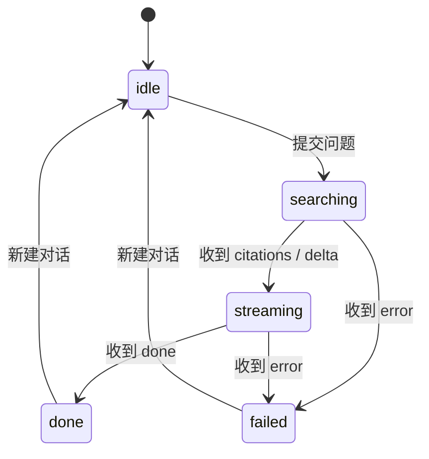

# 09. 前端详细设计（M3）

> 定位：06 §2 A5 要求"前端详细设计在 M3 前成文（组件树 + store + 错误码文案表 + SSE 状态机）"。本文即该文档，落地范围 = M3 界面搭建。

| 项 | 内容 |
| --- | --- |
| 文档版本 | v0.5（2026-11-09：整批上传理由更新，V003 后无索引重建） |
| 上游 | [04 API 接口设计](04.API接口设计.md) v0.5、[01 功能模块梳理](01.功能模块梳理.md) v1.0、[prototype/index.html](../../prototype/index.html)（交互蓝本） |
| 下游 | `web/` 源码 |
| 技术栈 | React 18 + Vite 5 + TypeScript 5 + Zustand 4（02 S-06/S-07）；回答渲染另加 `react-markdown` 9 + `remark-gfm` 4（见 §8） |
| 不含 | 路由库、UI 组件库、E2E 自动化框架、国际化 |

---

## 1. 目录与职责

```
web/
├── index.html
├── vite.config.ts          # /api 代理到 127.0.0.1:8000（04 Q6，后端不开 CORS）
└── src/
    ├── main.tsx
    ├── App.tsx             # 布局 + hash 路由 + 抽屉 + 全局 Toast
    ├── api/
    │   ├── client.ts       # 信封解包、错误码→文案、全部 REST 调用
    │   └── chatStream.ts   # SSE 解析（fetch + ReadableStream，EventSource 不支持 POST）
    ├── state/              # 三个域 store + 一个轻提示 store
    │   ├── chatStore.ts    # 会话：消息、阶段、引用、历史
    │   ├── docsStore.ts    # 文档：列表、上传队列
    │   ├── healthStore.ts  # 服务状态：30 s 轮询、连续 2 次失败置 down
    │   └── toastStore.ts   # 轻提示（3.2 s 自动消失）
    ├── hooks/useHealth.ts  # 轮询副作用
    ├── lib/format.ts       # 大小 / 时间 / 文件类型格式化
    ├── components/         # 见 §2
    │   └── AnswerMarkdown.tsx  # 回答渲染：容错预处理 + GFM 子集 + [n] 徽章（§8）
    ├── pages/              # ChatPage / DocumentsPage
    └── styles/app.css      # 直接复用 prototype/styles.css（设计系统一致）
```

**约束**：组件不直接 `fetch`；错误码到文案的映射只在 `api/client.ts` 一处；不引路由库，用 `location.hash`（`#chat` / `#docs`）。

## 2. 组件树

```
App
├── Sidebar            品牌 / 导航（问答·知识库+文档数）/ 历史记录 / 服务状态
│   └── ConfirmModal   删除历史确认
├── Topbar             标题 + 副标题 + StatusPill（移动端含菜单按钮）
├── ChatPage
│   ├── MessageList
│   │   ├── Welcome      空态：图标 + 文案 + 知识库规模 + 示例问题
│   │   └── Message×N    用户气泡 / 助手卡片（正文 + Citations + 失败提示）
│   │       └── AnswerMarkdown  助手正文渲染：Markdown(GFM) 子集 + [n] 徽章
│   └── Composer        textarea + 字数 + 发送
├── DocumentsPage
│   ├── Dropzone        点击/拖拽，accept 六种后缀
│   ├── UploadQueue     逐文件状态：等待/解析中/完成/失败
│   └── DocTable        表头统计 + 行（文件名/类型/大小/片段数/更新时间/删除）
│       └── ConfirmModal 删除文档确认
└── ToastStack
```

## 3. 三个 store（一个域一个 store）

| store | 状态 | 动作 | 说明 |
| --- | --- | --- | --- |
| `chatStore` | `phase` / `messages` / `citations`(在消息上) / `error` / `conversationId` / `replaying` / `history` | `ask` / `loadHistory` / `openConversation` / `removeConversation` / `newChat` | 流式增量直接 append 到最后一条 assistant 消息 |
| `docsStore` | `items` / `loading` / `queue` / `busy` | `load` / `uploadFiles` / `remove` / `clearQueue` | 统计由列表现算（04 Q4），不另发请求 |
| `healthStore` | `state` / `model` / `llmKey` / `failures` | `refresh` | 30 s 轮询；连续 2 次请求失败 → `down`；`degraded` 立即展示且不计失败 |

## 4. SSE 状态机（与 04 §5.2 一致）



| 事件 | 前端动作 |
| --- | --- |
| `citations` | 写入最后一条 assistant 消息的 `citations`，切 `streaming` |
| `delta` | `content += text`，切 `streaming` |
| `done` | 记录 `conversationId`，切 `done`，刷新历史列表 |
| `error` | 记录 `{code,message}`，切 `failed`；消息卡片内显示红框提示（含错误码） |

**流建立之前**的失败（HTTP 非 200）由 `chatStream.ts` 转成同形状的 `error` 事件，UI 只处理一种形态。

## 5. 错误码 → 文案（20 条，落点 `api/client.ts`）

| 错误码 | 前端展示 |
| --- | --- |
| `VALIDATION_ERROR` | 参数校验失败 |
| `QUESTION_EMPTY` | 问题不能为空 |
| `QUESTION_TOO_LONG` | 问题不能超过 500 字 |
| `TOO_MANY_FILES` | 每次最多上传 20 个文件，请分批提交 |
| `PAYLOAD_TOO_LARGE` | 请求体过大 |
| `UNSUPPORTED_FILE_TYPE` | 不支持的文件类型 |
| `FILE_TOO_LARGE` | 文件超过 50 MB |
| `EMPTY_FILE` | 文件为空 |
| `INVALID_FILENAME` | 非法文件名 |
| `PARSE_FAILED` | 无法解析文件内容，可能是扫描件或空文档 |
| `TABLE_EMPTY` | 表格为空或无有效行 |
| `EMBEDDING_FAILED` | 向量化失败，请稍后重试 |
| `STORAGE_FAILED` | 文件保存失败 |
| `DOCUMENT_NOT_FOUND` | 文档不存在 |
| `CONVERSATION_NOT_FOUND` | 会话不存在 |
| `DB_UNAVAILABLE` | 数据库不可用，请检查数据库服务 |
| `LLM_KEY_MISSING` | 未配置大模型 API Key |
| `LLM_TIMEOUT` | 大模型响应超时，请重试 |
| `LLM_ERROR` | 大模型调用失败，请重试 |
| `INTERNAL_ERROR` | 服务内部错误 |

## 6. 关键交互

1. **输入**：`Enter` 发送、`Shift + Enter` 换行、输入法组合态（`isComposing`）不误发；`>500` 字禁止发送。
2. **上传**：拖拽或点选；本地先挡掉后缀不符 / 0 字节 / >50 MB（服务端仍是最终判定）；**整批一次 POST**（1~20 个），后端串行处理并在整批结束后重建关键词索引再返回，完成后自动刷新列表。
   - 为什么必须整批：逐个 POST 会让每个文件走一次完整入库事务（解析 + 嵌入 + 写库），N 个文件就是 N 次往返。
   - 整批后队列是"一起变成功"，没有逐文件进度；成功行仍给 3 s 回执后自动移出。
3. **删除**：文档与历史都走二次确认弹窗，文案带文件名/标题与不可恢复提示。
4. **历史**：点侧边栏条目 → 拉 `GET /conversations/{id}` 回放（用户 + 助手 + 引用快照）；回放态继续提问会新建会话（后端一期一问一答，`uq_messages_conversation_role`）。
5. **服务状态**：`ok` → 「知识库就绪」；`degraded` → 「部分能力不可用」（tooltip 说明是模型加载中/未配 Key）；`down` → 「服务不可用」。
6. **响应式**：`≤960 px` 侧边栏变抽屉 + 遮罩，顶栏出现菜单按钮。

## 7. 与原型的三处差异

| 原型（localStorage） | 实现（真 API） |
| --- | --- |
| 假数据、假延时 | 全部来自 8 个真实接口；上传/问答耗时由后端决定（冷启动首问约 20 s） |
| 一次可选多文件、同时处理 | 前端逐个提交（后端一次 1 个）；队列保留多文件排队体验 |
| 历史存在浏览器 | 历史在 PostgreSQL，刷新/换浏览器都在 |

## 8. 回答的 Markdown 渲染（FR-4、SRS 8.2）

**背景**：知识库里的 md 文档被切分后进入参考资料，模型会把原文的 `**加粗**`、`1.` 列表、代码块一起复述。改造前 `.msg-text` 只有 `white-space: pre-wrap`（`app.css`），标记原样漏给用户，典型是 `**第一类：直接创建线程（基础方式） **` 这种行。本期起**助手正文**按 Markdown 渲染；**用户气泡保持纯文本**，避免把用户手写的 `<`、`*` 当语法。

**渲染子集（与提示词约定一致，GFM 全开）**

| 允许 | 实现口径 |
| --- | --- |
| 标题 `###`~`######` | 气泡内字号递减，不出现 h1/h2 的视觉重量 |
| 有序/无序/任务列表 | 列表项内可嵌加粗与行内代码 |
| 加粗、斜体、删除线、行内代码 | — |
| 代码块 | 独立底色 + 等宽 + 横向滚动，**不做语法高亮**（不加 highlight 依赖） |
| 引用块、表格 | 表格外包横向滚动容器，避免撑破卡片 |
| 链接 | `target="_blank" rel="noopener noreferrer"` + 外链图标 |
| 禁用 | HTML 标签与图片：**不启用 `rehype-raw`、不用 `dangerouslySetInnerHTML`** |

**三条硬约定**

1. **容错优先于规范**。模型不总听话，渲染前先做文本预处理（`AnswerMarkdown.tsx`）：
   - 加粗收尾 `**xxx **` → `**xxx**`：右分隔符前带空格按 CommonMark 不算加粗，不修就会原样漏星号；
   - 连续 3 个以上空行压成 1 个；
   - **预处理只作用于代码块以外的段落**：先按 ``` 围栏切段，再逐段处理，Python 的 `**kwargs`、`2*3`、Java 的 `int[][]` 不能被误伤。
2. **流式期也渲染**，不在 `done` 后整体切换（会整块重排跳变）。未闭合的 ``` 围栏在渲染前临时补一个闭合围栏（围栏计数为奇数时），否则流式后半段会被整段吞成代码块、`done` 后又变回来。
3. **`[n]` 只样式化、不做交互**：普通文本节点里的 `[n]` 渲染成上标徽章 `<sup class="cite-badge">n</sup>`，**跳过 `code` / `pre` 子树**（`int[] a`、`a[1]` 不能被改）。引用卡片显示哪几条仍由 `citedNumbers()` 从**原始字符串**判定，本链路不改（见 §2 `Citations`）。

**验收口径**

| 项 | 预期 |
| --- | --- |
| 加粗 / 列表 / 行内代码 | 渲染为对应元素，正文里不出现裸 `**` |
| 模型写出 `**xxx **` | 容错后仍渲染为加粗，不漏星号 |
| 代码块（含 `[]`、`*` 运算符） | 保持原样、等宽滚动，内容不被改写 |
| `[1]` | 上标小徽章；引用卡片条数与改造前一致 |
| 流式过程 | 无"后半段忽变代码块"的跳变，光标不消失 |
| 表格 | 横向滚动，不撑破卡片 |
| 控制台 / 构建 | 0 error；`tsc --noEmit` + `vite build` 通过 |

## 9. 验收记录（2026-11-02，浏览器实测）

Chromium 无头 + 真实后端（uvicorn 8000 / Vite 5173）：

| 场景 | 结果 |
| --- | --- |
| 空知识库首页 | 欢迎态 + 状态胶囊 + 示例问题正常 |
| 上传 Markdown | 队列显示「已完成 · 1 个片段」，表格出现 1 行，nav 计数 +1 |
| 提问命中 | 引用卡片 1 条（文件名/全文/清洗后摘要），回答含 `[1]`，历史 +1 |
| 历史回放 | 2 条消息、引用快照完整 |
| 删除文档 | 弹窗 → 确认 → 表格回到空态，nav 计数归 0 |
| 移动端 480 px | 抽屉 + 遮罩正常 |
| 控制台 | **0 error**（favicon 404 已用内联 SVG 修掉） |
| 构建 | `tsc --noEmit` 通过；`vite build` 产出 JS 170 KB / CSS 21 KB |

## 变更记录

| 版本 | 日期 | 变更内容 | 状态 |
| --- | --- | --- | --- |
| v0.1 | 2026-11-02 | 首版：目录、组件树、三个 store、SSE 状态机、20 条错误码文案、交互约定、与原型差异、实测记录 | 待审核 |
| v0.2 | 2026-11-04 | 上传改为**整批一次 POST**（1~20）：`uploadMany`、队列一起置 uploading、成功行仍 3 s 后移出；`TOO_MANY_FILES` 文案改「每次最多 20 个」；说明逐个 POST 会触发 N 次 BM25 全量重建 | 待审核 |
| v0.3 | 2026-11-06 | 新增 §8「回答的 Markdown 渲染」：助手正文按 GFM 子集渲染（用户气泡仍纯文本）、容错预处理（`**xxx **` 收尾、只作用于代码块外）、流式期全程渲染 + 未闭合围栏补全、`[n]` 上标徽章且不碰 `citedNumbers()` 链路、代码块不做高亮；技术栈补 `react-markdown`/`remark-gfm`，组件树补 `AnswerMarkdown`，原 §8 验收记录顺延为 §9 | 待审核 |
| v0.4 | 2026-11-06 | 项目改名：ragdemo → zhiwen（中文名「知问 · 个人知识库问答」），文档标题与项目元信息同步；正文内容未变 | 已落地 |
| v0.5 | 2026-11-09 | §上传「为什么必须整批」的理由由「避免 N 次 BM25 全量重建」改为「避免 N 次完整入库事务」（V003 后无重建）；交互不变 | 已落地 |
